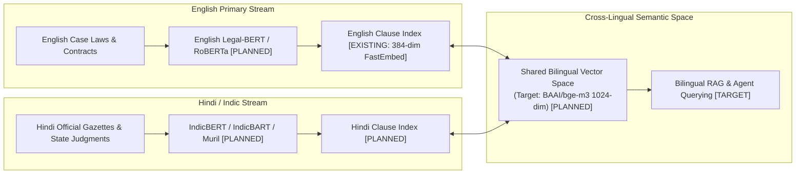

# 01. Dataset Engineering Architecture

**Document ID:** `LEGALAI-DOC-DE-01`  
**Version:** `1.2.0`  
**Status:** Draft v1.0 — Pending Technical and Legal Review  
**Audited Date:** 2026-11-13  
**Classification:** Core System Architecture  
**Dependencies:** `INDEX.md`, `04_CANONICAL_DATA_SCHEMAS.md`, `PHASE_1_2_EVIDENCE_REGISTER.md`

---

## 1. Executive Summary

The LegalAI platform requires a scalable, deterministic, and legally compliant data architecture capable of processing complex unstructured legal corpora (contracts, central and state enactments, subordinate rules, Supreme Court of India and High Court judicial opinions) in both **English** and **Hindi**. 

This document defines the **Medallion Data Lakehouse Architecture** (Bronze, Silver, Gold), the bilingual parallel ingestion topology, the vector database partition scheme, and the exact interface with the existing FastAPI + SQLAlchemy + Qdrant application stack, accurately distinguishing existing runtime components from planned enhancements and qualifying statutory assumptions.

---

## 2. High-Level Data Topology

```mermaid
flowchart TD
    subgraph Sources["Raw Ingestion Sources"]
        S1["Contract Corpora<br/>(CUAD, MAUD) [VERIFIED]"]
        S2["Indian Statutory Repositories<br/>(India Code, State Gazettes) [VERIFIED]"]
        S3["Case Law & Judgments<br/>(AWS SC/HC Judgments, DigiSCR) [VERIFIED/CONDITIONAL]"]
        S4["Bilingual Legal Corpora<br/>(Official Parallel Gazettes, BhashaBench)"]
        S5["Structured Case Studies<br/>(OpenNYAI Rhetorical Roles) [VERIFIED]"]
    end

    subgraph Bronze["Tier 1: Bronze Lake (Raw Immutable Storage)"]
        B1["Raw File Store<br/>(PDF, DOCX, HTML, Raw TXT)"]
        B2["Provenance & Hash Registry<br/>(SHA-256, Source URL, Ingestion Timestamp)"]
    end

    subgraph Silver["Tier 2: Silver Lake (Cleaned, Normalized, Structured)"]
        SV1["Document Parser & OCR Engine<br/>(PyMuPDF, pdfplumber, PaddleOCR/Tesseract)"]
        SV2["Court Header/Footer & Margin Line Number Stripper"]
        SV3["Citation Normalizer & Legal NER Extractor (11 Canonical Entities)"]
        SV4["MinHash LSH Deduplication & Near-Duplicate Cluster Filter"]
        SV5["Language Identifier & Script Validator (NFC Devanagari/Latin)"]
        SV6["Canonical Schema Enforcer (Pydantic v2 Models)"]
    end

    subgraph Gold["Tier 3: Gold Lake (Task-Ready Partitions)"]
        G1["Fine-Tuning Slices<br/>(Parquet/JSONL for Legal-BERT & LLMs)"]
        G2["Hybrid Vector Indexing Store<br/>(Dense BAAI/bge-m3 + Sparse BM25) [TARGET]"]
        G3["FIRAC Case Study Knowledge Graph<br/>(Facts, Issues, Ratios, Precedents)"]
        G4["Evaluation Benchmarks<br/>(Strict Document-Split Golden Testsets)"]
    end

    subgraph Runtime["LegalAI Runtime Engine (Component Status)"]
        R1["FastAPI Application Server<br/>(backend/app/main.py) [EXISTING]"]
        R2["Qdrant Vector Database<br/>(backend/app/services/vector_db.py) [EXISTING: 384-dim]"]
        R3["SQLAlchemy Relational Store<br/>(backend/app/models/db_models.py) [EXISTING]"]
        R4["Multi-Agent Orchestrator<br/>(Sequential Prompt Chain in nlu.py) [PARTIAL -> TARGET]"]
    end

    Sources --> Bronze
    Bronze --> Silver
    Silver --> Gold
    Gold --> Runtime
```



---

## 3. Data Tiering Specification (Medallion Architecture)

### 3.1 Tier 1: Bronze (Raw Ingestion)
The Bronze tier is an immutable, append-only landing zone. No transformations or character-level sanitizations are performed at this layer.

- **Storage Format:** Original native formats (`.pdf`, `.docx`, `.txt`, `.json`, `.tar.gz`) stored alongside sidecar metadata files (`<filename>.meta.json`).
- **Canonical Filesystem Layout:**
  ```
  data/bronze/
  ├── contracts/
  │   ├── cuad/
  │   └── maud/
  ├── statutes/
  │   ├── central/
  │   │   ├── indian_contract_act_1872/
  │   │   └── companies_act_2013/
  │   └── state/
  ├── judgments/
  │   ├── supreme_court/
  │   │   ├── 1950_2000/
  │   │   └── 2001_2024/
  │   └── high_courts/
  │       ├── delhi/
  │       ├── bombay/
  │       └── allahabad/
  └── bilingual/
      ├── official_gazette_parallel/
      └── bhashabench_eval/
  ```
- **Metadata Fields (Immutable Sidecar):**
  - `source_id`: Unique identifier (e.g., `SRC-IN-SC-2023-CIV-8910`).
  - `sha256_hash`: Cryptographic integrity verification hash of raw payload.
  - `source_origin_url`: Canonical download URL or archive endpoint.
  - `ingestion_timestamp`: ISO 8601 UTC timestamp.
  - `source_license`: Documented upstream license identifier.
  - `mime_type`: Raw document MIME type.

### 3.2 Tier 2: Silver (Normalized & Structured)
The Silver tier takes raw artifacts, processes them through deterministic extraction pipelines, cleans formatting anomalies, strips non-text artifacts, enforces canonical Pydantic v2 schemas, and resolves cross-references.

- **Processing Steps:**
  1. **Layout Extraction:** Convert multi-column Indian court judgments and double-spaced contracts into linearized text flows using bounding-box heuristics.
  2. **Boilerplate & Noise Elimination:** Strip court watermarks, digital signature blocks, e-filing receipt numbers, advocate stamps, and marginal line numbers without touching clause numbering.
  3. **Section & Clause Segmentation:** Deconstruct text into atomic legal units (clauses, statutory sections, FIRAC components).
  4. **Legal Entity Extraction (NER):** Tag 11 canonical legal entity types: courts, judges, statutory citations, sections, petitioners, respondents, dates, monetary values, obligations, precedents, and jurisdictional clauses.
  5. **Deduplication:** Run MinHash LSH across documents with calibrated Jaccard similarity thresholds to cluster duplicate appellate judgments and standard form contract boilerplates.
  6. **Schema Enforcement:** Validate records against schemas defined in `04_CANONICAL_DATA_SCHEMAS.md`. Failed records route to `data/silver/quarantine/`.
- **Storage Format:** Apache Parquet with Snappy compression, partitioned by `jurisdiction`, `legal_domain`, and `language` in `data/silver/validated/`.

### 3.3 Tier 3: Gold (Task-Ready & Serving)
The Gold tier provides pre-indexed, curated, leakage-proof dataset splits optimized for downstream consumption by model training harnesses, vector search engines, and agentic workflows.

- **Canonical Partitions (`data/gold/`):**
  1. `data/gold/contracts/clause_classification/`: Multi-label balanced clause classification datasets (train/val/test splits).
  2. `data/gold/contracts/risk_intelligence/`: Paired clause text, canonical clause type, risk level (`low`, `medium`, `high`, `critical`), statutory conflict tags, perspective lens, and revision suggestions.
  3. `data/gold/rag/statutes_corpus/`: Chunked statutory enactments enriched with section titles, parent statute names, chapter headings, and amendment history.
  4. `data/gold/rag/precedents_corpus/`: Segmented court judgments indexed with headnotes, ratio decidendi tags, and citation graphs.
  5. `data/gold/case_studies/firac/`: Structured FIRAC analyses with verified factual summaries and judicial rationale.
  6. `data/gold/bilingual/parallel_lexicon/`: English-Hindi parallel statutory corpora and aligned bilingual contract clauses.
  7. `data/gold/benchmarks/`: Frozen, tamper-evident evaluation sets for precision, recall, MRR@k, and Hallucination Index.

---

## 4. Bilingual Dual-Stream Architecture (English & Hindi)

LegalAI enforces a dual-stream data model to ensure Hindi is integrated into statutory retrieval and clause analysis:



### 4.1 Statutory Qualification on Official Languages Act, 1963
The legal basis for bilingual statutory corpora must be accurately stated:
1. **Legal Effect of Section 5(1):** Under Section 5(1) of the *Official Languages Act, 1963*, a translation in Hindi published under the authority of the President in the Official Gazette is legally recognized as the "authoritative text thereof in Hindi".
2. **Constitutional Primacy of English:** Under Article 348(1)(b) of the Constitution of India, the authoritative text of all Parliamentary Acts, Bills, and Ordinances remains in the English language until Parliament by law otherwise provides. Section 5 does **not** create a mandatory, universal obligation that every Central Act or ordinance must immediately have an authorized Hindi translation published.
3. **Dataset Collection Reality:** Coverage of official Hindi translations is ongoing and selective. Ingestion pipelines focus on major commercial and civil statutes published by *Vidhi Sahitya Prakashan* (Legislative Department, Ministry of Law and Justice), rather than assuming universal coverage across all 850+ Central Acts.

---

## 5. Storage Topology and Directory Layout

The physical data directory follows a deterministic structure residing outside version control (`.gitignore` entry `data/`):

```
LegalAI-main/
├── data/                               # Master Data Lakehouse
│   ├── bronze/                         # Raw artifacts (immutable raw bytes + SHA-256 sidecars)
│   │   ├── contracts/
│   │   ├── statutes/
│   │   ├── judgments/
│   │   └── bilingual/
│   ├── silver/                         # Parsed, cleaned, schema-validated Parquet
│   │   ├── validated/
│   │   └── quarantine/                 # Schema failures & parse errors
│   ├── gold/                           # Task-ready splits & evaluation sets
│   │   ├── contracts/
│   │   ├── rag/
│   │   ├── case_studies/
│   │   ├── bilingual/
│   │   └── benchmarks/
│   └── manifests/                      # Dataset lineage, split seeds, audit logs
```

---

## 6. Interface with Existing Codebase Components

The dataset architecture interfaces directly with operational application services:

### 6.1 Vector DB (Qdrant) Integration
- **Current File:** `backend/app/services/vector_db.py`
- **Current Implementation Status:** **Existing** (Lines 12–262)
  - Collection `clauses`: 384 dimensions (`BAAI/bge-small-en-v1.5`), Cosine distance.
  - Collection `statutes`: 384 dimensions (`BAAI/bge-small-en-v1.5`), Cosine distance.
  - FastEmbed client runs locally in ONNX runtime mode.
- **Architectural Scaling (Phase 2 & 3 Target):**
  - Maintain backward compatibility by retaining 384-dim local fallback for lightweight development.
  - Introduce bilingual collections: `statutes_hi`, `precedents_sc`, `precedents_hc` utilizing multilingual embeddings (1024-dim `bge-m3` or 768-dim `multilingual-e5-base`).
  - Standardize point payload structure to match canonical Pydantic v2 schemas (`04_CANONICAL_DATA_SCHEMAS.md`).

### 6.2 Relational Database Integration
- **Current File:** `backend/app/models/db_models.py`
- **Current Implementation Status:** **Existing** (Lines 1–94)
- **Entities:** `User`, `Contract`, `Analysis`, `ChatSession`, `ChatMessage`, `AuditLog`.
- **Pipeline Interlock:** Gold dataset samples can be automatically seeded into the relational SQLite/PostgreSQL store for regression testing.

### 6.3 Rule Engines & Compliance
- **Current Files:** `backend/app/services/classifier.py` and `backend/app/services/compliance.py`.
- **Current Implementation Status:** **Existing**
- **Pipeline Interlock:** Evaluates clauses against Sections 10, 11, 23, 27, 28, 56, 73 (unliquidated damages requiring proof of loss), and 74 (liquidated damages / penalties) of the Indian Contract Act, 1872.

### 6.4 Data Sovereignty & Hosting Classification
- **Clarification:** LegalAI's requirement that database volumes (Qdrant, PostgreSQL, Parquet lakehouse) reside in data centers located physically within India is an **internal security and enterprise risk-management policy**, NOT a universal statutory mandate under Section 16 of the DPDP Act (which provides a government negative-list mechanism, scheduled for phased commencement).
