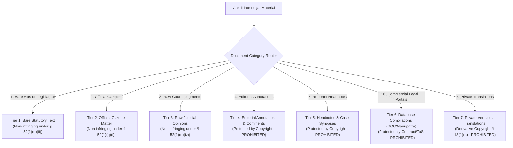
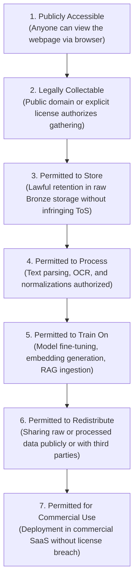
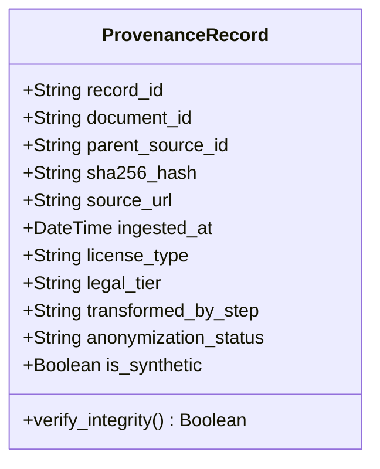

# 03. License and Provenance Policy

**Document ID:** `LEGALAI-DOC-DE-03`  
**Version:** `1.2.0`  
**Status:** Draft v1.0 — Pending Technical and Legal Review  
**Audited Date:** 2026-11-13  
**Dependencies:** `INDEX.md`, `02_SOURCE_REGISTRY.md`, `13_DATA_PRIVACY_AND_GOVERNANCE.md`, `PHASE_1_2_EVIDENCE_REGISTER.md`

---

## 1. Executive Summary

Legal data engineering operates in a heavily regulated domain where statutory copyright exceptions, judicial open-access doctrines, statutory privacy mandates, and commercial licensing intersect.

This policy establishes the formal intellectual property, copyright compliance, and data provenance rules governing all corpora ingested, processed, fine-tuned upon, or served by **LegalAI**. It establishes strict boundaries to guarantee that:
1. All datasets comply with Indian copyright law, particularly **Section 52(1)(q)** of the *Indian Copyright Act, 1957*.
2. The doctrine established in the landmark Supreme Court ruling ***Eastern Book Company v. D.B. Modak (2008) 1 SCC 1*** is rigorously upheld: raw judicial opinions are public domain, while editorial enhancements are strictly excluded.
3. Upstream open-source licenses (e.g., `CC BY 4.0`, `Apache 2.0`, `MIT`, `OGD`) are satisfied with immutable attribution metadata, and mixed-license collections are kept cleanly partitioned.
4. Restrictive or proprietary standards (such as commercial ACORD forms) are quarantined and excluded.
5. Ingestion provenance is fully auditable through cryptographic hashes and deterministic lineage records.
6. Statutory privacy protections under the *POCSO Act, 2012*, *Bharatiya Nyaya Sanhita, 2023* (Sections 72 & 73), *Family Courts Act, 1984*, and the incoming *Digital Personal Data Protection Act, 2023* (phased commencement) are strictly enforced.

---

## 2. Multi-Tiered Indian Copyright Framework (Section 52(1)(q))

Under Section 52(1)(q) of the *Copyright Act, 1957*, certain legal materials are exempt from copyright infringement claims. However, legal text cannot be treated monolithically. LegalAI enforces a strict 7-tier classification:

### 2.1 Comprehensive Classification & Permissions Matrix

| Material Tier | Statutory Basis & Copyright Status | Source Terms & Boundary | Collection & Storage | Embedding & Training | Redistribution | Commercial Serving |
| :--- | :--- | :--- | :--- | :--- | :--- | :--- |
| **1. Bare Statutory Text** | Public Domain per § 52(1)(q)(ii) (unless accompanied by commentary). | Official government portals (*India Code*). | **Allowed** | **Allowed** | **Allowed** | **Allowed** (Accurate reproduction required) |
| **2. Gazette Publications** | Public Domain per § 52(1)(q)(i). | Central & State Government Gazettes. | **Allowed** | **Allowed** | **Allowed** | **Allowed** |
| **3. Raw Court Judgments** | Public Record per § 52(1)(q)(iv) & *Eastern Book Company*. | Official Court Portals (DigiSCR, e-Courts, High Court sites). | **Allowed** | **Allowed** | **Allowed** (Subject to victim redaction) | **Allowed** (Value-added legal services permitted) |
| **4. Editorial Annotations** | Protected under § 13(1)(a) (Original literary work). | Commercial law books & treatise annotations. | **Prohibited** | **Prohibited** | **Prohibited** | **Prohibited** without express license |
| **5. Law Reporter Headnotes** | Protected under "Modicum of Creativity" standard (*Eastern Book Company*). | Law reports (SCC, AIR, SCR commercial headnotes). | **Prohibited** | **Prohibited** | **Prohibited** | **Prohibited** |
| **6. Commercial Databases** | Database compilation rights & contractual Terms of Service bars. | Proprietary portals (SCC Online, Manupatra, LexisNexis). | **Prohibited** | **Prohibited** | **Prohibited** | **Prohibited** (Web scraping barred) |
| **7. Private Translations** | Independent derivative copyright under § 13(1)(a) & § 14(a)(iv). | Unofficial private publishers. | **Prohibited** | **Prohibited** | **Prohibited** | **Prohibited** (Must use official gazetted translations) |

---

## 3. The 7-Tier Legal Permissions Ladder

Public availability of a document on the Internet does **not** grant unlimited legal rights to collect, store, train upon, or redistribute that document. LegalAI enforces an explicit 7-tier permission ladder:

> [!CRITICAL]
> **Operational Rule:**
> A source that satisfies Tier 1 (Publicly Accessible) does not automatically satisfy Tier 5 (Training) or Tier 7 (Commercial Use). For example, a scraped court database may be publicly accessible, but its portal Terms of Service may legally prohibit bulk automated collection (failing Tier 2) or commercial redistribution (failing Tier 6 & 7). Every ingested dataset must establish affirmative permissions through Tier 7 before deployment in production weights.

---

## 4. Statutory Anonymization & Privacy Mandates

### 4.1 Protection of Children from Sexual Offences (POCSO) Act, 2012
- **Section 24(5):** Police officers and medical practitioners are barred from disclosing the identity of the child in any media.
- **Section 33(7):** Special Court has a statutory obligation to ensure that the identity of the child is not disclosed at any time during the course of investigation or trial.
- **Sections 23 & 37:** Mandatory media bars and *in-camera* trial procedures.
- **Enforcement:** Automated regex and entity filters tag any document referencing POCSO for complete redaction of minor party names and family descriptors.

### 4.2 Bharatiya Nyaya Sanhita, 2023: Sections 72 and 73 (formerly IPC Section 228A)
- **Section 72, BNS 2023 (Disclosure of Identity of Victims):** Criminalizes printing or publishing the name or any matter which may disclose the identity of any victim of sexual offenses (Sections 64 to 71). Corresponds to old Section 228A of the IPC.
- **Section 73, BNS 2023 (Publishing In-Camera Court Proceedings):** Criminalizes printing or publishing any matter relating to court proceedings conducted *in camera* or prohibited by court order without prior written permission of the court.
- **Enforcement:** Mandatory masking of victim names (`Victim X`, `Prosecutrix`) and redaction of *in-camera* proceeding transcripts before Silver tier persistence.

### 4.3 Family Courts Act, 1984: Section 11 & Matrimonial Record Eligibility
- **Statutory Standard:** Section 11 provides that family court proceedings *may* be held in camera if the court desires, and *shall* be so held if either party requests.
- **Case-by-Case Eligibility Protocol:**
  - Section 11 does **not** make every family court decree secret by default.
  - Ingestion pipelines enforce a **case-by-case screening protocol**: records of proceedings held in camera, child custody proceedings, and personal matrimonial allegations are excluded or fully redacted.
  - Final appellate High Court and Supreme Court matrimonial jurisprudence delivered in open court on statutory interpretation (e.g., maintenance standards under Section 125 CrPC / Section 144 BNSS) remains public record, subject to personal PII anonymization.

### 4.4 Digital Personal Data Protection Act, 2023 (DPDP Act) — Phased Commencement
- **Statutory Commencement:** The Act received assent on August 11, 2023. Under Section 1(2), the Act comes into force in phases. Gazette notification dated 13 November 2025 schedules substantive provisions (Sections 3 to 17) for commencement 18 months post-publication.
- **Section 16 Cross-Border Transfer Clarification:** Section 16 empowers the Central Government to restrict transfers of personal data to specific foreign countries (a "negative list" model). It does **not** impose a universal statutory localization mandate requiring all database volumes to reside in India.
- **Internal Infrastructure Policy:** LegalAI's requirement that Qdrant, PostgreSQL, and Parquet volumes reside in Indian data centers is an **internal security and enterprise risk-management policy**, not a statutory command under Section 16.

---

## 5. Provenance Tracking Specification

Every dataset artifact processed in LegalAI must have a persistent, tamper-evident lineage record complying with the W3C PROV-O standard:

### 5.1 Cryptographic Hash Ledger
1. **Bronze Ingestion:** A SHA-256 checksum is computed from the raw binary stream and recorded in the ingestion manifest:
   $$\text{Hash}_{\text{document}} = \text{SHA256}(\text{RawBytes})$$
2. **Transformations:** Each transformation (OCR, cleaning, chunking, translation) records the `input_hash`, the script/version that executed the step (`git_commit_sha`), and the resulting `output_hash`.
3. **Immutability:** Parquet files in Silver and Gold include the immutable `source_sha256` and `source_url` in their embedded schema metadata.

---

## 6. Audit and Attribution Compliance

Whenever a dataset chunk or precedent is displayed to an end user via the LegalAI application:
- The specific judicial citation (e.g., *1954 AIR 44* or *2023 INSC 102*) or statutory section must be cited as the authoritative legal source.
- Upstream datasets (CUAD, OpenNYAI, India Code) are credited in system notices (`LEGAL_NOTICES.md`).
- Audit events are recorded through `backend/app/services/audit.py` to the persistent `AuditLog` database table.
