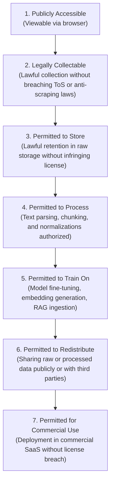
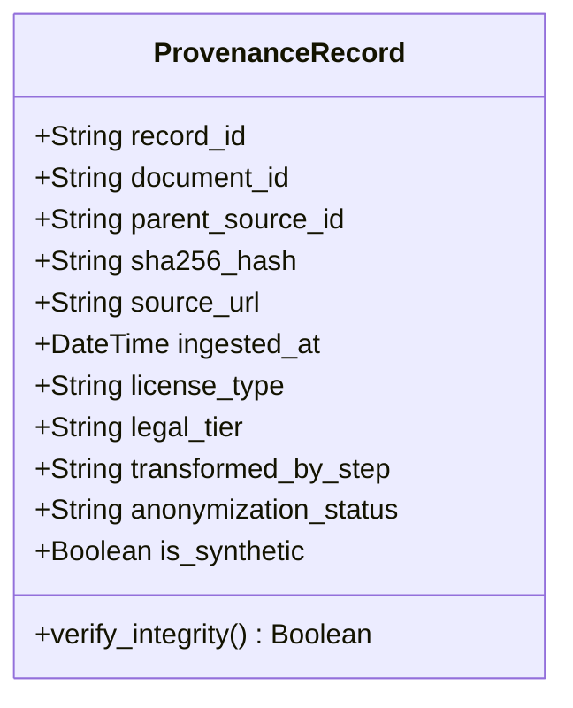

# 03. License and Provenance Policy

**Document ID:** `LEGALAI-DOC-DE-03`  
**Version:** `1.2.2.1`  
**Status:** Canonical Audited Policy — Pending Independent Technical and Legal Review  
**Audited Date:** 2026-11-13  
**Dependencies:** `INDEX.md`, `02_SOURCE_REGISTRY.md`, `13_DATA_PRIVACY_AND_GOVERNANCE.md`, `PHASE_1_2_2_1_EVIDENCE_REGISTER.md`

---

## 1. Executive Summary

Legal data engineering operates in a heavily regulated domain where statutory copyright exceptions, judicial open-access doctrines, statutory privacy mandates, and commercial licensing intersect.

This policy establishes the formal intellectual property, copyright compliance, and data provenance rules governing all corpora ingested, processed, fine-tuned upon, or served by **LegalAI**. It establishes strict boundaries to guarantee that:
1. All datasets comply with Indian copyright law, particularly **Section 52(1)(q)** of the *Copyright Act, 1957*, interpreting subclauses (i), (ii), (iii), and (iv) strictly in accordance with their statutory conditions.
2. The doctrine established in the landmark Supreme Court ruling ***Eastern Book Company v. D.B. Modak (2008) 1 SCC 1*** is rigorously upheld: raw judicial opinions are non-infringing under § 52(1)(q)(iv), while editorial enhancements (headnotes, synopses, paragraph structuring exhibiting creativity) are protected works and strictly excluded.
3. Upstream open-source licenses (e.g., `CC BY 4.0`, `Apache 2.0`, `MIT`, `OGD`) are satisfied with immutable attribution metadata, and mixed-license collections are kept cleanly partitioned.
4. Restrictive or proprietary standards (such as commercial ACORD insurance forms) are quarantined and permanently excluded.
5. Ingestion provenance is fully auditable through cryptographic hashes and deterministic lineage records.
6. Statutory privacy protections under the *POCSO Act, 2012* (Sections 24(5) & 27), *Bharatiya Nyaya Sanhita, 2023* (Sections 72 & 73), *Family Courts Act, 1984* (Section 11), and the *Digital Personal Data Protection Act, 2023* (phased commencement) are strictly enforced.

---

## 2. Statutory Copyright Framework: Indian Copyright Act, 1957, Section 52(1)(q)

Section 52(1)(q) of the *Copyright Act, 1957* exempts specific classes of government and judicial publications from copyright infringement. However, this exception is not an unconditional grant of public-domain status and contains distinct subclauses with express conditions:

> **Section 52(1)(q) Text:**  
> *"The following acts shall not constitute an infringement of copyright, namely:—*  
> *(q) the reproduction or publication of—*  
> *(i) any matter which has been published in any Official Gazette except an Act of a Legislature;*  
> *(ii) any Act of a Legislature subject to the condition that such Act is reproduced or published together with any commentary thereon or any other original matter;*  
> *(iii) the report of any committee, commission, council, board or other like body appointed by the Government if such report has been laid on the Table of the Legislature, unless the reproduction or publication of such report is prohibited by the Government;*  
> *(iv) any judgment or order of a court, tribunal or other judicial authority, unless the reproduction or publication of such judgment or order is prohibited by the court, the tribunal or other judicial authority, as the case may be;"*

---

### 2.1 Subclause-Specific Legal Analysis & Technical Operations Disentanglement

1. **Clause (i) — Official Gazette Material (Except Acts):**
   - Applies to statutory rules, regulations, orders, notifications, and gazette announcements published by Central or State Governments.
   - Does **not** apply to Acts of a Legislature (which are expressly excepted from clause (i) and governed by clause (ii)).
   - Such gazette materials are non-infringing to reproduce or publish.
2. **Clause (ii) — Acts of a Legislature (The Commentary/Original Matter Condition):**
   - Reproduction or publication of an Act of a Legislature is exempt **only** *"subject to the condition that such Act is reproduced or published together with any commentary thereon or any other original matter"*.
   - A standalone republication of the bare statutory text of an Act *without* any accompanying commentary, analysis, annotations, or original matter does **not** fall within Section 52(1)(q)(ii).
   - *LegalAI Arrangement Status:* LegalAI proposes to ingest, chunk, and index Acts of the Legislature alongside structured metadata, FIRAC analysis, clause classifications, and statutory risk scores. **However, whether programmatic metadata, structural segmentations, or algorithmic risk tags legally constitute "commentary thereon or any other original matter" within the meaning of Section 52(1)(q)(ii) has not been conclusively adjudicated by Indian courts.**  
   - **Legal Review Gate:** The legal sufficiency of LegalAI's metadata arrangement under clause (ii) is designated as **`PENDING LEGAL REVIEW`** and requires formal written confirmation by qualified Indian copyright counsel before commercial deployment. Standalone bulk redistribution of bare statutory text without accompanying original matter remains restricted.
3. **Clause (iii) — Government Reports:**
   - Reports of committees, commissions, or boards laid on the Table of the Legislature are non-infringing to reproduce unless explicitly prohibited by the Government.
4. **Clause (iv) — Judicial Opinions & Orders (*Eastern Book Company* Doctrine):**
   - Judgments and orders of courts, tribunals, or judicial authorities are non-infringing to reproduce unless prohibited by the court or tribunal.
   - In *Eastern Book Company v. D.B. Modak (2008) 1 SCC 1*, the Supreme Court held that the raw text of judgments is non-infringing and free for anyone to reproduce. However, headnotes, case summaries, editorial footnotes, and creative formatting introduced by private law reporters constitute original derivative literary works protected under Section 13(1)(a) of the Copyright Act.
   - Official Supreme Court Reports published on the DigiSCR portal (`EVID-SRC-13`) contain verbatim judicial text that is non-infringing, but editorial headnotes must be systematically parsed and filtered out.

---

### 2.2 Judicial Precedents on AI Training & Section 52(1)(a) Fair Dealing (HIGH-1222-02)

#### 2.2.1 Analysis of Delhi High Court Interim Order in *ANI Media Pvt. Ltd. v. OpenAI Opco LLC* (24 July 2026)
In *ANI Media Pvt. Ltd. v. OpenAI Opco LLC* (CS(COMM) 2026, Delhi High Court, interim order dated 24 July 2026; cited in Evidence Register as `EVID-LEG-09`), the High Court considered prima facie copyright infringement allegations arising from an AI company's automated web scraping and ingestion of copyrighted news content for LLM training:
1. **Procedural Nature of the Order:** The order of 24 July 2026 was issued at the **interim injunction stage** and reflects a preliminary, *prima facie* procedural assessment based on the specific facts before the Court.
2. **Statutory Fair Dealing Scope:** The Court evaluated arguments surrounding Section 52(1)(a) of the *Copyright Act, 1957*. Indian copyright law does not provide an open-ended "fair use" doctrine comparable to 17 U.S.C. § 107. Section 52(1)(a) is strictly confined to fair dealing for:
   - Private or personal use, including research;
   - Criticism or review;
   - Reporting of current events and current affairs.
3. **Unresolved Legal Questions:** The interim order **did not resolve or settle** whether commercial AI pretraining, continual pretraining, or commercial RAG ingestion constitute fair dealing or copyright infringement under Indian law. Crucial questions regarding model weight memorization, verbatim regurgitation, and database extraction remain pending before the High Court.
4. **Policy Governance Directive for LegalAI:** The *ANI Media* proceedings confirm that **commercial AI training cannot be treated as an exempt fair dealing activity under settled Indian law**. Public availability or public record status of a text does not confer automatic commercial model-training authorization. Consequently, all model training (SFT and pretraining) on Indian legal materials is formally classified as **`CONDITIONAL ON INDEPENDENT LEGAL REVIEW`**.

---

### 2.3 Comprehensive Classification & 10-Operation Rights Matrix (HIGH-1222-01)

Every operation performed on legal material is evaluated independently across the 10 canonical data operations:

| Material Tier | Statutory Basis & Copyright Status | Source Terms & Boundary | Op-01 to Op-05 (Processing & Embed) | Op-06 (Commercial RAG Serving) | Op-07 & Op-08 (Model Training / SFT) | Op-09 (Model Weights) | Op-10 (Redistribution) |
| :--- | :--- | :--- | :---: | :---: | :---: | :---: | :---: |
| **1. Central Acts of Legislature** | § 52(1)(q)(ii) (conditioned on accompanying commentary or original matter). | Official portals (*India Code* `EVID-SRC-07`). | **PASS** | **Conditional** (Commentary pairing pending review) | **Pending Legal Review** (No statutory TDM exception) | **Pending Legal Review** | **Restricted** (Only with accompanying original matter) |
| **2. Gazette Rules / Orders** | § 52(1)(q)(i) (Non-infringing Official Gazette matter). | Central & State Gazettes (*egazette.gov.in*). | **PASS** | **PASS** | **Pending Legal Review** | **Pending Legal Review** | **PASS** (With official attribution) |
| **3. Raw Court Judgments** | § 52(1)(q)(iv) & *Eastern Book Company* (Non-infringing public record). | Official Court Portals (DigiSCR `EVID-SRC-13`, AWS SC `EVID-SRC-08`, AWS HC `EVID-SRC-09`). | **PASS** | **Conditional** (Requires PII/BNS § 73 redaction; commercial serving pending review) | **Pending Legal Review** (Public status does not imply training license) | **Pending Legal Review** | **PASS** (Verbatim text only; victim identity redacted) |
| **4. Editorial Annotations & Treatises** | Protected under § 13(1)(a) (Original literary work). | Commercial law books & treatise commentaries. | **PROHIBITED** | **PROHIBITED** | **PROHIBITED** | **PROHIBITED** | **PROHIBITED** without express written license |
| **5. Reporter Headnotes & Synopses** | Protected under "Modicum of Creativity" standard (*Eastern Book Company*). | Law reports (SCC, AIR, commercial SCR headnotes). | **PROHIBITED** | **PROHIBITED** | **PROHIBITED** | **PROHIBITED** | **PROHIBITED** (Only raw judicial text permitted) |
| **6. Commercial Legal Databases** | Database compilation rights & contractual Terms of Service bars. | Proprietary portals (SCC Online, Manupatra, LexisNexis). | **PROHIBITED** | **PROHIBITED** | **PROHIBITED** | **PROHIBITED** | **PROHIBITED** (Bulk scraping contractually barred) |
| **7. Private Vernacular Translations** | Independent derivative copyright under § 13(1)(a) & § 14(a)(iv). | Unofficial private translations and publishers. | **PROHIBITED** | **PROHIBITED** | **PROHIBITED** | **PROHIBITED** | **PROHIBITED** (Must use official gazetted translations) |

---

### 2.4 CUAD & MAUD: Separation of Annotation Rights from Underlying Contracts (LEG-122-02, MED-1222-01)

> [!CRITICAL]
> **Rights Separation & Underlying Contract Warranty Disclaimer:**  
> An open-source license applying to dataset annotations does **not** convey an open-source license to the underlying contracts. The Atticus Project explicitly disclaims warranting the copyright status of the underlying agreements.

#### A. Dataset Annotations (CUAD & MAUD):
- **Publisher:** The Atticus Project (Prof. Dan Hendrycks et al. for CUAD; The Atticus Project & ABA M&A Committee for MAUD).
- **Confirmed License:** Creative Commons Attribution 4.0 International (`CC BY 4.0`).
- **Attribution Requirement:** Mandatory citation of The Atticus Project and respective research publications.
- **Permissions:** Annotation labels, question-answer pairs, and boundary spans may be freely stored, modified, redistributed, and used commercially under `CC BY 4.0`.

#### B. Underlying Contract Documents (SEC EDGAR Filings):
- **Source:** US Securities and Exchange Commission (SEC) EDGAR public regulatory filing system.
- **Nature of Documents:** Material commercial contracts and merger agreements filed as public disclosure exhibits under SEC Regulation S-K.
- **Licensing Status of Underlying Agreements:** The filing of a commercial agreement on SEC EDGAR fulfills a statutory corporate disclosure obligation; it does **not** dedicate the contract text to the global public domain or grant an unencumbered commercial license to third parties. The contracting parties retain underlying intellectual property and trade secret rights.
- **Atticus Disclaimer:** The official CUAD documentation explicitly disclaims copyright warranty:
  > *"The Atticus Project makes no representation or warranty regarding the copyright status of the underlying contracts."*
- **LegalAI Operational Boundaries for Underlying Contracts:**
  - *Op-01 & Op-02 (Collection & Storage):* **CONDITIONAL / RESTRICTED** (Quarantined for internal research and evaluation only; no commercial distribution).
  - *Op-03 to Op-05 (Parsing, Indexing, Embeddings):* **CONDITIONAL** (Permitted internally for benchmark evaluation).
  - *Op-06 (Commercial RAG Serving of Contract Text):* **PROHIBITED** (LegalAI serving pipeline evaluates user-uploaded contracts, never serving raw CUAD contracts to end users).
  - *Op-07 & Op-08 (Model Training on Full Contract Text):* **PENDING LEGAL REVIEW** (Unwarranted by Atticus).
  - *Op-09 (Model Weights from Full Contract Text):* **PENDING LEGAL REVIEW**.
  - *Op-10 (Redistribution of Raw Contracts):* **STRICTLY PROHIBITED**.

---

### 2.5 India Code & Government Open Data License (GODL) Disentanglement (SRC-122-01)

The existence of the Government Open Data License (GODL) on `data.gov.in` does not establish that every document hosted on India Code is covered by GODL. Each material category has a distinct legal basis:
1. **Central Acts of Parliament:** Governed by Section 52(1)(q)(ii) of the *Copyright Act, 1957*. Standalone bare reproduction is restricted unless accompanied by commentary or other original matter.
2. **Subordinate Rules, Regulations & Orders:** Governed by Section 52(1)(q)(i) (Official Gazette matter other than Acts).
3. **Official Gazette Notifications:** Governed by Section 52(1)(q)(i).
4. **Government Reports laid before Parliament:** Governed by Section 52(1)(q)(iii) unless prohibited.
5. **Portal UI, Search Index & Database Schema:** Governed by National Informatics Centre (NIC) terms / GODL India.
6. **State Acts & Subordinate Legislation:** Subject to respective State Official Gazettes and Section 52(1)(q)(ii).
7. **Hindi Translations:** Authoritative only when published in the Official Gazette under Presidential authority pursuant to Section 5(1) of the *Official Languages Act, 1963* (`EVID-LEG-01`); unofficial private translations remain copyrighted under Section 13(1)(a).

---

## 3. The 7-Tier Legal Permissions Ladder

Public accessibility of a document on the Internet does **not** grant unlimited legal rights to collect, store, train upon, or redistribute that document. LegalAI enforces an explicit 7-tier permission ladder:

> [!CRITICAL]
> **Operational Rule:**
> A source that satisfies Tier 1 (Publicly Accessible) does not automatically satisfy Tier 5 (Training) or Tier 7 (Commercial Use). For example, a scraped court database may be publicly accessible, but its portal Terms of Service may legally prohibit bulk automated collection (failing Tier 2) or commercial redistribution (failing Tier 6 & 7). Every ingested dataset must establish affirmative permissions through Tier 7 before deployment in production weights.

---

## 4. Statutory Non-Disclosure and Privacy Mandates

### 4.1 Protection of Children from Sexual Offences (POCSO) Act, 2012
- **Section 24(5) (Police Officer's Duty):**  
  > *"The police officer shall also ensure that the identity of the child is protected from the public media, unless for reasons to be recorded in writing, the Special Court has permitted such disclosure in the interest of the child."*  
  This statutory obligation is imposed specifically on the **police officer** during investigation (`EVID-LEG-06`).
- **Section 27 (Medical Examination):** Medical examination of the child is conducted independently pursuant to Section 27 and Section 164A CrPC / Section 184 BNSS.
- **Section 33(7) (Special Court's Duty):** Places an affirmative statutory duty on the Special Court to ensure that the identity of the child is not disclosed during trial.
- **Section 23 (Penalties on Media & Public):** Punishes any person or media organization publishing the name, address, photograph, or identifying particulars of the child.
- **Enforcement in LegalAI:** Automated regex and NER filters redact child victim identities to `[REDACTED_CHILD_VICTIM]` or `Child_X`.

---

### 4.2 Bharatiya Nyaya Sanhita, 2023: Sections 72 and 73
- **Section 72, BNS 2023 (formerly IPC Section 228A):**  
  Criminalizes printing or publishing the name or any matter disclosing the identity of any victim of sexual offenses (Sections 64 to 71).
- **Section 73, BNS 2023 (Proceedings Relating to Section 72 Offences):**  
  > *"Whoever prints or publishes any matter in respect for any proceeding before a court with respect to an offence referred to in section 72 without previous permission of such court, shall be punished with imprisonment of either description for a term which may extend to two years and shall also be liable to fine.*  
  > *Explanation.—The printing or publishing of the judgment of any High Court or the Supreme Court does not amount to an offence within the meaning of this section."* (`EVID-LEG-05`)
- **Statutory Limitation:** Section 73 applies **strictly to proceedings relating to offences under Section 72 BNS**. It does **not** create a universal penal prohibition against publishing every in-camera proceeding under every Indian law.
- **Enforcement:** Mandatory masking of victim names (`Victim X`, `Prosecutrix`) and exclusion of trial transcripts relating to Section 72 offenses. High Court and Supreme Court judgments on points of law remain publishable under the statutory Explanation, subject to victim identity masking.

---

### 4.3 Family Courts Act, 1984: Section 11 & Matrimonial In-Camera Analysis (HIGH-1222-04)
- **Statutory Purpose of Section 11:** Section 11 of the *Family Courts Act, 1984* provides:
  > *"In every suit or proceedings to which this Act applies, the proceedings may be held in camera if the Family Court so desires and shall be so held if either party so desires."* (`EVID-LEG-04`)
- **Procedural Nature of In-Camera Hearings:**
  As interpreted by the Supreme Court in *Santhini v. Vijaya Venketesh* (2018) 1 SCC 1 and High Courts (e.g., *R. Sridhar v. R. Sukanya*), holding proceedings "in camera" is a procedural mechanism designed to exclude the general public, media, and spectators from the physical or virtual hearing room to facilitate candid reconciliation and protect familial dignity.
- **Distinction Between Section 11 and Statutory Non-Publication Prohibitions:**
  1. *Section 11 FCA vs. Section 22 Hindu Marriage Act, 1955:* Section 11 of the Family Courts Act regulates trial hearing conduct, but does **not** by its terms enact an automatic penal prohibition on publishing reported judgments on questions of law. In contrast, **Section 22 of the Hindu Marriage Act, 1955** explicitly provides that it is unlawful for any person to print or publish any matter in relation to matrimonial proceedings conducted in camera without prior leave of the court, punishable with fine up to one thousand rupees.
  2. *Appellate Precedents on Questions of Law:* Landmark Supreme Court and High Court judgments establishing principles of matrimonial law, child custody, and maintenance are officially published in law reports.
  3. *LegalAI Precautionary Policy Standard (Tier 5):* To prevent the exposure of sensitive domestic information, LegalAI applies an internal **7-step eligibility screening protocol** as an institutional risk-management policy (harmonizing FCA § 11, HMA § 22, and DPDP Act 2023), rather than treating it as a direct statutory mandate of Section 11 alone:
     - Step 1: Trial court depositions, witness testimonies, and interim application transcripts are strictly quarantined and excluded.
     - Step 2: Litigant party names are replaced with anonymous tokens (`Appellant_Wife`, `Respondent_Husband`).
     - Step 3: Residential addresses, phone numbers, and workplaces are permanently redacted.
     - Step 4: Minor children names, schools, and identifying details are permanently excised.
     - Step 5: Exact maintenance numbers and bank account references are generalized.
     - Step 6: Abstract legal questions (e.g., interpretation of cruelty, desertion, jurisdiction) are retained.
     - Step 7: Records are verified for absence of explicit court gag or sealing orders.

---

### 4.4 Digital Personal Data Protection Act, 2023 (DPDP Act) — Phased Commencement
- **Statutory Commencement:** The DPDP Act received presidential assent on August 11, 2023. Under Section 1(2), provisions come into force on dates appointed by the Central Government. Substantive operational chapters (Sections 3 to 17) are subject to phased transition rules (`EVID-LEG-02`).
- **Section 16 Cross-Border Transfer Power (Negative List):**  
  Section 16 empowers the Central Government to restrict transfers of personal data to specified countries (a "negative list" model). Section 16 **does not** mandate universal India-only data localization for all data fiduciaries.
- **Internal Infrastructure Policy:** LegalAI's requirement that Qdrant, PostgreSQL, and Parquet data lakes reside in Indian data centers (AWS `ap-south-1`) is an **internal risk-management policy (Tier 5)**, not a statutory mandate under Section 16.

---

## 5. Provenance Tracking Specification

Every dataset artifact processed in LegalAI must have a persistent, tamper-evident lineage record complying with the W3C PROV-O standard:

### 5.1 Cryptographic Hash Ledger
1. **Bronze Ingestion:** A SHA-256 checksum is computed from the raw binary stream and recorded in the ingestion manifest:
   $$\text{Hash}_{\text{document}} = \text{SHA256}(\text{RawBytes})$$
2. **Transformations:** Each transformation (OCR, cleaning, chunking, translation) records the `input_hash`, the script/version that executed the step (`git_commit_sha`), and the resulting `output_hash`.
3. **Immutability:** Parquet files in Silver and Gold include the immutable `source_sha256` and `source_url` in their embedded schema metadata.

---

## 6. Audit and Attribution Compliance

Whenever a dataset chunk or precedent is displayed to an end user via the LegalAI application:
- The specific judicial citation (e.g., *1954 AIR 44* or *2023 INSC 102*) or statutory section must be cited as the authoritative legal source.
- Upstream datasets (CUAD, OpenNYAI, India Code, DigiSCR) are credited in system notices (`LEGAL_NOTICES.md`).
- Audit events are recorded through `backend/app/services/audit.py` to the persistent `AuditLog` database table (`EVID-COD-01`).
