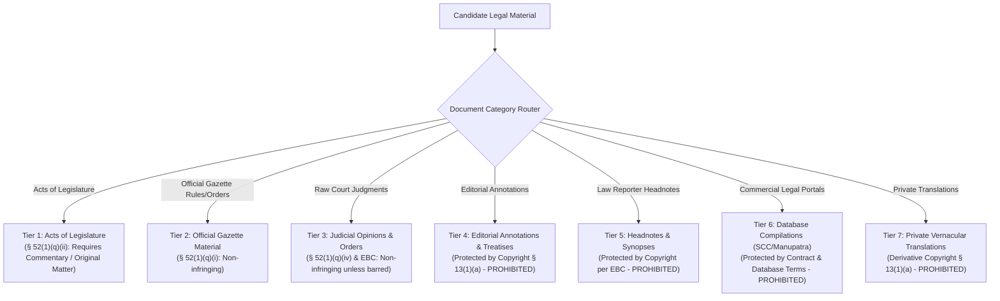
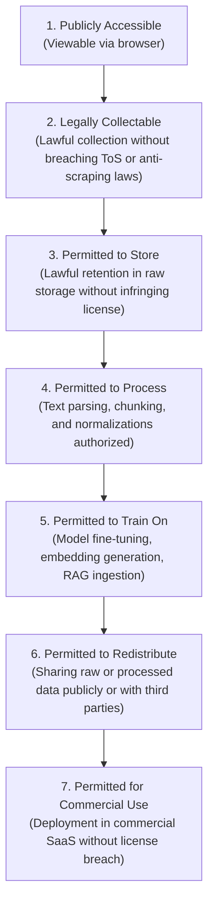
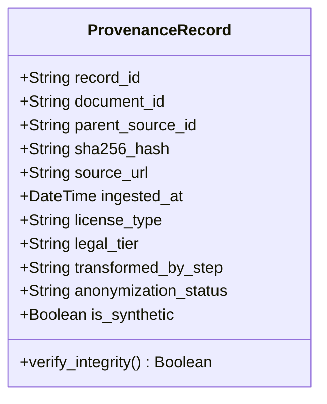

# 03. License and Provenance Policy

**Document ID:** `LEGALAI-DOC-DE-03`  
**Version:** `1.2.1`  
**Status:** Draft v1.0 — Pending Technical and Legal Review  
**Audited Date:** 2026-11-13  
**Dependencies:** `INDEX.md`, `02_SOURCE_REGISTRY.md`, `13_DATA_PRIVACY_AND_GOVERNANCE.md`, `PHASE_1_2_1_EVIDENCE_REGISTER.md`

---

## 1. Executive Summary

Legal data engineering operates in a heavily regulated domain where statutory copyright exceptions, judicial open-access doctrines, statutory privacy mandates, and commercial licensing intersect.

This policy establishes the formal intellectual property, copyright compliance, and data provenance rules governing all corpora ingested, processed, fine-tuned upon, or served by **LegalAI**. It establishes strict boundaries to guarantee that:
1. All datasets comply with Indian copyright law, particularly **Section 52(1)(q)** of the *Copyright Act, 1957*, interpreting subclauses (i), (ii), (iii), and (iv) strictly in accordance with their statutory conditions.
2. The doctrine established in the landmark Supreme Court ruling ***Eastern Book Company v. D.B. Modak (2008) 1 SCC 1*** is rigorously upheld: raw judicial opinions are non-infringing under § 52(1)(q)(iv), while editorial enhancements (headnotes, synopses, paragraph structuring exhibiting creativity) are protected works and strictly excluded.
3. Upstream open-source licenses (e.g., `CC BY 4.0`, `Apache 2.0`, `MIT`, `OGD`) are satisfied with immutable attribution metadata, and mixed-license collections are kept cleanly partitioned.
4. Restrictive or proprietary standards (such as commercial ACORD insurance forms) are quarantined and permanently excluded.
5. Ingestion provenance is fully auditable through cryptographic hashes and deterministic lineage records.
6. Statutory privacy protections under the *POCSO Act, 2012* (Sections 24(5) & 27), *Bharatiya Nyaya Sanhita, 2023* (Sections 72 & 73), *Family Courts Act, 1984* (Section 11), and the *Digital Personal Data Protection Act, 2023* (phased commencement) are strictly enforced.

---

## 2. Statutory Copyright Framework: Indian Copyright Act, 1957, Section 52(1)(q)

Section 52(1)(q) of the *Copyright Act, 1957* exempts specific classes of government and judicial publications from copyright infringement. However, this exception is not an unconditional grant of public-domain status and contains distinct subclauses with express conditions:

> **Section 52(1)(q) Text:**
> *"The following acts shall not constitute an infringement of copyright, namely:—*  
> *(q) the reproduction or publication of—*  
> *(i) any matter which has been published in any Official Gazette except an Act of a Legislature;*  
> *(ii) any Act of a Legislature subject to the condition that such Act is reproduced or published together with any commentary thereon or any other original matter;*  
> *(iii) the report of any committee, commission, council, board or other like body appointed by the Government if such report has been laid on the Table of the Legislature, unless the reproduction or publication of such report is prohibited by the Government;*  
> *(iv) any judgment or order of a court, tribunal or other judicial authority, unless the reproduction or publication of such judgment or order is prohibited by the court, the tribunal or other judicial authority, as the case may be;"*

### 2.1 Subclause-Specific Legal Analysis

1. **Clause (i) — Official Gazette Material (Except Acts):**
   - Applies to statutory rules, regulations, orders, notifications, and gazette announcements published by Central or State Governments.
   - Does **not** apply to Acts of a Legislature (which are expressly excepted from clause (i) and governed by clause (ii)).
   - Such gazette materials are non-infringing to reproduce or publish.
2. **Clause (ii) — Acts of a Legislature (The Commentary/Original Matter Condition):**
   - Reproduction or publication of an Act of a Legislature is exempt **only** *"subject to the condition that such Act is reproduced or published together with any commentary thereon or any other original matter"*.
   - A standalone republication of the bare statutory text of an Act *without* any accompanying commentary, analysis, annotations, or original matter does **not** fall within Section 52(1)(q)(ii).
   - In LegalAI, Acts of the Legislature are ingested, chunked, and indexed alongside **original matter** (e.g., FIRAC structured metadata, clause classification labels, statutory risk scores, cross-references, and bilingual alignments). This integration satisfies the statutory condition of clause (ii).
   - Standalone bulk redistribution of bare statutory text without accompanying original matter is restricted unless independently authorized under the Government Open Data License (GODL) of India Code.
3. **Clause (iii) — Government Reports:**
   - Reports of committees, commissions, or boards laid on the Table of the Legislature are non-infringing to reproduce unless explicitly prohibited by the Government.
4. **Clause (iv) — Judicial Opinions & Orders (*Eastern Book Company* Doctrine):**
   - Judgments and orders of courts, tribunals, or judicial authorities are non-infringing to reproduce unless prohibited by the court or tribunal.
   - In *Eastern Book Company v. D.B. Modak (2008) 1 SCC 1*, the Supreme Court held that the text of judgments is public and free for anyone to reproduce. However, headnotes, case summaries, editorial footnotes, and creative formatting introduced by private law reporters constitute original derivative literary works protected under Section 13(1)(a) of the Copyright Act.
5. **Model Training & Commercial SaaS Boundaries:**
   - Indian copyright law does not currently contain an express statutory text-and-data-mining (TDM) or artificial intelligence model-training exception.
   - While intermediate reproduction for RAG indexing coupled with original analytical output falls within the principles of Section 52(1)(q)(ii) and fair dealing under Section 52(1)(a), commercial model weight distribution remains an evolving legal area.
   - **Legal Counsel Dependency:** Deployment of proprietary model weights trained directly on large-scale third-party compilations requires formal review by qualified Indian legal counsel.

### 2.2 Comprehensive Classification & Rights Matrix

| Material Tier | Statutory Basis & Copyright Status | Source Terms & Boundary | Ingestion & Storage | Indexing & Embedding | Model Training | Redistribution | Commercial SaaS Serving |
| :--- | :--- | :--- | :--- | :--- | :--- | :--- | :--- |
| **1. Acts of Legislature** | § 52(1)(q)(ii) (conditioned on accompanying commentary or original matter). | Official portals (*India Code*). | **Allowed** | **Allowed** (Coupled with LegalAI original tags) | **Allowed** (Intermediate processing) | **Restricted** (Only with accompanying original matter) | **Allowed** (As part of value-added platform) |
| **2. Gazette Rules / Orders** | § 52(1)(q)(i) (Non-infringing Official Gazette matter). | Central & State Gazettes (*egazette.gov.in*). | **Allowed** | **Allowed** | **Allowed** | **Allowed** | **Allowed** |
| **3. Raw Court Judgments** | § 52(1)(q)(iv) & *Eastern Book Company* (Public record). | Official Court Portals (DigiSCR, e-Courts, High Court sites). | **Allowed** | **Allowed** | **Allowed** | **Allowed** (Subject to victim identity redactions) | **Allowed** (Value-added legal intelligence) |
| **4. Editorial Annotations** | Protected under § 13(1)(a) (Original literary work). | Commercial law books & treatise commentaries. | **Prohibited** | **Prohibited** | **Prohibited** | **Prohibited** | **Prohibited** without express copyright license |
| **5. Reporter Headnotes** | Protected under "Modicum of Creativity" standard (*Eastern Book Company*). | Law reports (SCC, AIR, SCR commercial headnotes). | **Prohibited** | **Prohibited** | **Prohibited** | **Prohibited** | **Prohibited** (Only raw judicial text permitted) |
| **6. Commercial Databases** | Database compilation rights & contractual Terms of Service bars. | Proprietary portals (SCC Online, Manupatra, LexisNexis). | **Prohibited** | **Prohibited** | **Prohibited** | **Prohibited** | **Prohibited** (Bulk scraping contractually barred) |
| **7. Private Translations** | Independent derivative copyright under § 13(1)(a) & § 14(a)(iv). | Unofficial private translations and publishers. | **Prohibited** | **Prohibited** | **Prohibited** | **Prohibited** | **Prohibited** (Must use official gazetted translations) |

---

## 3. The 7-Tier Legal Permissions Ladder

Public accessibility of a document on the Internet does **not** grant unlimited legal rights to collect, store, train upon, or redistribute that document. LegalAI enforces an explicit 7-tier permission ladder:

> [!CRITICAL]
> **Operational Rule:**
> A source that satisfies Tier 1 (Publicly Accessible) does not automatically satisfy Tier 5 (Training) or Tier 7 (Commercial Use). For example, a scraped court database may be publicly accessible, but its portal Terms of Service may legally prohibit bulk automated collection (failing Tier 2) or commercial redistribution (failing Tier 6 & 7). Every ingested dataset must establish affirmative permissions through Tier 7 before deployment in production weights.

---

## 4. Statutory Non-Disclosure and Privacy Mandates

### 4.1 Protection of Children from Sexual Offences (POCSO) Act, 2012
- **Section 24(5) (Police Officer's Duty):**  
  > *"The police officer shall also ensure that the identity of the child is protected from the public media, unless for reasons to be recorded in writing, the Special Court has permitted such disclosure in the interest of the child."*  
  This statutory obligation is imposed specifically on the **police officer** during investigation.
- **Section 27 (Medical Examination):** Medical examination of the child is conducted independently pursuant to Section 27 and Section 164A CrPC / Section 184 BNSS.
- **Section 33(7) (Special Court's Duty):** Places an affirmative statutory duty on the Special Court to ensure that the identity of the child is not disclosed during trial.
- **Section 23 (Penalties on Media & Public):** Punishes any person or media organization publishing the name, address, photograph, or identifying particulars of the child.
- **Enforcement in LegalAI:** Automated regex and NER filters redact child victim identities to `[REDACTED_CHILD_VICTIM]` or `Child_X`.

### 4.2 Bharatiya Nyaya Sanhita, 2023: Sections 72 and 73
- **Section 72, BNS 2023 (formerly IPC Section 228A):**  
  Criminalizes printing or publishing the name or any matter disclosing the identity of any victim of sexual offenses (Sections 64 to 71).
- **Section 73, BNS 2023 (Proceedings Relating to Section 72 Offences):**  
  > *"Whoever prints or publishes any matter in respect for any proceeding before a court with respect to an offence referred to in section 72 without previous permission of such court, shall be punished with imprisonment of either description for a term which may extend to two years and shall also be liable to fine.*  
  > *Explanation.—The printing or publishing of the judgment of any High Court or the Supreme Court does not amount to an offence within the meaning of this section."*
- **Statutory Limitation:** Section 73 applies **strictly to proceedings relating to offences under Section 72 BNS**. It does **not** create a universal penal prohibition against publishing every in-camera proceeding under every Indian law.
- **Enforcement:** Mandatory masking of victim names (`Victim X`, `Prosecutrix`) and exclusion of trial transcripts relating to Section 72 offenses. High Court and Supreme Court judgments on points of law remain publishable under the statutory Explanation, subject to victim identity masking.

### 4.3 Family Courts Act, 1984: Section 11 & Matrimonial In-Camera Analysis
- **Statutory Scope:** Section 11 provides that family court proceedings *may* be held in camera if the court desires, and *shall* be so held if either party requests.
- **Distinction Between In-Camera Status, Gag Orders, and Public Precedents:**
  1. *In-Camera Trial Proceedings:* Where Section 11 is invoked, trial transcripts, depositions, and pleadings are confidential and excluded from ingestion.
  2. *Court-Specific Sealing/Gag Orders:* Where a court expressly issues a confidentiality or non-publication order under Section 151 CPC or inherent powers, the record is quarantined.
  3. *Appellate Judgments on Questions of Law:* Section 11 does **not** create an automatic statutory ban on published High Court or Supreme Court appellate judgments deciding legal questions under the Hindu Marriage Act, Special Marriage Act, or Family Courts Act.
  4. *LegalAI Internal Policy (Tier 5):* To prevent sensitive personal exposure, LegalAI applies a voluntary **7-step eligibility screening protocol** that scrubs spousal names, residential addresses, minor child details, and maintenance amounts, while retaining abstract FIRAC legal principles.

### 4.4 Digital Personal Data Protection Act, 2023 (DPDP Act) — Phased Commencement
- **Statutory Commencement:** The DPDP Act received presidential assent on August 11, 2023. Under Section 1(2), provisions come into force on dates appointed by the Central Government. Substantive operational chapters (Sections 3 to 17) are subject to phased transition rules.
- **Section 16 Cross-Border Transfer Power (Negative List):**  
  Section 16 empowers the Central Government to restrict transfers of personal data to specified countries (a "negative list" model). Section 16 **does not** mandate universal India-only data localization for all data fiduciaries.
- **Internal Infrastructure Policy:** LegalAI's requirement that Qdrant, PostgreSQL, and Parquet data lakes reside in Indian data centers (AWS `ap-south-1`) is an **internal risk-management policy (Tier 5)**, not a statutory mandate under Section 16.

---

## 5. Provenance Tracking Specification

Every dataset artifact processed in LegalAI must have a persistent, tamper-evident lineage record complying with the W3C PROV-O standard:

### 5.1 Cryptographic Hash Ledger
1. **Bronze Ingestion:** A SHA-256 checksum is computed from the raw binary stream and recorded in the ingestion manifest:
   $$\text{Hash}_{\text{document}} = \text{SHA256}(\text{RawBytes})$$
2. **Transformations:** Each transformation (OCR, cleaning, chunking, translation) records the `input_hash`, the script/version that executed the step (`git_commit_sha`), and the resulting `output_hash`.
3. **Immutability:** Parquet files in Silver and Gold include the immutable `source_sha256` and `source_url` in their embedded schema metadata.

---

## 6. Audit and Attribution Compliance

Whenever a dataset chunk or precedent is displayed to an end user via the LegalAI application:
- The specific judicial citation (e.g., *1954 AIR 44* or *2023 INSC 102*) or statutory section must be cited as the authoritative legal source.
- Upstream datasets (CUAD, OpenNYAI, India Code) are credited in system notices (`LEGAL_NOTICES.md`).
- Audit events are recorded through `backend/app/services/audit.py` to the persistent `AuditLog` database table.
