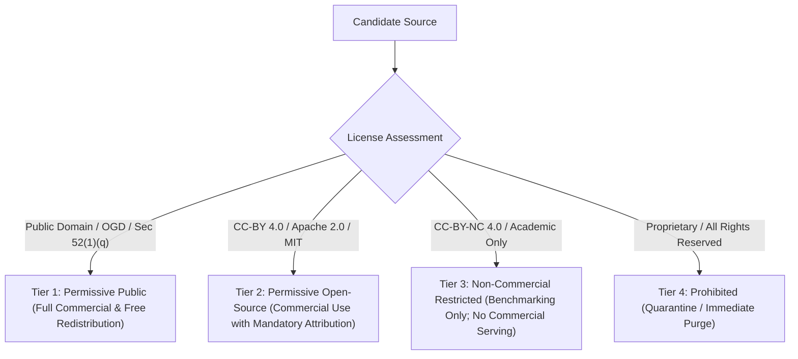
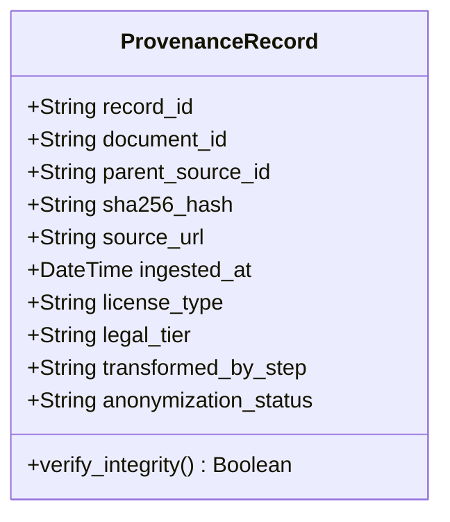

# 03. License and Provenance Policy

**Document ID:** `LEGALAI-DOC-DE-03`  
**Version:** `1.0.0`  
**Status:** Canonical Legal Policy  
**Dependencies:** `INDEX.md`, `02_SOURCE_REGISTRY.md`, `13_DATA_PRIVACY_AND_GOVERNANCE.md`

---

## 1. Executive Summary

Legal data engineering operates in a heavily regulated domain where copyright, judicial open-access doctrines, statutory privacy mandates, and commercial licensing intersect. 

This policy establishes the formal intellectual property and data provenance rules governing all corpora ingested, processed, fine-tuned upon, or served by **LegalAI**. It establishes strict boundaries to guarantee that:
1. All datasets comply with Indian copyright law, particularly **Section 52(1)(q)** of the *Indian Copyright Act, 1957*.
2. The doctrine established in the landmark Supreme Court ruling ***Eastern Book Company v. D.B. Modak (2008) 1 SCC 1*** is rigorously upheld.
3. Upstream open-source licenses (e.g., `CC BY 4.0`, `Apache 2.0`, `MIT`, `OGD`) are satisfied with immutable attribution metadata.
4. Restrictive or non-commercial licenses (`CC BY-NC 4.0`, proprietary standards) are quarantined and prohibited from contaminating commercial model weights.
5. Ingestion provenance is fully auditable through cryptographic hashes and deterministic lineage records.

---

## 2. Indian Statutory Copyright Framework

### 2.1 Section 52(1)(q) of the Indian Copyright Act, 1957
Under the Indian copyright regime, certain acts do not constitute an infringement of copyright. In the legal and governmental domain, Section 52(1)(q) specifies that the following acts are non-infringing:

> **Section 52(1)(q):**
> *(i) the reproduction or publication of any matter which has been published in any Official Gazette except an Act of a Legislature;*  
> *(ii) the reproduction or publication of any Act of a Legislature unless such reproduction or publication is accompanied by any commentary or other original matter;*  
> *(iv) the reproduction or publication of any judgment or order of a court, tribunal or other judicial authority, unless the reproduction or publication of such judgment or order is prohibited by the court, tribunal or other judicial authority, as the case may be.*

**Operational Directive for LegalAI:**
- Central and state enactments, subordinate rules, and gazette notifications published by the Government of India or State Governments are lawful to ingest, reproduce, chunk, embed, and redistribute in their pure statutory form.
- Judgments, orders, and decrees of the Supreme Court of India, High Courts, District Courts, and Statutory Tribunals (NCLT, NCLAT, NGT, ITAT) are public record and permissible for ingestion.

### 2.2 The *Eastern Book Company v. D.B. Modak* Doctrine (2008 1 SCC 1)
In *Eastern Book Company & Ors. v. D.B. Modak & Anr.*, the Supreme Court of India addressed whether commercial law publishers hold copyright over published judgments:

1. **Raw Judicial Text:** The raw text of orders and judgments delivered by judges is in the public domain. No individual, publisher, or entity can claim copyright over the text of a judicial opinion.
2. **Editorial Enhancements:** Copy-editing, selection, arrangement, headnotes, paragraph numbering introduced by editors, and editorial cross-references require an expenditure of skill and judgment ("modicum of creativity"), thereby enjoying copyright protection.

**Strict Ingestion Boundary:**
- Ingestion pipelines must source judgments **exclusively from official public portals** (Supreme Court of India `main.sci.gov.in`, `digiscr.sci.gov.in`, High Court websites, e-Courts `judgments.ecourts.gov.in`) or open public-domain archives (AWS Registry of Open Data).
- Ingestion of proprietary law reports (such as *Supreme Court Cases (SCC)*, *All India Reporter (AIR)*, *Manupatra*, *LexisNexis India*) including their editorial headnotes, catchwords, and custom paragraph numbering is **strictly prohibited**.

---

## 3. Commercial vs. Non-Commercial Licensing Matrix

Every source registered in `02_SOURCE_REGISTRY.md` is categorized into one of four licensing tiers:

### 3.1 Permissible Licenses (Tiers 1 & 2)
* **Eligible Uses:** Vector search indexing, retrieval-augmented generation (RAG), supervised fine-tuning (SFT), direct delivery in application UI, and commercial SaaS deployment.
* **Requirements:**
  - Attribution sidecars must be preserved in all derived Parquet partitions.
  - Full license text included in dataset documentation.

### 3.2 Non-Commercial / Research-Only Licenses (Tier 3)
* **Applicable Datasets:** Academic benchmarks or evaluation subsets explicitly licensed under Non-Commercial terms (e.g., `CC BY-NC 4.0`).
* **Governance Rule:**
  - **Quarantine:** Stored in an isolated directory (`data/gold/benchmarks_academic_nc/`).
  - **Zero Model Weights Contamination:** Tier 3 data must **never** be used for training, fine-tuning, or adapter distillation of commercial models.
  - **Restricted Use:** Permitted solely for offline validation, academic benchmarking, and internal model quality scoring.

### 3.3 Prohibited Datasets (Tier 4)
* Datasets lacking clear license terms, proprietary standards with restrictive clauses (e.g., standard ACORD forms without commercial release), or scraped proprietary portals.
* **Action:** Instant rejection by the Bronze ingestion validator.

---

## 4. Statutory Anonymization & Privacy Mandates

Regardless of public availability, Indian law mandates strict privacy and redaction for specific classes of judicial records:

### 4.1 Protection of Children from Sexual Offences (POCSO) Act, 2012
- **Section 33(7) & Section 24(5):** Absolute statutory bar on disclosing the identity of a child victim, including name, address, school, photograph, or any particulars leading to identification.
- **Enforcement:** Automated regex and entity filters tag any document referencing POCSO for complete redaction of minor party names and family descriptors.

### 4.2 Bharatiya Nyaya Sanhita, 2023 / Indian Penal Code Section 228A
- **Statutory Mandate:** Criminal offense to print or publish the name or any matter which may disclose the identity of any person against whom sexual offenses have been alleged or established.
- **Enforcement:** Mandatory masking of victim names (`Victim X`, `Prosecutrix`, `Child A`) before Silver tier persistence.

### 4.3 Matrimonial and Family Courts Act, 1984
- **Section 11:** Family court proceedings held *in camera* require redaction of sensitive domestic dispute particulars before publication.

---

## 5. Provenance Tracking Specification

Every dataset artifact processed in LegalAI must have a persistent, tamper-evident lineage record complying with the W3C PROV-O standard:

### 5.1 Cryptographic Hash Ledger
1. **Bronze Ingestion:** Upon landing, a SHA-256 checksum is computed from the raw binary stream and recorded in the ingestion manifest:
   $$\text{Hash}_{\text{document}} = \text{SHA256}(\text{RawBytes})$$
2. **Transformations:** Each transformation (OCR, cleaning, chunking, translation) records the `input_hash`, the script/version that executed the step (`git_commit_sha`), and the resulting `output_hash`.
3. **Immutability:** Parquet files in Silver and Gold include the immutable `source_sha256` and `source_url` in their embedded schema metadata.

---

## 6. Audit and Attribution Compliance

Whenever a dataset chunk or precedent is displayed to an end user via the LegalAI application (e.g., in `frontend/src/pages/DocumentReviewer.jsx` or `frontend/src/components/ReviewModal.jsx`):
- The specific judicial citation (e.g., *AIR 1962 SC 1314* or *2023 INSC 102*) or statutory section must be cited as the authoritative source.
- Upstream datasets (CUAD, OpenNYAI, India Code) are credited in the system documentation and repository notices file (`LEGAL_NOTICES.md`).

