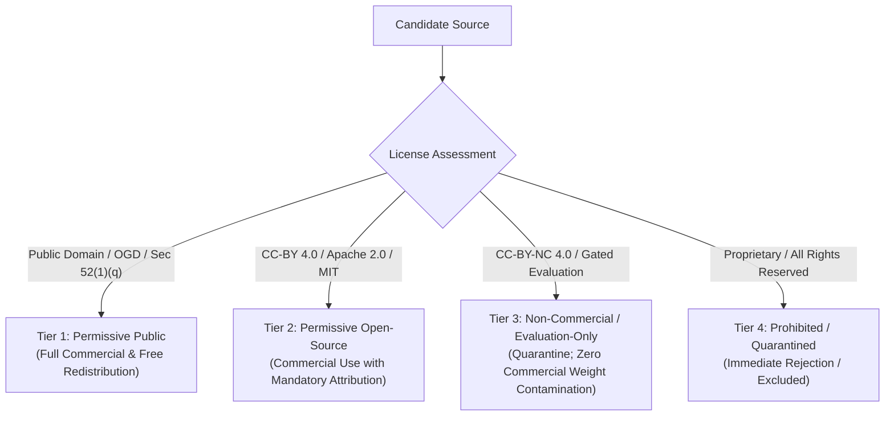
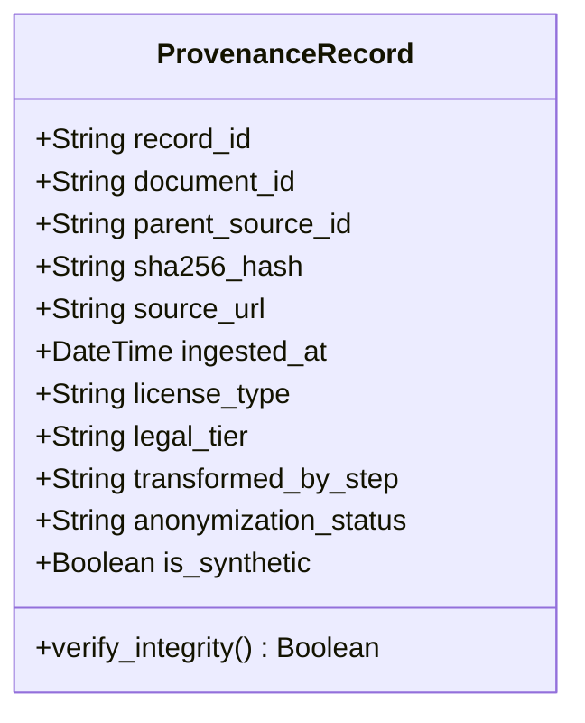

# 03. License and Provenance Policy

**Document ID:** `LEGALAI-DOC-DE-03`  
**Version:** `1.1.0`  
**Status:** Draft v1.0 — Pending Technical and Legal Review  
**Audited Date:** 2026-11-12  
**Dependencies:** `INDEX.md`, `02_SOURCE_REGISTRY.md`, `13_DATA_PRIVACY_AND_GOVERNANCE.md`, `PHASE_1_1_ISSUE_REGISTER.md`

---

## 1. Executive Summary

Legal data engineering operates in a heavily regulated domain where statutory copyright exceptions, judicial open-access doctrines, statutory privacy mandates, and commercial licensing intersect.

This policy establishes the formal intellectual property and data provenance rules governing all corpora ingested, processed, fine-tuned upon, or served by **LegalAI**. It establishes strict boundaries to guarantee that:
1. All datasets comply with Indian copyright law, particularly **Section 52(1)(q)** of the *Indian Copyright Act, 1957*.
2. The doctrine established in the landmark Supreme Court ruling ***Eastern Book Company v. D.B. Modak (2008) 1 SCC 1*** is rigorously upheld: raw judicial opinions are public domain, while editorial enhancements are strictly excluded.
3. Upstream open-source licenses (e.g., `CC BY 4.0`, `Apache 2.0`, `MIT`, `OGD`) are satisfied with immutable attribution metadata, and mixed-license collections are kept cleanly partitioned.
4. Restrictive or proprietary standards (such as commercial ACORD forms) are quarantined and excluded.
5. Ingestion provenance is fully auditable through cryptographic hashes and deterministic lineage records.
6. Statutory privacy protections under the *POCSO Act, 2012*, *Bharatiya Nyaya Sanhita, 2023* (Sections 72 & 73), *Family Courts Act, 1984*, and the incoming *Digital Personal Data Protection Act, 2023* (phased commencement) are strictly enforced.

---

## 2. Indian Statutory Copyright Framework

### 2.1 Section 52(1)(q) of the Indian Copyright Act, 1957
Under the Indian copyright regime, certain acts do not constitute an infringement of copyright. Section 52(1)(q) specifies that the following acts are non-infringing:

> **Section 52(1)(q):**
> *(i) the reproduction or publication of any matter which has been published in any Official Gazette except an Act of a Legislature;*  
> *(ii) the reproduction or publication of any Act of a Legislature unless such reproduction or publication is accompanied by any commentary or other original matter;*  
> *(iv) the reproduction or publication of any judgment or order of a court, tribunal or other judicial authority, unless the reproduction or publication of such judgment or order is prohibited by the court, tribunal or other judicial authority, as the case may be.*

**Operational Directives for LegalAI:**
- **Central and State Acts:** Central and state enactments, subordinate rules, and gazette notifications published by the Government of India or State Governments are lawful to ingest, reproduce, chunk, embed, and redistribute in their pure statutory form under sub-clauses (i) and (ii), provided they are unaccompanied by commercial third-party commentary.
- **Judgments and Orders:** Orders, judgments, and decrees delivered by the Supreme Court of India, High Courts, District Courts, and Statutory Tribunals (NCLT, NCLAT, NGT, ITAT) are public records and non-infringing to reproduce under sub-clause (iv), unless a specific order of the court prohibits publication.

### 2.2 The *Eastern Book Company v. D.B. Modak* Doctrine (2008 1 SCC 1)
In *Eastern Book Company & Ors. v. D.B. Modak & Anr.*, the Supreme Court of India established the authoritative standard on copyright in judicial reports:

1. **Raw Judicial Text (No Copyright):** The raw text of orders and judgments delivered by judges is in the public domain. No individual, publisher, or entity can claim copyright over the text of a judicial opinion delivered by a court.
2. **Editorial Enhancements (Protected by Copyright):** Headnotes, catchwords, editorial paragraph numbering, annotations, selection and arrangement of arguments, and editorial cross-references introduced by law reporters require an expenditure of skill and judgment ("modicum of creativity" standard), thereby enjoying copyright protection.

**Strict Ingestion Boundary:**
- Ingestion pipelines must source judgments **exclusively from official public portals** (Supreme Court of India `main.sci.gov.in`, `digiscr.sci.gov.in`, High Court portals, e-Courts `judgments.ecourts.gov.in`) or open public-domain archives (AWS Registry of Open Data).
- Ingestion of proprietary commercial law reports (such as *Supreme Court Cases (SCC)*, *All India Reporter (AIR)*, *Manupatra*, *LexisNexis India*, *SCC Online*) including their editorial headnotes, editorial paragraphing, and synopsis is **strictly prohibited**.

---

## 3. Commercial vs. Non-Commercial Licensing Matrix

Every source registered in `02_SOURCE_REGISTRY.md` is categorized into one of four licensing tiers:

### 3.1 Permissible Licenses (Tiers 1 & 2)
* **Eligible Uses:** Vector search indexing, retrieval-augmented generation (RAG), supervised fine-tuning (SFT), direct delivery in application UI, and commercial SaaS deployment.
* **Requirements:**
  - Attribution sidecars must be preserved in all derived Parquet partitions.
  - Full license text included in dataset documentation.
  - Distinct datasets retain their individual licenses; no uniform license is applied to mixed collections.

### 3.2 Non-Commercial / Evaluation-Only Licenses (Tier 3)
* **Applicable Datasets:** Academic benchmarks or evaluation subsets explicitly licensed under Non-Commercial terms (e.g., `CC BY-NC 4.0`) or gated evaluation agreements (`BhashaBench-Legal`).
* **Governance Rules:**
  - **Quarantine:** Stored in an isolated directory (`data/gold/benchmarks_academic_nc/`).
  - **Zero Model Weights Contamination:** Tier 3 data must **never** be used for training, fine-tuning, or adapter distillation of commercial models.
  - **Restricted Use:** Permitted solely for offline validation, academic benchmarking, and internal model quality scoring.

### 3.3 Prohibited Datasets (Tier 4)
* Datasets lacking clear license terms, proprietary standards with restrictive clauses (e.g., standard ACORD forms without commercial release), or scraped proprietary portals violating Terms of Service.
* **Action:** Instant rejection by the Bronze ingestion validator.

---

## 4. Statutory Anonymization & Privacy Mandates

Regardless of public availability, Indian law mandates strict privacy and redaction for specific classes of judicial records:

### 4.1 Protection of Children from Sexual Offences (POCSO) Act, 2012
- **Section 24(5):** Police officers and medical practitioners are barred from disclosing the identity of the child in any media.
- **Section 33(7):** Special Court has a statutory obligation to ensure that the identity of the child is not disclosed at any time during the course of investigation or trial.
- **Section 23 & Section 37:** Media bars and mandatory *in-camera* trial procedures.
- **Enforcement:** Automated regex and entity filters tag any document referencing POCSO for complete redaction of minor party names and family descriptors.

### 4.2 Bharatiya Nyaya Sanhita, 2023: Sections 72 and 73 (formerly IPC Section 228A)
- **Section 72, BNS 2023 (Disclosure of Identity of Victims):** Criminalizes printing or publishing the name or any matter which may disclose the identity of any victim of offenses under Sections 64 to 71 (rape and sexual assault). Corresponds to old Section 228A of the IPC.
- **Section 73, BNS 2023 (Publishing In-Camera Court Proceedings):** Criminalizes printing or publishing any matter relating to court proceedings conducted *in camera* or prohibited by court order without prior written permission of the court.
- **Enforcement:** Mandatory masking of victim names (`Victim X`, `Prosecutrix`, `Child A`) and redaction of in-camera proceeding transcripts before Silver tier persistence.

### 4.3 Matrimonial and Family Courts Act, 1984
- **Section 11:** Mandates that family court proceedings may be held *in camera* and must be so held if either party requests, requiring masking of sensitive domestic dispute particulars before publication.

### 4.4 Digital Personal Data Protection Act, 2023 (DPDP Act) — Phased Commencement
- **Enactment Status:** Act No. 22 of 2023, enacted August 11, 2023.
- **Commencement Status:** Under Section 1(2), the Act comes into force in phases via Central Government notifications. Detailed operational rules (notice formats, consent manager architecture, Data Protection Board procedures) are being notified in stages.
- **Governance Directives:**
  - Do not treat unnotified administrative rules as currently enforceable statutory mandates.
  - Treat DPDP principles (purpose limitation, data minimization, consent specificity, and rights of Data Principals) as the baseline for forward-looking enterprise data governance architecture.
  - Contracts uploaded by users to `/api/upload` are processed under strict purpose limitation and never repurposed for general model training without explicit consent.

---

## 5. Technical Privacy Controls: Definitions and Standards

To eliminate terminology ambiguity, LegalAI enforces precise distinctions between privacy engineering techniques:

| Privacy Technique | Definition | Reversibility | Regulatory Status (DPDP / GDPR) |
| :--- | :--- | :--- | :--- |
| **Redaction (Masking)** | Irreversible replacement of sensitive text with a generic marker (e.g., `[REDACTED_NAME]`, `XXX-XX-1234`). | Irreversible | Complete removal of personal data. |
| **Pseudonymization** | Replacement of an identifier with an artificial code (e.g., `Party_A7F9B1`), where re-identification is possible using a separated key or dictionary. | **Reversible** | Remains **Personal Data**; requires technical and organizational separation of the key. |
| **Anonymization** | Transformation of data such that the Data Principal can no longer be identified directly or indirectly by any means reasonably likely to be used. | **Irreversible** | Exits the scope of personal data regulation if irreversible. |

> [!WARNING]
> **Cryptographic Hashing Fallacy:**
> Salted SHA-256 hashing of individual names or identifiers constitutes **pseudonymization**, NOT irreversible anonymization. Because personal names belong to a finite, predictable space, salted hashes can be re-identified using dictionary attacks or brute-force matching if the salt is compromised or rainbow tables are generated. Salted hash keys must be stored in secure key vaults and treated as protected access controls.

---

## 6. Provenance Tracking Specification

Every dataset artifact processed in LegalAI must have a persistent, tamper-evident lineage record complying with the W3C PROV-O standard:

### 6.1 Cryptographic Hash Ledger
1. **Bronze Ingestion:** Upon landing, a SHA-256 checksum is computed from the raw binary stream and recorded in the ingestion manifest:
   $$\text{Hash}_{\text{document}} = \text{SHA256}(\text{RawBytes})$$
2. **Transformations:** Each transformation (OCR, cleaning, chunking, translation) records the `input_hash`, the script/version that executed the step (`git_commit_sha`), and the resulting `output_hash`.
3. **Immutability:** Parquet files in Silver and Gold include the immutable `source_sha256` and `source_url` in their embedded schema metadata.

---

## 7. Audit and Attribution Compliance

Whenever a dataset chunk or precedent is displayed to an end user via the LegalAI application (e.g., in `frontend/src/pages/DocumentReviewer.jsx` or `frontend/src/components/ReviewModal.jsx`):
- The specific judicial citation (e.g., *1954 AIR 44* or *2023 INSC 102*) or statutory section must be cited as the authoritative legal source.
- Upstream datasets (CUAD, OpenNYAI, India Code) are credited in system notices (`LEGAL_NOTICES.md`).
- Audit events are recorded through `backend/app/services/audit.py` to the persistent `AuditLog` database table.
