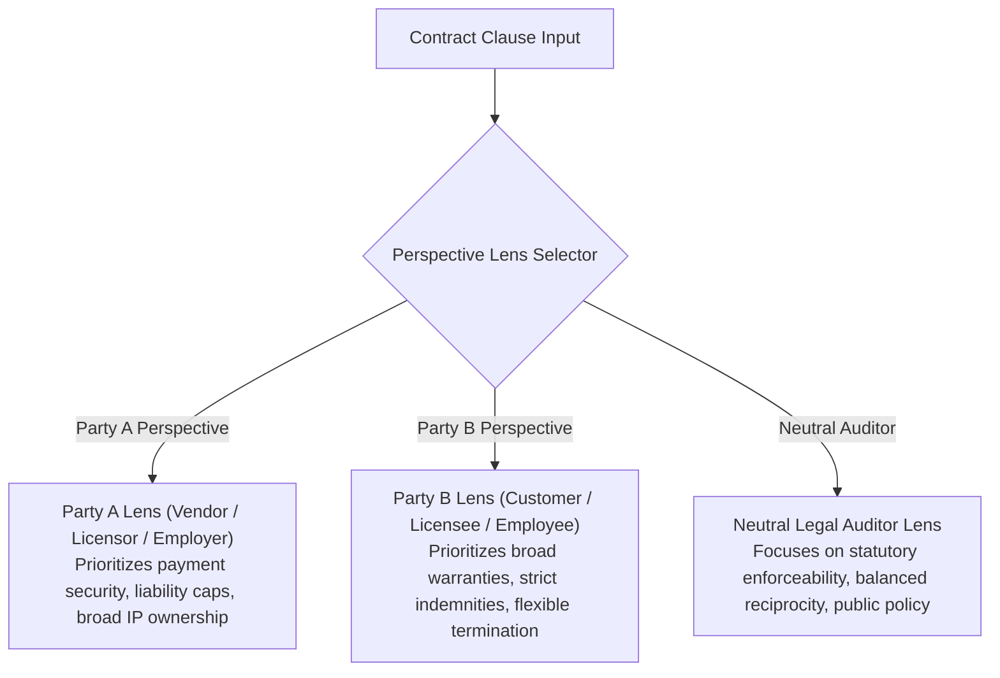
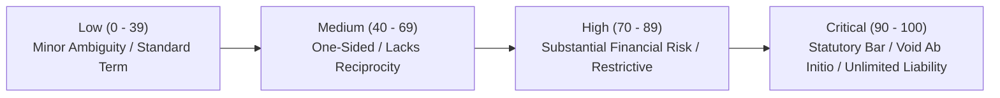
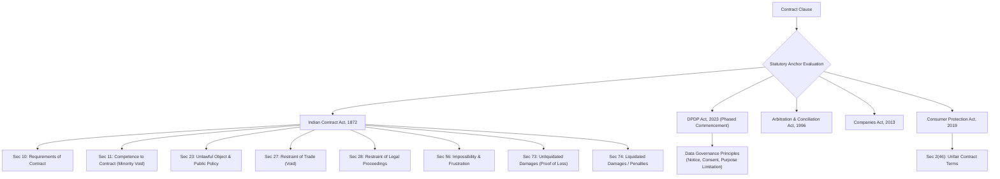
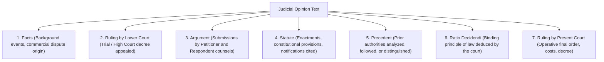

# 05. Label Taxonomy

**Document ID:** `LEGALAI-DOC-DE-05`  
**Version:** `1.1.0`  
**Status:** Draft v1.0 — Pending Technical and Legal Review  
**Audited Date:** 2026-11-12  
**Dependencies:** `INDEX.md`, `04_CANONICAL_DATA_SCHEMAS.md`, `backend/app/models/schemas.py`, `PHASE_1_1_ISSUE_REGISTER.md`

---

## 1. Executive Summary

A deterministic, legally precise taxonomy is the prerequisite for high-performance NLP models. In legal analytics, ambiguous classification schemas lead to catastrophic downstream errors in compliance checks and risk scores.

This document defines the canonical multi-tier taxonomy for LegalAI:
1. **Contract Clause Taxonomy (21 Canonical `ClauseType` Classes + CUAD Crosswalk)**
2. **Contract Risk Severity & Typology (`RiskLevel` Standard)**
3. **Perspective Lens Framework (Party A, Party B, Neutral Auditor)**
4. **Indian Statutory Anchor Matrix (ICA 1872, DPDP 2023, Arb Act 1996, Companies Act 2013, CPA 2019)**
5. **Legal Named Entity Recognition (NER) Taxonomy (11 Canonical Classes)**
6. **Judicial Rhetorical Roles Taxonomy (7 Canonical OpenNYAI Classes)**

---

## 2. Contract Clause Taxonomy (21 Canonical Classes)

All clauses are classified into one primary category and zero or more secondary categories. These classes maintain strict parity with `ClauseType` in `backend/app/models/schemas.py` and map directly to `CLAUSE_RULES` in `backend/app/services/classifier.py`.

| Category ID | Canonical Label (`ClauseType`) | Semantic Definition & Inclusions | Crosswalk: CUAD 41 Class Alignment |
| :--- | :--- | :--- | :--- |
| `CL-01` | **Payment** | Compensation, invoices, fee schedules, tax liability, reimbursable expenses, late interest charges. | `Price Restrictions`, `Minimum Commitment` |
| `CL-02` | **Termination** | Expiration, termination for cause, termination for convenience, cure periods, exit transitions. | `Termination for Convenience`, `Notice Period to Terminate` |
| `CL-03` | **Liability** | Aggregate monetary caps, exclusion of consequential/indirect damages, disclaimer of statutory torts. | `Cap on Liability`, `Liquidated Damages`, `Uncapped Liability` |
| `CL-04` | **Indemnity** | Third-party claims defense, hold harmless covenants, IP infringement indemnity procedures. | `Indemnification`, `IP Infringement Protection` |
| `CL-05` | **Confidentiality** | Protection of proprietary data, definition of confidential material, duration of non-disclosure covenants. | `Non-Disclosure/Confidentiality`, `Exclusivity` |
| `CL-06` | **Intellectual Property** | Work-for-hire declarations, IP assignments, moral rights waivers, background vs. foreground IP rights. | `IP Ownership Assignment`, `License Grant` |
| `CL-07` | **Force Majeure** | Excused non-performance due to acts of God, epidemics, war, governmental bans, strike events. | `Force Majeure` |
| `CL-08` | **Governing Law** | Substantive state and national jurisdiction governing construction and validity of agreement. | `Governing Law` |
| `CL-09` | **Dispute Resolution** | Mandatory arbitration, institutional rules (MCIA, SIAC), mediation prerequisites, exclusive venue. | `Dispute Resolution/Arbitration` |
| `CL-10` | **Non-Compete** | Restraints on trade, post-contractual covenants, geographical and temporal business exclusions. | `Non-Compete`, `No-Solicit of Customers` |
| `CL-11` | **Data Protection** | Personal data processing obligations, DPDP Act compliance, data breach notifications, transfer limits. | `Data Protection/Security`, `Audit Rights` |
| `CL-12` | **Warranty** | Express warranties, implied warranties, disclaimer of merchantability/fitness, service level guarantees. | `Warranty/Guarantees`, `Covenant` |
| `CL-13` | **Insurance** | Mandatory coverage types (Commercial General Liability, Errors & Omissions), policy limits, certificates. | `Insurance Requirements` |
| `CL-14` | **Assignment** | Restriction or authorization of assignment of rights, transfer of duties, change of control provisions. | `Assignment/Novation`, `Change of Control` |
| `CL-15` | **Notice** | Formal modes of communication (certified mail, registered email), deemed receipt conditions, designated addresses. | `Notice Provision` |
| `CL-16` | **Amendment** | Formalities required to alter agreement terms (mutual written instruments, electronic signatures). | `Modification/Amendment` |
| `CL-17` | **Severability** | Preservation of surviving provisions if any clause is adjudicated invalid, illegal, or unenforceable. | `Severability` |
| `CL-18` | **Entire Agreement** | Integration merger clause superseding prior oral or written representations, negotiations, or drafts. | `Entire Agreement/Integration` |
| `CL-19` | **Renewal** | Automatic rollover, renewal term triggers, renegotiation notice windows, price escalations. | `Renewal Term`, `Post-Termination Restrictions` |
| `CL-20` | **Penalty** | Stipulated damages, punitive liquidated damages, performance forfeitures, default surcharges. | `Liquidated Damages` |
| `CL-21` | **Other** | Miscellaneous administrative covenants, counterparts, headings clause, recitals. | `Miscellaneous` |

---

## 3. Perspective Lens Framework

Risk analysis cannot be performed in the abstract because a clause that is advantageous to one contracting party is frequently hazardous to the counterparty. LegalAI enforces three distinct perspective lenses:



1. **Party A (`party_a`):** Evaluates risk from the perspective of the first executing party (typically the service provider, vendor, licensor, lessor, or employer).
2. **Party B (`party_b`):** Evaluates risk from the perspective of the receiving party (typically the customer, client, licensee, lessee, or employee).
3. **Neutral Auditor (`neutral`):** Objective legal review evaluating statutory validity, procedural fairness, and court enforceability under Indian law.

---

## 4. Risk Severity and Typology (`RiskLevel` Standard)

Risks are assessed against contractual fairness and Indian statutory enforceability. Every identified risk is assigned a severity grade conforming to `RiskLevel` in `backend/app/models/schemas.py`:



### 4.1 Severity Definitions and Triggers

1. **Critical (`critical`, 90–100):**
   - **Definition:** Directly violates mandatory Indian statutory provisions, is declared void *ab initio* by statute, or exposes a party to catastrophic uncapped liability.
   - **Triggers:**
     - Post-termination non-compete clause violating **Section 27 of the Indian Contract Act, 1872** (void *ab initio* per *Percept D'Mark v. Zaheer Khan*).
     - Absolute waiver of right to litigate or arbitrate violating **Section 28 of the Indian Contract Act, 1872**.
     - Uncapped, unlimited liability on indirect, consequential, or punitive damages.
     - Unlawful object or consideration violating **Section 23 of the Indian Contract Act, 1872**.

2. **High (`high`, 70–89):**
   - **Definition:** Heavy asymmetric risk exposure, severe financial detriment, or extreme one-sided termination rights without notice.
   - **Triggers:**
     - Unilateral termination for convenience with immediate effect (zero notice period).
     - Broad indemnification extending to ordinary negligence or third-party acts beyond reasonable control.
     - Punitive liquidated damages bearing no reasonable relationship to anticipated losses (conflicting with Section 74).
     - Blanket perpetual non-disclosure obligations encompassing non-confidential public domain information.

3. **Medium (`medium`, 40–69):**
   - **Definition:** Operational imbalances, ambiguous dispute resolution mechanisms, or missing protective boilerplate.
   - **Triggers:**
     - Asymmetric payment terms (e.g., Net 90 days with no late-payment interest for supplier).
     - Lack of cure periods for curable contractual breaches.
     - Ambiguous force majeure clauses lacking notice or duty to mitigate.
     - Foreign governing law/jurisdiction without an explicit arbitration agreement between Indian corporate entities.

4. **Low (`low`, 0–39):**
   - **Definition:** Standard commercial boilerplate with minor drafting ambiguities or drafting style inconsistencies.
   - **Triggers:**
     - Standard mutual integration/entire agreement clauses.
     - Informal notice provisions (e.g., ordinary unverified email).
     - Generic severability declarations.

---

## 5. Indian Statutory Anchor Matrix

LegalAI anchors all compliance and risk intelligence directly to Indian legislative enactments.



### 5.1 Statutory Reference Guide
* **Indian Contract Act, 1872:**
  - `ICA-SEC-10`: **What agreements are contracts.** Sets the essential ingredients: free consent, parties competent to contract, lawful consideration, lawful object, not expressly declared void.
  - `ICA-SEC-11`: **Who are competent to contract.** Defines competence (age of majority, sound mind, not disqualified by law). A contract entered into by a minor is void *ab initio* (*Mohori Bibee v. Dharmodas Ghose*).
  - `ICA-SEC-23`: **What considerations and objects are lawful.** Consideration or object is unlawful if forbidden by law, fraudulent, injurious to person or property, immoral, or opposed to public policy.
  - `ICA-SEC-27`: **Agreement in restraint of trade void.** Every agreement restraining a person from exercising a lawful profession, trade, or business is void to that extent (sole exception: sale of goodwill within reasonable local limits).
  - `ICA-SEC-28`: **Agreements in restraint of legal proceedings void.** Restricting enforcement of rights or limiting the statutory limitation period is void. Exception: valid arbitration agreements.
  - `ICA-SEC-56`: **Agreement to do impossible act / Frustration.** An agreement to do an impossible act is void. If an act becomes impossible or unlawful after execution without default of either party, the contract becomes void (*Satyabrata Ghose v. Mugneeram Bangur*).
  - `ICA-SEC-73`: **Compensation for loss or damage caused by breach (Unliquidated Damages).** Party suffering breach is entitled to compensation for loss/damage which naturally arose in the usual course of things, or which parties contemplated when contracting. Remote and indirect loss is barred. **Actual loss must be proven.**
  - `ICA-SEC-74`: **Compensation for breach where penalty stipulated (Liquidated Damages).** Governs pre-agreed damages. The court awards reasonable compensation not exceeding the amount named, whether or not actual damage is proved, subject to judicial review (*Fateh Chand*, *Kailash Nath Associates*). Punitive penalties exceeding genuine pre-estimates of loss are unenforceable.
* **Digital Personal Data Protection Act, 2023 (DPDP Act) — Phased Commencement:**
  - `DPDP-SEC-05`: Notice obligations prior to seeking consent.
  - `DPDP-SEC-06`: Consent conditions (free, specific, informed, unconditional, unambiguous).
  - `DPDP-SEC-08`: Obligations of Data Fiduciaries (technical and organizational safeguards, erasure upon withdrawal).
  - `DPDP-SEC-16`: Cross-border data transfer framework.
  - *Note on Enforcement:* Operational rules are in phased notification by the Central Government.
* **Arbitration and Conciliation Act, 1996:**
  - `ARB-SEC-07`: Form of arbitration agreement (must be in writing).
  - `ARB-SEC-11`: Judicial appointment of arbitrators.
  - `ARB-SEC-34`: Grounds for setting aside arbitral awards (patent illegality, conflict with public policy of India).
* **Companies Act, 2013:**
  - `COMP-SEC-180`: Restrictions on powers of Board.
  - `COMP-SEC-188`: Related party transactions requiring approvals.
* **Consumer Protection Act, 2019:**
  - `CPA-SEC-2-46`: **Unfair Contract Terms:** Unilateral termination, excessive security deposits, imposing disproportionate penalties on consumers.

---

## 6. Legal Named Entity Recognition (NER) Taxonomy (11 Classes)

The Legal NER tagset defines exactly 11 canonical legal entity classes:

```
[B/I]-PETITIONER            : Individual, corporation, or entity initiating lawsuit / first party
[B/I]-RESPONDENT            : Defendant, respondent, non-moving party / second party
[B/I]-JUDGE                 : Judicial officer presiding over matter (e.g., 'CJI D.Y. Chandrachud')
[B/I]-COURT                 : Judicial forum (e.g., 'Supreme Court of India', 'Delhi High Court')
[B/I]-STATUTE               : Named legislative Act or Code (e.g., 'Indian Contract Act, 1872')
[B/I]-SECTION               : Codified section, sub-section, or article (e.g., 'Section 74(1)', 'Article 226')
[B/I]-PRECEDENT_CITATION    : Law reporter citation (e.g., '(2015) 4 SCC 136', '1954 AIR 44')
[B/I]-MONETARY_AMOUNT       : Financial value in INR or foreign currencies (e.g., '₹5,00,00,000', 'Rs. 25 Lakhs')
[B/I]-DATE                  : Effective date, execution date, limitation milestone (e.g., '14th August, 2022')
[B/I]-OBLIGATION            : Actionable covenant statement (e.g., 'shall maintain books of account')
[B/I]-JURISDICTION_CLAUSE   : Territorial forum anchor (e.g., 'exclusive jurisdiction of courts in New Delhi')
```

---

## 7. Judicial Rhetorical Roles Taxonomy (7 Classes)

For judgment decomposition and FIRAC extraction, LegalAI adopts the 7 canonical rhetorical roles established by OpenNYAI and SemEval-2023 Task 6:


