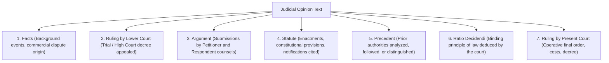

# 05. Label Taxonomy

**Document ID:** `LEGALAI-DOC-DE-05`  
**Version:** `1.2.0`  
**Status:** Draft v1.0 — Pending Technical and Legal Review  
**Audited Date:** 2026-11-13  
**Dependencies:** `INDEX.md`, `04_CANONICAL_DATA_SCHEMAS.md`, `backend/app/models/schemas.py`, `PHASE_1_2_EVIDENCE_REGISTER.md`

---

## 1. Executive Summary

A deterministic, legally precise taxonomy is the prerequisite for high-performance NLP models. In legal analytics, ambiguous classification schemas lead to catastrophic downstream errors in compliance checks and risk scores.

This document defines the canonical multi-tier taxonomy for LegalAI:
1. **Contract Clause Taxonomy (21 Canonical `ClauseType` Classes + CUAD Crosswalk)**
2. **Context-Dependent Legal Risk Analysis (Nuanced Statutory Assessment)**
3. **Reproducible Heuristic Risk-Scoring Formulation**
4. **Perspective Lens Framework (Party A, Party B, Neutral Auditor)**
5. **Indian Statutory Anchor Matrix (ICA 1872, DPDP 2023, Arb Act 1996, Companies Act 2013, CPA 2019)**
6. **Legal Named Entity Recognition (NER) Taxonomy (11 Canonical Classes)**
7. **Judicial Rhetorical Roles Taxonomy (7 Canonical OpenNYAI Classes)**

---

## 2. Contract Clause Taxonomy (21 Canonical Classes)

All clauses are classified into one primary category and zero or more secondary categories. These classes maintain strict parity with `ClauseType` in `backend/app/models/schemas.py` and map directly to `CLAUSE_RULES` in `backend/app/services/classifier.py`.

| Category ID | Canonical Label (`ClauseType`) | Semantic Definition & Inclusions | Crosswalk: CUAD 41 Class Alignment |
| :--- | :--- | :--- | :--- |
| `CL-01` | **Payment** | Compensation, invoices, fee schedules, tax liability, reimbursable expenses, late interest charges. | `Price Restrictions`, `Minimum Commitment` |
| `CL-02` | **Termination** | Expiration, termination for cause, termination for convenience, cure periods, exit transitions. | `Termination for Convenience`, `Notice Period to Terminate` |
| `CL-03` | **Liability** | Aggregate monetary caps, exclusion of consequential/indirect damages, disclaimer of statutory torts. | `Cap on Liability`, `Liquidated Damages`, `Uncapped Liability` |
| `CL-04` | **Indemnity** | Third-party claims defense, hold harmless covenants, IP infringement indemnity procedures. | `Indemnification`, `IP Infringement Protection` |
| `CL-05` | **Confidentiality** | Protection of proprietary data, definition of confidential material, duration of non-disclosure covenants. | `Non-Disclosure/Confidentiality`, `Exclusivity` |
| `CL-06` | **Intellectual Property** | Work-for-hire declarations, IP assignments, moral rights waivers, background vs. foreground IP rights. | `IP Ownership Assignment`, `License Grant` |
| `CL-07` | **Force Majeure** | Excused non-performance due to acts of God, epidemics, war, governmental bans, strike events. | `Force Majeure` |
| `CL-08` | **Governing Law** | Substantive state and national jurisdiction governing construction and validity of agreement. | `Governing Law` |
| `CL-09` | **Dispute Resolution** | Mandatory arbitration, institutional rules (MCIA, SIAC), mediation prerequisites, exclusive venue. | `Dispute Resolution/Arbitration` |
| `CL-10` | **Non-Compete** | Restraints on trade, post-contractual covenants, geographical and temporal business exclusions. | `Non-Compete`, `No-Solicit of Customers` |
| `CL-11` | **Data Protection** | Personal data processing obligations, DPDP Act compliance, data breach notifications, transfer limits. | `Data Protection/Security`, `Audit Rights` |
| `CL-12` | **Warranty** | Express warranties, implied warranties, disclaimer of merchantability/fitness, service level guarantees. | `Warranty/Guarantees`, `Covenant` |
| `CL-13` | **Insurance** | Mandatory coverage types (Commercial General Liability, Errors & Omissions), policy limits, certificates. | `Insurance Requirements` |
| `CL-14` | **Assignment** | Restriction or authorization of assignment of rights, transfer of duties, change of control provisions. | `Assignment/Novation`, `Change of Control` |
| `CL-15` | **Notice** | Formal modes of communication (certified mail, registered email), deemed receipt conditions, designated addresses. | `Notice Provision` |
| `CL-16` | **Amendment** | Formalities required to alter agreement terms (mutual written instruments, electronic signatures). | `Modification/Amendment` |
| `CL-17` | **Severability** | Preservation of surviving provisions if any clause is adjudicated invalid, illegal, or unenforceable. | `Severability` |
| `CL-18` | **Entire Agreement** | Integration merger clause superseding prior oral or written representations, negotiations, or drafts. | `Entire Agreement/Integration` |
| `CL-19` | **Renewal** | Automatic rollover, renewal term triggers, renegotiation notice windows, price escalations. | `Renewal Term`, `Post-Termination Restrictions` |
| `CL-20` | **Penalty** | Stipulated damages, punitive liquidated damages, performance forfeitures, default surcharges. | `Liquidated Damages` |
| `CL-21` | **Other** | Miscellaneous administrative covenants, counterparts, headings clause, recitals. | `Miscellaneous` |

---

## 3. Context-Dependent Legal Risk Analysis

Legal enforceability under Indian law cannot be evaluated using crude binary rules. A clause that is void in one commercial context may be fully enforceable in another. LegalAI requires contextual qualification for high-severity labels:

### 3.1 Non-Compete Clauses (Section 27, Indian Contract Act, 1872)
- **During the Term of Employment/Contract (VALID):** Restrictive covenants operating *during* the subsistence of the contract are **valid and enforceable** to protect legitimate business interests (*Niranjan Shankar Golikari v. Century Spg. & Mfg. Co. AIR 1967 SC 1098*). They do not constitute a restraint of trade under Section 27.
- **Post-Termination Non-Compete (VOID AB INITIO):** Restrictive covenants operating *after* termination or expiry of the agreement are **void ab initio** under Section 27 (*Percept D'Mark (India) Pvt. Ltd. v. Zaheer Khan (2006) 4 SCC 227*). Indian courts do not apply the English doctrine of reasonableness to post-employment restrictions.
- **Statutory Exception (VALID):** An agreement not to carry on a similar business within specified local limits upon the **sale of the goodwill of a business** is explicitly valid under the Exception to Section 27, provided the limits appear reasonable to the court.
- **Annotation Directive:** A non-compete clause cannot be marked `critical` without verifying whether it applies post-termination or during the term.

### 3.2 Governing Law & Jurisdiction Clauses (Sections 23 & 28, ICA 1872)
- **Cross-Border Commercial Contracts (VALID):** Where at least one party is incorporated or resident outside India, the parties possess full party autonomy under Indian Private International Law to choose a foreign substantive governing law and a foreign seat of arbitration (*Bharat Aluminium Co. v. Kaiser Aluminium Technical Services (2012) 9 SCC 552*).
- **Domestic Indian Parties (RESTRICTED / VOID):** Where *both* contracting parties are domestic Indian corporate entities, contracting out of Indian substantive law or excluding Indian courts violates Section 28 (restraint of legal proceedings) and Section 23 (public policy of India) (*TDM Infrastructure (P) Ltd. v. UE Development India (P) Ltd. (2008) 14 SCC 271*).
- **Annotation Directive:** Tag as `critical` or `high` only when two domestic Indian entities attempt to contract out of Indian law.

---

## 4. Reproducible Heuristic Risk-Scoring Formulation

> [!NOTE]
> **Heuristic Model Classification:**
> The numerical risk score generated by LegalAI is a **rule-based heuristic ranking model** designed to triage contract review for legal practitioners. It does **not** represent an actuarially or legally validated prediction of litigation liability.

### 4.1 Mathematical Formulation
For any given clause $c$, the risk score $\text{RiskScore}(c) \in [0, 100]$ is computed as follows:

$$\text{RiskScore}(c) = \min\left(100, \, \max\left(0, \, \Big[\text{BaseWeight}(S_c) \times \text{PerspectiveFactor}(P) + \text{StatutoryPenalty}(c) - \text{MitigationDiscount}(c)\Big] \times \text{Confidence}(c)\right)\right)$$

### 4.2 Parameter Definitions & Calibrated Weights

1. **Base Severity Weight ($\text{BaseWeight}(S_c)$):**
   - `critical`: $95$
   - `high`: $75$
   - `medium`: $50$
   - `low`: $20$

2. **Perspective Factor ($\text{PerspectiveFactor}(P)$):**
   - Perspective lens applied ($P \in \{\text{party\_a}, \text{party\_b}, \text{neutral}\}$):
     - If clause terms disproportionately disfavor the analyzed party: $P = 1.2$
     - If clause terms favor the analyzed party: $P = 0.6$
     - Neutral legal auditor lens: $P = 1.0$

3. **Statutory Penalty ($\text{StatutoryPenalty}(c)$):**
   - Direct statutory bar (e.g., Post-term Section 27, Section 28 bar): $+25$
   - Uncapped consequential/indirect damages liability: $+20$
   - Procedural non-compliance (missing cure period, immediate termination): $+10$
   - None: $0$

4. **Mitigation Discount ($\text{MitigationDiscount}(c)$):**
   - Reciprocal mutual termination notice ($\ge 30$ days): $-15$
   - Reasonable financial liability cap (e.g., $1\times$ to $2\times$ annual contract value): $-20$
   - Mandatory cure period ($\ge 15$ days) for curable breaches: $-10$
   - None: $0$

5. **Confidence Multiplier ($\text{Confidence}(c)$):**
   - Rule match confidence score $\in [0.8, 1.0]$.

### 4.3 Severity Mapping Bands
- **Critical (`critical`):** Score $90$ to $100$
- **High (`high`):** Score $70$ to $89$
- **Medium (`medium`):** Score $40$ to $69$
- **Low (`low`):** Score $0$ to $39$

---

## 5. Indian Statutory Anchor Matrix

LegalAI anchors all compliance checks directly to codified enactments:

| Statute Code | Enactment | Section & Title | Core Legal Rule & Judicial Test |
| :--- | :--- | :--- | :--- |
| `ICA-SEC-10` | Indian Contract Act, 1872 | Section 10: Essential elements | Free consent, competent parties, lawful consideration, lawful object. |
| `ICA-SEC-11` | Indian Contract Act, 1872 | Section 11: Competence to contract | Majority, sound mind, not disqualified. Minor's agreement void *ab initio* (*Mohori Bibee*). |
| `ICA-SEC-23` | Indian Contract Act, 1872 | Section 23: Lawful object/consideration | Unlawful if forbidden by law, fraudulent, injurious, immoral, or opposed to public policy. |
| `ICA-SEC-27` | Indian Contract Act, 1872 | Section 27: Restraint of trade | Restraint on trade void. Post-employment void (*Percept D'Mark*); during employment valid (*Niranjan Golikari*). |
| `ICA-SEC-28` | Indian Contract Act, 1872 | Section 28: Restraint of legal proceedings | Absolute restriction on litigation or curtailing statutory limitation period is void. Arbitration exception valid. |
| `ICA-SEC-56` | Indian Contract Act, 1872 | Section 56: Frustration & impossibility | Agreement to do impossible act void; subsequent impossibility without fault dissolves contract (*Satyabrata Ghose*). |
| `ICA-SEC-73` | Indian Contract Act, 1872 | Section 73: Unliquidated damages | Compensation for natural, direct, foreseeable losses. **Actual proof of loss required.** Remote damages barred. |
| `ICA-SEC-74` | Indian Contract Act, 1872 | Section 74: Liquidated damages & penalty | Court awards reasonable compensation not exceeding stipulated sum. Penalties unenforceable beyond reasonable pre-estimate (*Kailash Nath*). |
| `DPDP-SEC-06`| DPDP Act, 2023 | Section 6: Consent conditions | Notice and free, specific, informed consent. *(Note: Phased commencement under Section 1(2))*. |
| `ARB-SEC-07` | Arb. & Conciliation Act, 1996 | Section 7: Arbitration agreement | Mandatory written arbitration agreement; ousts ordinary civil court jurisdiction. |
| `CPA-SEC-2-46`| Consumer Protection Act, 2019 | Section 2(46): Unfair contract terms | Unilateral termination, excessive security deposits, imposing unreasonable penalties on consumers. |

---

## 6. Legal Named Entity Recognition (NER) Taxonomy (11 Classes)

```
[B/I]-PETITIONER            : Individual, corporation, or entity initiating lawsuit / first party
[B/I]-RESPONDENT            : Defendant, respondent, non-moving party / second party
[B/I]-JUDGE                 : Judicial officer presiding over matter (e.g., 'CJI D.Y. Chandrachud')
[B/I]-COURT                 : Judicial forum (e.g., 'Supreme Court of India', 'Delhi High Court')
[B/I]-STATUTE               : Named legislative Act or Code (e.g., 'Indian Contract Act, 1872')
[B/I]-SECTION               : Codified section, sub-section, or article (e.g., 'Section 74(1)', 'Article 226')
[B/I]-PRECEDENT_CITATION    : Law reporter citation (e.g., '(2015) 4 SCC 136', '1954 AIR 44')
[B/I]-MONETARY_AMOUNT       : Financial value in INR or foreign currencies (e.g., '₹5,00,00,000', 'Rs. 25 Lakhs')
[B/I]-DATE                  : Effective date, execution date, limitation milestone (e.g., '14th August, 2022')
[B/I]-OBLIGATION            : Actionable covenant statement (e.g., 'shall maintain books of account')
[B/I]-JURISDICTION_CLAUSE   : Territorial forum anchor (e.g., 'exclusive jurisdiction of courts in New Delhi')
```

---

## 7. Judicial Rhetorical Roles Taxonomy (7 Classes)


