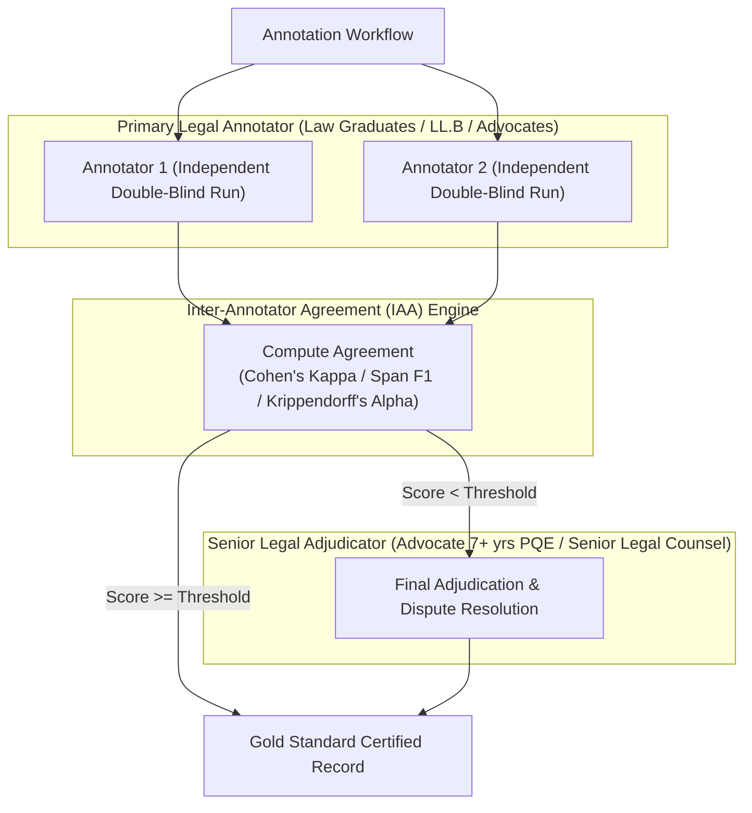

# 06. Annotation Guidelines

**Document ID:** `LEGALAI-DOC-DE-06`  
**Version:** `1.1.0`  
**Status:** Draft v1.0 — Pending Technical and Legal Review  
**Audited Date:** 2026-11-12  
**Dependencies:** `INDEX.md`, `04_CANONICAL_DATA_SCHEMAS.md`, `05_LABEL_TAXONOMY.md`, `PHASE_1_1_ISSUE_REGISTER.md`

---

## 1. Executive Summary

High-quality legal artificial intelligence requires domain-expert annotations with rigorous quality control. Because legal interpretation is subjective and nuanced, naive crowdsourcing produces noisy labels that impair model reliability.

This guideline specifies the formal annotation protocols, boundary conditions, inter-annotator agreement (IAA) thresholds, and adjudication procedures required for all dataset curation in **LegalAI**.

---

## 2. Annotator Qualifications and Roles

All annotators must belong to one of two tiers:

1. **Primary Annotators (Tier 1):** Holding an LL.B. or B.A. LL.B. degree with demonstrable proficiency in Indian contract law and civil procedure.
2. **Senior Legal Adjudicators (Tier 2):** Advocates with a minimum of 7 years post-qualification experience (PQE) or corporate legal counsels. The Adjudicator possesses final authority in resolving labeling disputes.

---

## 3. Dual-Annotator Protocol & Agreement Metrics

All training and evaluation datasets require a double-blind dual-annotation setup where Annotator 1 and Annotator 2 independently annotate the identical source document without cross-communication.

### 3.1 Inter-Annotator Agreement (IAA) Metrics

| Annotation Task | Target Metric | Minimum Acceptance Threshold | Resolution Protocol |
| :--- | :--- | :--- | :--- |
| **Clause Classification (21 `ClauseType` Classes)** | Cohen's Kappa ($\kappa$) | $\kappa \ge 0.82$ (Near-perfect agreement) | Disagreements routed to Tier 2 Adjudicator |
| **Risk Severity Rating (4 `RiskLevel` Grades)** | Weighted Cohen's Kappa ($\kappa_w$) | $\kappa_w \ge 0.85$ (Quadratic weights) | Maximum severity applied pending Adjudication |
| **Legal NER Span Boundaries (11 Classes)** | Span-level F1 @ IoU $\ge 0.80$ | $\text{F1} \ge 0.88$ | Boundary union reviewed by Adjudicator |
| **FIRAC Segment Tagging (7 Roles)** | Sentence-level Fleiss' Kappa ($\kappa_f$) | $\kappa_f \ge 0.78$ | Bench context reviewed by Senior Counsel |
| **Retrieval Relevance (0–3 Scale)** | Krippendorff's Alpha ($\alpha$) | $\alpha \ge 0.80$ | Average score taken if difference $\le 1$; else Adjudicated |

---

## 4. Task-Specific Annotation Procedures

### 4.1 Task A: Contract Clause Segmentation & Classification

1. **Boundary Demarcation:**
   - Include the clause header/numbering (e.g., `12. INDEMNITY.`) as `clause_title`.
   - The `clause_text` must capture the complete operational sentence or paragraph up to the final period before the next numbered provision.
   - Character offsets (`char_start`, `char_end`) must be recorded using **0-based Unicode code points** on the normalized text.
2. **Category Assignment:**
   - Review against the 21 canonical `ClauseType` classes in `05_LABEL_TAXONOMY.md`.
   - If a clause conflates multiple subjects (e.g., *Governing Law & Dispute Resolution*), tag the dominant subject as `clause_category` and the ancillary subject under `secondary_categories`.

### 4.2 Task B: Risk Scoring and Remediation Drafting

1. **Mandatory Perspective Lens Selection:**
   - Every risk annotation must specify the perspective lens: **Party A (`party_a`)**, **Party B (`party_b`)**, or **Neutral Legal Auditor (`neutral`)**.
2. **Scoring Rules:**
   - Mark as `critical` ($90-100$) if there is a direct statutory bar:
     - Section 27 post-term non-compete (void *ab initio*).
     - Section 28 absolute restriction on legal proceedings or curtailment of limitation periods.
     - Uncapped liability for consequential or indirect damages.
   - Mark as `high` ($70-89$) if unilateral termination without cause has zero notice, or indemnification covers ordinary negligence without a cap.
   - For damages clauses:
     - Differentiate **Section 73** (unliquidated damages, requiring proof of actual direct loss) from **Section 74** (liquidated damages / penalties, where excessive penalties are subject to judicial capping).
3. **Remediation Guidelines:**
   - The suggested revision must provide balanced language consistent with Indian commercial drafting standards.

### 4.3 Task C: Legal Named Entity Recognition (NER) (11 Classes)

1. **Boundary Inclusions:**
   - **`STATUTE`**: Capture the full official short title (e.g., `Indian Contract Act, 1872`, NOT just `Contract Act`).
   - **`SECTION`**: Include the word "Section" or "Sec." along with all sub-clauses: `Section 74(1)(a)`.
   - **`MONETARY_AMOUNT`**: Include currency descriptors: `₹1,50,00,000`, `Rs. 50 Lakhs`, `USD 10,000`.
   - **`PRECEDENT_CITATION`**: Include reporter volume, abbreviation, page, and paragraph: `(2015) 4 SCC 136`.
   - **`OBLIGATION`**: Actionable covenant clauses (e.g., `shall deliver monthly audited financial statements`).
2. **Boundary Exclusions:**
   - Exclude trailing syntactic punctuation marks (periods, commas, semicolons) that belong to grammar rather than the entity span.

### 4.4 Task D: FIRAC Case Study Decomposition

Annotators must parse judicial opinions according to the 7 canonical rhetorical roles:

1. **Facts (`facts`):** Material dispute events, contractual obligations, breach actions. Exclude lower court decree details.
2. **Ruling by Lower Court (`ruling_by_lower_court`):** Decrees of trial courts, appellate High Court benches, or tribunals.
3. **Argument (`arguments`):** Distinct legal propositions advanced by petitioner and respondent counsels.
4. **Statute (`statute`):** Legislative provisions, rules, and constitutional articles examined.
5. **Precedent (`precedent`):** Prior case law considered, followed, or distinguished.
6. **Ratio Decidendi (`ratio_decidendi`):** The binding legal principle necessary to resolve the dispute (verified using Wambaugh's Inversion Test).
7. **Ruling by Present Court (`holding` / `disposition`):** Operative order (appeal allowed/dismissed, decree set aside, costs).

---

## 5. Curation of Gold-Certified Benchmarks

To guarantee clean evaluation:
1. **100% Expert Adjudication:** 100% of samples designated for `data/gold/benchmarks/` must be vetted by a Tier 2 Senior Legal Adjudicator.
2. **Zero Synthetic Blend in Golden Sets:** No synthetic or LLM-generated clause may be placed in the gold test set without explicit provenance metadata tagging (`is_synthetic: true`).
3. **Immutability:** Once certified, gold evaluation partitions are sealed with SHA-256 integrity checksums and locked against modifications.
