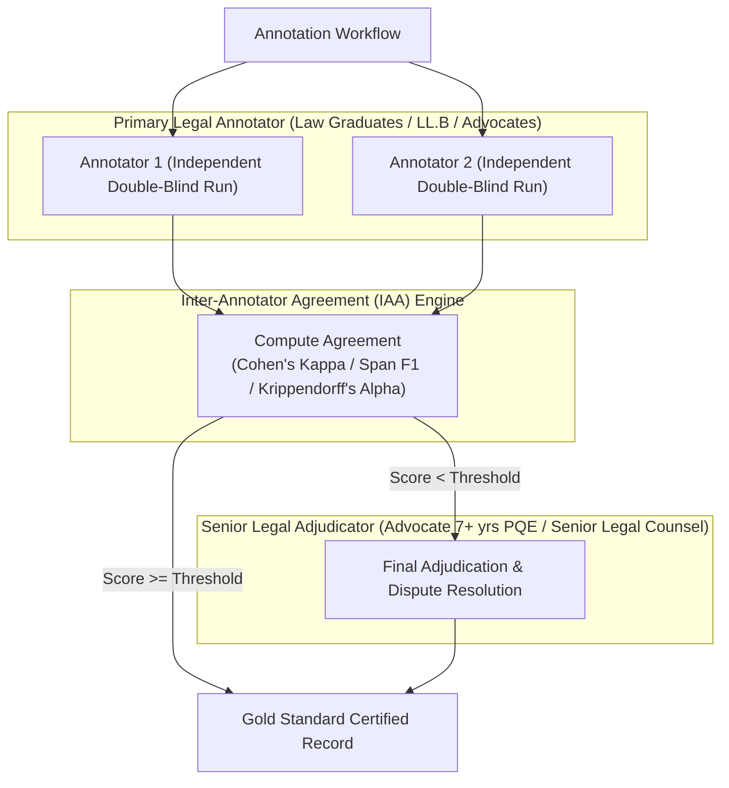
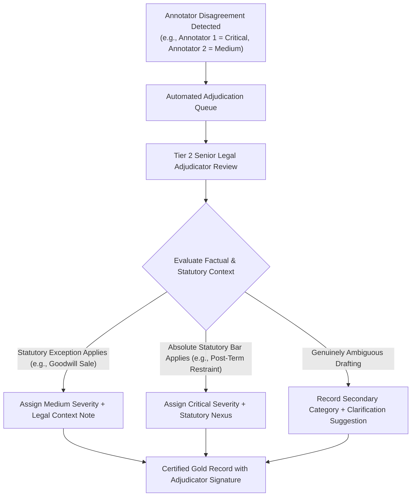

# 06. Annotation Guidelines

**Document ID:** `LEGALAI-DOC-DE-06`  
**Version:** `1.2.0`  
**Status:** Draft v1.0 — Pending Technical and Legal Review  
**Audited Date:** 2026-11-13  
**Dependencies:** `INDEX.md`, `04_CANONICAL_DATA_SCHEMAS.md`, `05_LABEL_TAXONOMY.md`, `PHASE_1_2_EVIDENCE_REGISTER.md`

---

## 1. Executive Summary

High-quality legal artificial intelligence requires domain-expert annotations with rigorous quality control. Because legal interpretation is subjective and nuanced, naive crowdsourcing produces noisy labels that impair model reliability.

This guideline specifies the formal annotation protocols, boundary conditions, inter-annotator agreement (IAA) thresholds, contextual examples, and adjudication procedures required for all dataset curation in **LegalAI**.

---

## 2. Annotator Qualifications and Roles

All annotators must belong to one of two tiers:

1. **Primary Annotators (Tier 1):** Holding an LL.B. or B.A. LL.B. degree with demonstrable proficiency in Indian contract law and civil procedure.
2. **Senior Legal Adjudicators (Tier 2):** Advocates with a minimum of 7 years post-qualification experience (PQE) or corporate legal counsels. The Adjudicator possesses final authority in resolving labeling disputes.

---

## 3. Dual-Annotator Protocol & Agreement Metrics

All training and evaluation datasets require a double-blind dual-annotation setup where Annotator 1 and Annotator 2 independently annotate the identical source document without cross-communication.

| Annotation Task | Target Metric | Minimum Acceptance Threshold | Resolution Protocol |
| :--- | :--- | :--- | :--- |
| **Clause Classification (21 `ClauseType` Classes)** | Cohen's Kappa ($\kappa$) | $\kappa \ge 0.82$ (Near-perfect agreement) | Disagreements routed to Tier 2 Adjudicator |
| **Risk Severity Rating (4 `RiskLevel` Grades)** | Weighted Cohen's Kappa ($\kappa_w$) | $\kappa_w \ge 0.85$ (Quadratic weights) | Maximum severity applied pending Adjudication |
| **Legal NER Span Boundaries (11 Classes)** | Span-level F1 @ IoU $\ge 0.80$ | $\text{F1} \ge 0.88$ | Boundary union reviewed by Adjudicator |
| **FIRAC Segment Tagging (7 Roles)** | Sentence-level Fleiss' Kappa ($\kappa_f$) | $\kappa_f \ge 0.78$ | Bench context reviewed by Senior Counsel |
| **Retrieval Relevance (0–3 Scale)** | Krippendorff's Alpha ($\alpha$) | $\alpha \ge 0.80$ | Average score taken if difference $\le 1$; else Adjudicated |

---

## 4. Exemplar Annotation Criteria for Critical & High-Risk Clauses

To prevent annotator drift and subjective inconsistency, annotators must adhere to standardized inclusion, exclusion, and contextual criteria:

### 4.1 Non-Compete Clauses (`Non-Compete`, Section 27 ICA)
* **Inclusion Criteria:** Provisions restraining a party from carrying on a profession, trade, business, or competitive employment.
* **Exclusion Criteria:** Confidentiality obligations, non-solicitation of employees (which does not completely bar trade), or non-circumvention clauses.
* **Positive Example (Critical Risk):** *"For a period of 24 months following the termination of this Agreement, the Executive shall not directly or indirectly engage in any business competing with the Company within India."* (Post-termination; void under Section 27 per *Percept D'Mark*).
* **Negative Example (Valid / Low Risk):** *"During the term of employment, the Employee shall devote their whole time exclusively to the business of the Company and shall not engage in any other business or vocation."* (Valid during employment per *Niranjan Shankar Golikari*).
* **Ambiguous Example (Medium / High Risk):** *"The Service Provider covenants not to provide similar IT consulting services to any entity operating in the same sector for 6 months post-termination, unless prior written consent is obtained."*
* **Escalation Rule:** If restraint is post-termination, tag as `critical` under Party B lens; if during employment, tag as `low`/`medium`. If linked to sale of business goodwill, tag as `medium` and escalate to Tier 2 Adjudicator to evaluate local reasonableness.

### 4.2 Limitation of Liability Clauses (`Liability`, Sections 73-74 ICA)
* **Inclusion Criteria:** Terms establishing monetary caps, excluding direct or indirect damages, or disclaiming statutory warranties.
* **Positive Example (High / Critical Risk):** *"In no event shall the Vendor's total aggregate liability exceed INR 1,000, and Customer hereby waives all claims for direct, indirect, punitive, or statutory damages."* (Grossly disproportionate cap; unconscionable under commercial standards).
* **Negative Example (Standard / Balanced):** *"Each party's total aggregate liability arising out of or related to this Agreement shall be limited to the total fees paid or payable by Customer in the twelve (12) months preceding the incident."* (Commercially standard 12-month trailing cap).
* **Escalation Rule:** If liability is completely uncapped for indemnification while capped for all other breaches, tag asymmetry under the affected party lens.

---

## 5. Formal Adjudication & Human Escalation Workflow

When double-blind annotations diverge below threshold ($\kappa < 0.82$):

---

## 6. Curation of Gold-Certified Benchmarks

To guarantee clean evaluation:
1. **100% Expert Adjudication:** 100% of samples designated for `data/gold/benchmarks/` must be vetted by a Tier 2 Senior Legal Adjudicator.
2. **Zero Synthetic Blend in Golden Sets:** No synthetic or LLM-generated clause may be placed in the gold test set without explicit provenance metadata tagging (`is_synthetic: true`).
3. **Immutability:** Once certified, gold evaluation partitions are sealed with SHA-256 integrity checksums and locked against modifications.
