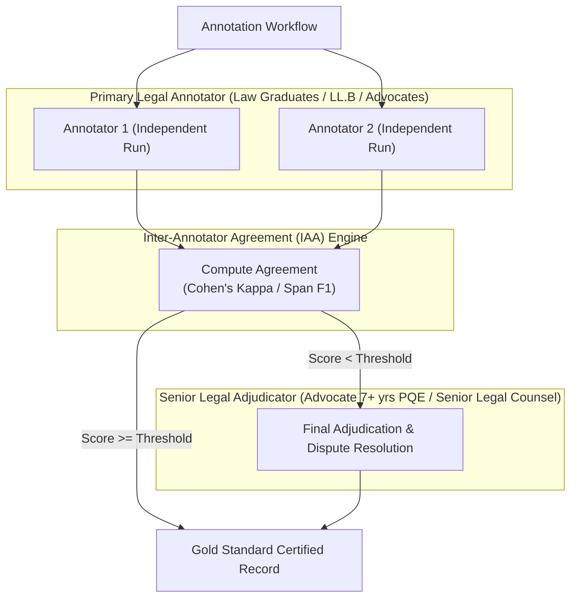

# 06. Annotation Guidelines

**Document ID:** `LEGALAI-DOC-DE-06`  
**Version:** `1.0.0`  
**Status:** Canonical Annotation Standard  
**Dependencies:** `INDEX.md`, `04_CANONICAL_DATA_SCHEMAS.md`, `05_LABEL_TAXONOMY.md`

---

## 1. Executive Summary

High-quality legal artificial intelligence requires domain-expert annotations with rigorous quality control. Because legal interpretation is subjective and nuanced, naive crowdsourcing produces noisy labels that impair model reliability.

This guideline specifies the formal annotation protocols, boundary conditions, inter-annotator agreement (IAA) thresholds, and adjudication procedures required for all dataset curation in **LegalAI**.

---

## 2. Annotator Qualifications and Roles

All annotators must belong to one of two tiers:

1. **Primary Annotators (Tier 1):** Holding an LL.B. or B.A. LL.B. degree with demonstrable proficiency in Indian contract law and civil procedure.
2. **Senior Legal Adjudicators (Tier 2):** Advocates with a minimum of 7 years post-qualification experience (PQE) or corporate legal counsels. The Adjudicator possesses final authority in resolving labeling disputes.

---

## 3. Dual-Annotator Protocol & Agreement Metrics

All training and evaluation datasets require a double-blind dual-annotation setup where Annotator 1 and Annotator 2 independently annotate the identical source document without cross-communication.

### 3.1 Inter-Annotator Agreement (IAA) Metrics

| Annotation Task | Target Metric | Minimum Acceptance Threshold | Resolution Protocol |
| :--- | :--- | :--- | :--- |
| **Clause Classification (21 Classes)** | Cohen's Kappa ($\kappa$) | $\kappa \ge 0.82$ (Near-perfect agreement) | Disagreements routed to Tier 2 Adjudicator |
| **Risk Severity Rating (4 Levels)** | Weighted Cohen's Kappa ($\kappa_w$) | $\kappa_w \ge 0.85$ (Quadratic weights) | Maximum severity applied pending Adjudication |
| **Legal NER Span Boundaries** | Span-level F1 @ IoU $\ge 0.80$ | $\text{F1} \ge 0.88$ | Boundary union reviewed by Adjudicator |
| **FIRAC Segment Tagging** | Sentence-level Fleiss' Kappa ($\kappa_f$) | $\kappa_f \ge 0.78$ | Bench context reviewed by Senior Counsel |
| **Retrieval Relevance (0–3 Scale)** | Krippendorff's Alpha ($\alpha$) | $\alpha \ge 0.80$ | Average score taken if difference $\le 1$; else Adjudicated |

### 3.2 Mathematical Formulation of Thresholds

1. **Cohen's Kappa ($\kappa$):**
   $$\kappa = \frac{P_o - P_e}{1 - P_e}$$
   where $P_o$ is the relative observed agreement among annotators, and $P_e$ is the hypothetical probability of chance agreement. Any dataset slice with $\kappa < 0.70$ is unconditionally rejected and re-annotated from scratch with revised guidelines.

2. **Intersection over Union (IoU) for NER Spans:**
   $$\text{IoU}(S_1, S_2) = \frac{|S_1 \cap S_2|}{|S_1 \cup S_2|}$$
   where $S_1$ and $S_2$ are character span ranges. Exact boundary matches ($\text{IoU} = 1.0$) are enforced for statutory section numbers and monetary amounts.

---

## 4. Task-Specific Annotation Procedures

### 4.1 Task A: Contract Clause Segmentation & Classification

1. **Boundary Demarcation:**
   - Include the clause header/numbering (e.g., `12. INDEMNITY.`) as `clause_title`.
   - The `clause_text` must capture the complete operational sentence or paragraph up to the final period before the next numbered provision.
   - Do not truncate sub-clauses (e.g., `12.1`, `12.2`) if they form a single conceptual obligation; otherwise, segment them into atomic sibling clauses.
2. **Category Assignment:**
   - Review against the 21 classes in `05_LABEL_TAXONOMY.md`.
   - If a clause conflates multiple subjects (e.g., *Governing Law & Dispute Resolution* merged into one paragraph), tag the dominant subject as `clause_category` and the ancillary subject under `secondary_categories`.

### 4.2 Task B: Risk Scoring and Remediation Drafting

1. **Perspective Lens Standard:**
   - Annotations must indicate perspective: **Party A (e.g., Vendor/Licensor)**, **Party B (e.g., Customer/Licensee)**, or **Neutral Legal Auditor**.
2. **Scoring Rules:**
   - Mark as `critical` ($90-100$) if there is a direct statutory bar (e.g., Section 27 post-term non-compete, or absolute restraint of legal proceedings under Section 28).
   - Mark as `high` ($70-89$) if unilateral termination without cause is permitted with zero notice, or uncapped indemnification covers indirect third-party claims.
3. **Remediation Guidelines:**
   - The suggested revision must provide balanced language consistent with standard Indian commercial drafting (e.g., *"Subject to a mutual 30-day written notice period..."* or *"Excluding indirect, special, or consequential damages..."*).

### 4.3 Task C: Legal Named Entity Recognition (NER)

1. **Boundary Inclusions:**
   - **`STATUTE`**: Capture the full official short title (e.g., `Indian Contract Act, 1872`, NOT just `Contract Act`).
   - **`SECTION`**: Include the word "Section" or "Sec." along with all sub-clauses: `Section 73(1)(a)`.
   - **`MONETARY_AMOUNT`**: Include currency descriptors: `₹1,50,00,000`, `Rs. 50 Lakhs`, `USD 10,000`.
   - **`PRECEDENT_CITATION`**: Include reporter volume, abbreviation, page, and paragraph: `(2014) 5 SCC 438, at para 14`.
2. **Boundary Exclusions:**
   - Exclude trailing punctuation marks (periods, commas, semicolons) that belong to syntactic grammar rather than the entity token.

### 4.4 Task D: FIRAC Case Study Decomposition

Annotators must parse judicial opinions according to the 7 rhetorical roles:

1. **Facts (`facts`):**
   - Tag factual background, underlying commercial agreements, performance disputes, and cause of action. Do not include lower court rulings in this section.
2. **Procedural History (`procedural_history`):**
   - Trace the jurisdictional route: e.g., Trial Court suit $\rightarrow$ High Court First Appeal $\rightarrow$ Supreme Court Special Leave Petition (SLP) under Article 136.
3. **Legal Issues (`legal_issues`):**
   - Frame as explicit questions of law: e.g., *"Whether Section 56 of the Indian Contract Act applies to leases of immovable property?"*
4. **Ratio Decidendi (`ratio_decidendi`):**
   - **Strict Rule:** Must represent the *necessary legal principle* upon which the dispute was decided. 
   - **Negative Rule:** Exclude hypothetical digressions, historical surveys of English common law, or general remarks on judicial philosophy (these belong to `obiter_dicta`).
5. **Holding / Outcome (`holding`):**
   - Capture the final operational order: Appeal allowed / dismissed; decree set aside; costs awarded.

---

## 5. Curation of Gold-Certified Benchmarks

To guarantee clean evaluation:
1. **100% Expert Adjudication:** 100% of samples designated for `data/gold/benchmarks/` must be vetted by a Tier 2 Senior Legal Adjudicator.
2. **Zero Synthetic Blend in Golden Sets:** No synthetic or LLM-generated clause may be placed in the gold test set without explicit provenance metadata tagging.
3. **Immutability:** Once certified, gold evaluation partitions are sealed with SHA-256 integrity checksums and locked against modifications.

