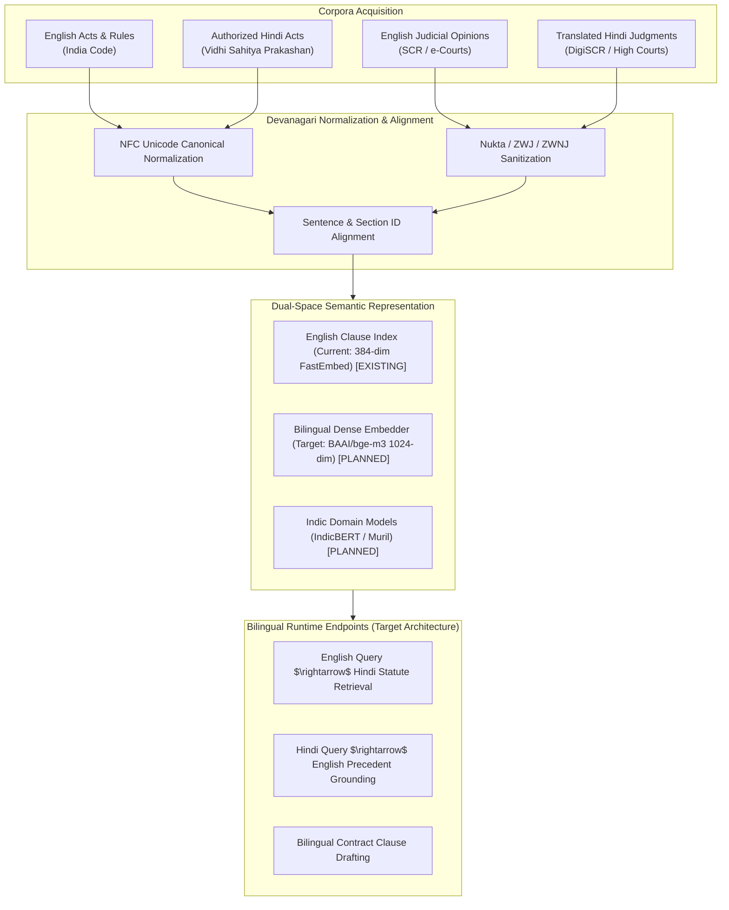
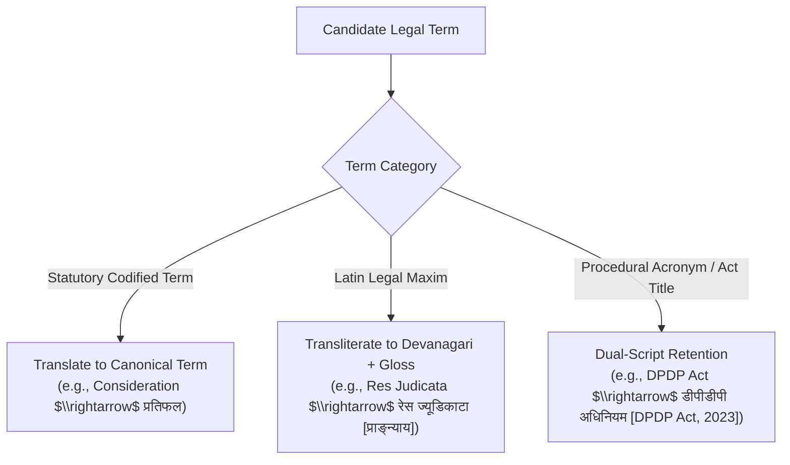

# 07. Bilingual Data Strategy (English & Hindi)

**Document ID:** `LEGALAI-DOC-DE-07`  
**Version:** `1.1.0`  
**Status:** Draft v1.0 — Pending Technical and Legal Review  
**Audited Date:** 2026-11-12  
**Target Languages:** English (`en`), Hindi (`hi`, Devanagari script)  
**Dependencies:** `INDEX.md`, `01_DATASET_ARCHITECTURE.md`, `04_CANONICAL_DATA_SCHEMAS.md`, `PHASE_1_1_ISSUE_REGISTER.md`

---

## 1. Executive Summary

In India's judicial ecosystem, while the Supreme Court and corporate arbitration predominantly function in English, substantial portions of commercial documentation, state-level subordinate litigation, government procurement tenders, and consumer notices operate in Hindi and regional languages. Article 348 of the Constitution of India and Section 5 of the *Official Languages Act, 1963* mandate the publication of authorized Hindi translations of all Central Acts and ordinances.

This strategy establishes the foundation for **LegalAI's Bilingual Intelligence Engine**, ensuring that Hindi is integrated natively into statutory retrieval, clause analysis, and conversational drafting without degradation or superficial machine translation artifacts.

---

## 2. Bilingual Architecture Topology

---

## 3. Official Parallel Statutory Corpora

To establish unambiguous statutory grounding, LegalAI builds directly upon authorized Hindi translations published by the **Legislative Department, Ministry of Law and Justice, Government of India**:

1. **The Official Language (Legislative) Commission Data:**
   - Source: Official Gazettes & *Vidhi Sahitya Prakashan* publications.
   - Authoritative Character: Per Section 5(1) of the *Official Languages Act, 1963*, a translation in Hindi published under the authority of the President in the Official Gazette is deemed to be the authoritative text in Hindi.
2. **Alignment Strategy:**
   - Central statutes (e.g., *Indian Contract Act, 1872*, *Companies Act, 2013*, *Arbitration and Conciliation Act, 1996*) are aligned at the **Section**, **Sub-Section**, and **Proviso** level using canonical alphanumeric identifiers (e.g., `ICA-1872-SEC-027`).
   - Each record pairs `section_text_en` with its statutory twin `section_text_hi`, establishing parallel training and vector-grounding anchors.

---

## 4. Legal Terminology Lexicon (Canonical Glossary)

Generic translation engines fail drastically in legal domains by translating technical terms into colloquial vernacular (e.g., translating legal *Consideration* into *विचार* instead of *प्रतिफल*).

The LegalAI platform enforces the following verified canonical legal terminology dictionary:

| English Legal Term | Canonical Hindi Translation (राजभाषा मानक) | Colloquial Trap to Avoid | Statutory Nexus |
| :--- | :--- | :--- | :--- |
| **Consideration** | **प्रतिफल (Pratifal)** | विचार (Vichar) | Sec 2(d), Indian Contract Act |
| **Indemnity / Indemnify** | **क्षतिपूर्ति (Kshatipoorti)** | मुआवजा (Muawza) | Sec 124, Indian Contract Act |
| **Liquidated Damages** | **परिनिर्धारित नुकसानी (Parinirdharit Nuksaani)** | तय हर्जाना | Sec 74, Indian Contract Act |
| **Injunction** | **व्यादेश (Vyadesh)** | रोक / स्टे | Specific Relief Act, 1963 |
| **Void ab initio** | **प्रारंभतः शून्य (Prarambhatah Shunya)** | शुरुआत से रद्द | Sec 11 & 23, Contract Act |
| **Breach of Contract** | **संविदा-भंग (Samvida-Bhang)** | अनुबंध तोड़ना | Sec 73, Indian Contract Act |
| **Free Consent** | **स्वतंत्र सम्मति (Swatantra Sammati)** | खुली सहमति | Sec 14, Indian Contract Act |
| **Specific Performance** | **विनिर्दिष्ट पालन (Vinirdisht Paalan)** | खास काम करना | Sec 10, Specific Relief Act |
| **Restraint of Trade** | **व्यापार में अवरोध (Vyapaar mein Avarodh)** | धंधे पर रोक | Sec 27, Indian Contract Act |
| **Novation** | **नवीयन (Naveeyan)** | नया करना | Sec 62, Indian Contract Act |
| **Jurisdiction** | **अधिकारिता / क्षेत्राधिकार (Adhikarita)** | इलाका | Code of Civil Procedure, 1908 |
| **Petitioner / Plaintiff** | **याचिकाकर्ता / वादी (Yachikakarta / Vaadi)** | अर्जीदार | High Court / Supreme Court Rules |
| **Respondent / Defendant** | **प्रत्यर्थी / प्रतिवादी (Pratyarthi / Prativadi)** | विपक्षी | High Court / Supreme Court Rules |
| **Ratio Decidendi** | **विनिश्चय-आधार (Vinishchay-Aadhaar)** | फैसले की वजह | Judicial Precedent Doctrine |
| **Obiter Dicta** | **इतरोक्ति (Itarokti)** | जज की राय | Common Law Jurisprudence |
| **Force Majeure** | **अप्रत्याशित घटना (Apratyashit Ghatna)** | ईश्वरीय प्रकोप | Sec 56, Indian Contract Act |
| **Severability** | **पृथक्करणीयता (Prithakkaraneyata)** | अलग करना | Standard Contract Boilerplate |
| **Waiver** | **अधित्यजन (Adhityajan)** | छोड़ना | Sec 63, Indian Contract Act |
| **Quash** | **अखंडित करना / निरस्त करना (Nirast Karna)** | रद्द करना | Art 226 / Sec 482 CrPC |
| **Ad interim** | **अंतरिम (Antarim)** | कामचलाऊ | CPC Order 39 |

---

## 5. Script & Character Normalization Rules

Devanagari text in digital court filings is often subject to font encoding corruptions (e.g., legacy KrutiDev / Chanakya fonts converted to Unicode) and diacritic inconsistencies.

### 5.1 Unicode Normalization (NFC Standard)
All incoming Hindi strings must undergo deterministic Unicode Normalization Form C (`NFC`):
$$\text{Text}_{\text{normalized}} = \text{unicodedata.normalize}('NFC', \text{RawHindiText})$$

### 5.2 Nukta and Zero-Width Character Sanitization
1. **Nukta Normalization:** Unify composite vs. decomposed characters (e.g., `क़` (`\u0915\u093c`) $\rightarrow$ unified glyph).
2. **Zero-Width Joiner (ZWJ) and Non-Joiner (ZWNJ):**
   - Retain ZWJ (`\u200D`) and ZWNJ (`\u200C`) only when syntactically required for conjunct consonants in legal terms (e.g., *न्यायालय*, *सम्प्रति*).
   - Strip stray or consecutive invisible characters.
3. **Punctuation Standards:**
   - Map Western pipe (`|`) to the Devanagari Purna Viram (पूर्ण विराम, `\u0964`).
   - Standardize Devanagari numerals (`०-९`) with automatic dual-mapping to Arabic numerals (`0-9`) for dates and statutory section queries.

---

## 6. Transliteration vs. Translation Protocol

Certain legal concepts, procedural writs, and Latin legal maxims must **not** be translated literally into Hindi:

1. **Latin Doctrines:** Transliterate phonetically into Devanagari followed by the statutory Hindi equivalent in brackets:
   - *Res Judicata* $\rightarrow$ **रेस ज्यूडिकाटा (प्राङ्न्याय)**
   - *Habeas Corpus* $\rightarrow$ **हेबियस कॉर्पस (बंदी प्रत्यक्षीकरण)**
   - *Quo Warranto* $\rightarrow$ **कुओ वारंटो (अधिकार पृच्छा)**
   - *Caveat Emptor* $\rightarrow$ **कैविएट एम्प्टर (क्रेता सावधान)**
2. **Statute Titles:** Retain both English short title and Devanagari title in vector payloads:
   - `The Information Technology Act, 2000` $\leftrightarrow$ `सूचना प्रौद्योगिकी अधिनियम, 2000`

---

## 7. Cross-Lingual Embedding & Retrieval Strategy

To support seamless cross-lingual retrieval (e.g., user queries in Hindi: *"क्या संविदा में गैर-प्रतिस्पर्धा खंड वैध है?"* and the system retrieves English precedents on Section 27):

1. **Shared Multilingual Vector Space (Phase 2/3 Target):**
   - The current production codebase uses monolingual 384-dim `BAAI/bge-small-en-v1.5`.
   - The planned upgrade incorporates native multilingual dense models: **`BAAI/bge-m3`** (1024-dimensional) or **`intfloat/multilingual-e5-base`** (768-dimensional).
2. **Cross-Lingual Leakage Safeguards:**
   - Cross-lingual leakage cannot be detected by character n-grams due to distinct scripts (Latin vs. Devanagari).
   - Invariance is maintained by co-locating parallel English and Hindi sections under the same document split identifier (`document_id`).
