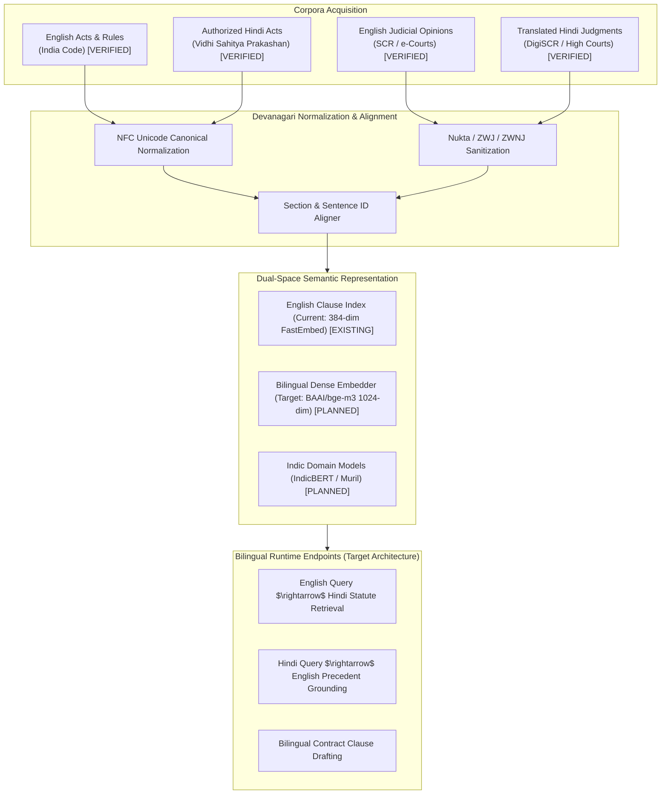

# 07. Bilingual Data Strategy (English & Hindi)

**Document ID:** `LEGALAI-DOC-DE-07`  
**Version:** `1.2.0`  
**Status:** Draft v1.0 — Pending Technical and Legal Review  
**Audited Date:** 2026-11-13  
**Target Languages:** English (`en`), Hindi (`hi`, Devanagari script)  
**Dependencies:** `INDEX.md`, `01_DATASET_ARCHITECTURE.md`, `04_CANONICAL_DATA_SCHEMAS.md`, `PHASE_1_2_EVIDENCE_REGISTER.md`

---

## 1. Executive Summary

In India's judicial ecosystem, while the Supreme Court and corporate arbitration predominantly function in English, substantial portions of commercial documentation, state-level subordinate litigation, government procurement tenders, and consumer notices operate in Hindi and regional languages.

This strategy establishes the foundation for **LegalAI's Bilingual Intelligence Engine**, ensuring that Hindi is integrated natively into statutory retrieval, clause analysis, and conversational drafting without degradation or superficial machine translation artifacts, while accurately reflecting the constitutional and statutory status of Hindi translations.

---

## 2. Constitutional & Statutory Status of Bilingual Texts

### 2.1 Article 348 of the Constitution of India (English Primacy)
Under Article 348(1)(b)(ii) of the Constitution of India, the authoritative text of all Bills, Acts of Parliament, Ordinances, and subordinate rules passed by Parliament must be in the **English language** until Parliament by law otherwise provides.

### 2.2 Section 5(1) of the Official Languages Act, 1963 (Authoritative Hindi Text)
Section 5(1) of the *Official Languages Act, 1963* provides:
> *"A translation in Hindi published under the authority of the President in the Official Gazette on and after the appointed day—*  
> *(a) of any Central Act or of any Ordinance promulgated by the President, or*  
> *(b) of any order, rule, regulation or bye-law issued under the Constitution or under any Central Act,*  
> *shall be deemed to be the authoritative text thereof in Hindi."*

**Legal & Operational Implications:**
1. **Authoritative Status:** Publication in the Gazette under Presidential authority creates an authorized legal text in Hindi for official and judicial reference.
2. **Absence of Universal Obligation:** Section 5(1) does **not** create an automatic, self-executing statutory mandate that every single Central Act, state law, ordinance, or administrative notification must immediately have an authorized Hindi translation published simultaneously.
3. **Dataset Collection Reality:** Bilingual statutory ingestion cannot assume universal coverage across all 850+ Central Acts. Ingestion pipelines prioritize available authorized translations published by *Vidhi Sahitya Prakashan* (Legislative Department, Ministry of Law and Justice) for core civil, commercial, and penal enactments, treating coverage as selective and expanding rather than universally complete.

---

## 3. Bilingual Architecture Topology

---

## 4. Legal Terminology Lexicon (Canonical Glossary)

Generic translation engines fail drastically in legal domains by translating technical terms into colloquial vernacular (e.g., translating legal *Consideration* into *विचार* instead of *प्रतिफल*).

The LegalAI platform enforces the following verified canonical legal terminology dictionary:

| English Legal Term | Canonical Hindi Translation (राजभाषा मानक) | Colloquial Trap to Avoid | Statutory Nexus |
| :--- | :--- | :--- | :--- |
| **Consideration** | **प्रतिफल (Pratifal)** | विचार (Vichar) | Sec 2(d), Indian Contract Act |
| **Indemnity / Indemnify** | **क्षतिपूर्ति (Kshatipoorti)** | मुआवजा (Muawza) | Sec 124, Indian Contract Act |
| **Liquidated Damages** | **परिनिर्धारित नुकसानी (Parinirdharit Nuksaani)** | तय हर्जाना | Sec 74, Indian Contract Act |
| **Injunction** | **व्यादेश (Vyadesh)** | रोक / स्टे | Specific Relief Act, 1963 |
| **Void ab initio** | **प्रारंभतः शून्य (Prarambhatah Shunya)** | शुरुआत से रद्द | Sec 11 & 23, Contract Act |
| **Breach of Contract** | **संविदा-भंग (Samvida-Bhang)** | अनुबंध तोड़ना | Sec 73, Indian Contract Act |
| **Free Consent** | **स्वतंत्र सम्मति (Swatantra Sammati)** | खुली सहमति | Sec 14, Indian Contract Act |
| **Specific Performance** | **विनिर्दिष्ट पालन (Vinirdisht Paalan)** | खास काम करना | Sec 10, Specific Relief Act |
| **Restraint of Trade** | **व्यापार में अवरोध (Vyapaar mein Avarodh)** | धंधे पर रोक | Sec 27, Indian Contract Act |
| **Novation** | **नवीयन (Naveeyan)** | नया करना | Sec 62, Indian Contract Act |
| **Jurisdiction** | **अधिकारिता / क्षेत्राधिकार (Adhikarita)** | इलाका | Code of Civil Procedure, 1908 |
| **Petitioner / Plaintiff** | **याचिकाकर्ता / वादी (Yachikakarta / Vaadi)** | अर्जीदार | High Court / Supreme Court Rules |
| **Respondent / Defendant** | **प्रत्यर्थी / प्रतिवादी (Pratyarthi / Prativadi)** | विपक्षी | High Court / Supreme Court Rules |
| **Ratio Decidendi** | **विनिश्चय-आधार (Vinishchay-Aadhaar)** | फैसले की वजह | Judicial Precedent Doctrine |
| **Obiter Dicta** | **इतरोक्ति (Itarokti)** | जज की राय | Common Law Jurisprudence |
| **Force Majeure** | **अप्रत्याशित घटना (Apratyashit Ghatna)** | ईश्वरीय प्रकोप | Sec 56, Indian Contract Act |
| **Severability** | **पृथक्करणीयता (Prithakkaraneyata)** | अलग करना | Standard Contract Boilerplate |
| **Waiver** | **अधित्यजन (Adhityajan)** | छोड़ना | Sec 63, Indian Contract Act |
| **Quash** | **अखंडित करना / निरस्त करना (Nirast Karna)** | रद्द करना | Art 226 / Sec 482 CrPC |
| **Ad interim** | **अंतरिम (Antarim)** | कामचलाऊ | CPC Order 39 |

---

## 5. Script & Character Normalization Rules

### 5.1 Unicode Normalization (NFC Standard)
All incoming Hindi strings must undergo deterministic Unicode Normalization Form C (`NFC`):
$$\text{Text}_{\text{normalized}} = \text{unicodedata.normalize}('NFC', \text{RawHindiText})$$

### 5.2 Nukta and Zero-Width Character Sanitization
1. **Nukta Normalization:** Unify composite vs. decomposed characters (e.g., `क़` (`\u0915\u093c`) $\rightarrow$ unified glyph).
2. **Zero-Width Joiner (ZWJ) and Non-Joiner (ZWNJ):**
   - Retain ZWJ (`\u200D`) and ZWNJ (`\u200C`) only when syntactically required for conjunct consonants in legal terms (e.g., *न्यायालय*, *सम्प्रति*).
   - Strip stray or consecutive invisible characters.
3. **Punctuation Standards:**
   - Map Western pipe (`|`) to the Devanagari Purna Viram (पूर्ण विराम, `\u0964`).
   - Standardize Devanagari numerals (`०-९`) with automatic dual-mapping to Arabic numerals (`0-9`) for dates and statutory section queries.

---

## 6. Transliteration vs. Translation Protocol

Certain legal concepts, procedural writs, and Latin legal maxims must **not** be translated literally into Hindi:

1. **Latin Doctrines:** Transliterate phonetically into Devanagari followed by the statutory Hindi equivalent in brackets:
   - *Res Judicata* $\rightarrow$ **रेस ज्यूडिकाटा (प्राङ्न्याय)**
   - *Habeas Corpus* $\rightarrow$ **हेबियस कॉर्पस (बंदी प्रत्यक्षीकरण)**
   - *Quo Warranto* $\rightarrow$ **कुओ वारंटो (अधिकार पृच्छा)**
   - *Caveat Emptor* $\rightarrow$ **कैविएट एम्प्टर (क्रेता सावधान)**
2. **Statute Titles:** Retain both English short title and Devanagari title in vector payloads:
   - `The Information Technology Act, 2000` $\leftrightarrow$ `सूचना प्रौद्योगिकी अधिनियम, 2000`

---

## 7. Cross-Lingual Embedding & Retrieval Strategy

To support seamless cross-lingual retrieval (e.g., user queries in Hindi: *"क्या संविदा में गैर-प्रतिस्पर्धा खंड वैध है?"* and the system retrieves English precedents on Section 27):

1. **Shared Multilingual Vector Space (Phase 2/3 Target):**
   - Current codebase uses monolingual 384-dim `BAAI/bge-small-en-v1.5`.
   - Planned upgrade incorporates native multilingual dense models: **`BAAI/bge-m3`** (1024-dimensional) or **`intfloat/multilingual-e5-base`** (768-dimensional).
2. **Cross-Lingual Leakage Safeguards:**
   - Invariance is maintained by co-locating parallel English and Hindi sections under the same document split identifier (`document_id`), audited via semantic cosine checks ($\text{CosineSim} \ge 0.88$).
