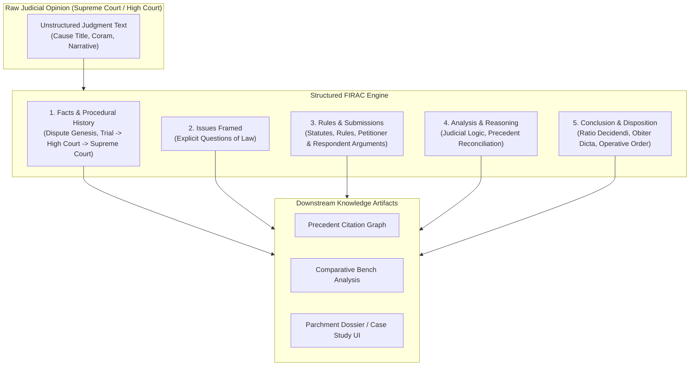
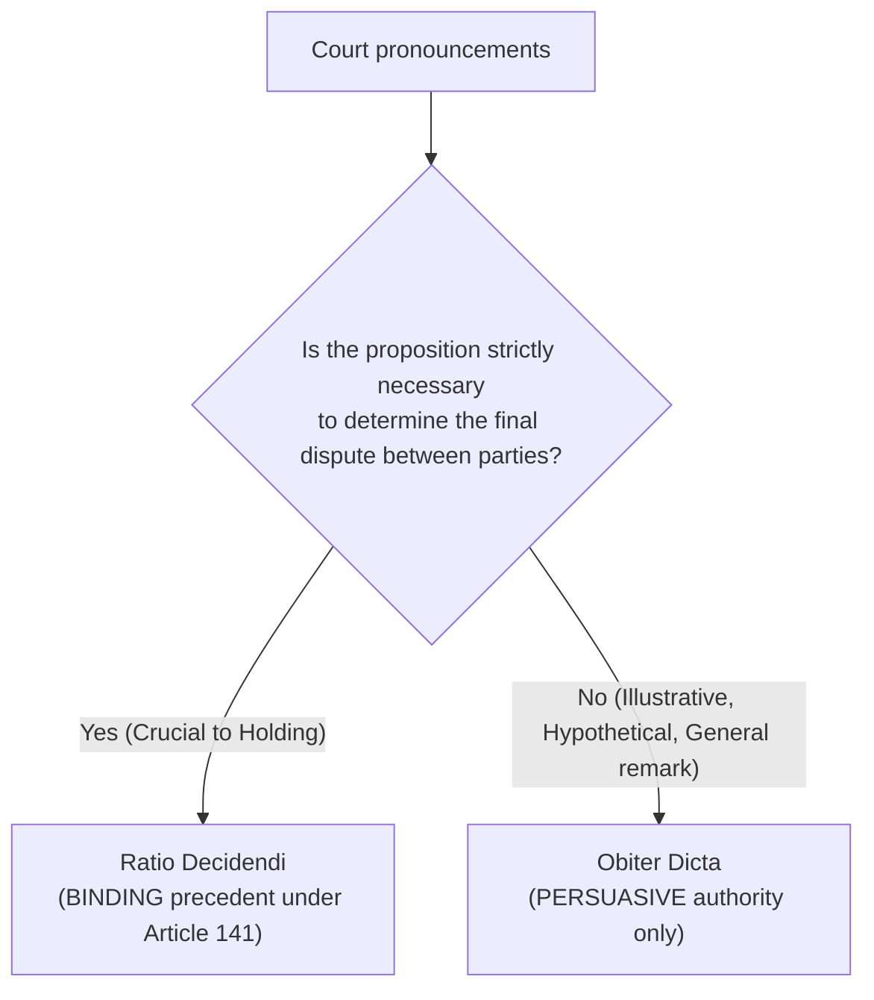
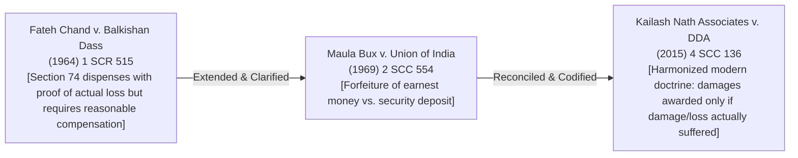

# 08. Case Study Data Specification

**Document ID:** `LEGALAI-DOC-DE-08`  
**Version:** `1.1.0`  
**Status:** Draft v1.0 — Pending Technical and Legal Review  
**Audited Date:** 2026-11-12  
**Dependencies:** `INDEX.md`, `04_CANONICAL_DATA_SCHEMAS.md#realjudgmentcasestudyrecord`, `05_LABEL_TAXONOMY.md`, `PHASE_1_1_ISSUE_REGISTER.md`

---

## 1. Executive Summary

Legal analysis in India is fundamentally governed by the doctrine of precedent (*Stare Decisis*) enshrined in **Article 141 of the Constitution of India**, which mandates that the law declared by the Supreme Court shall be binding on all courts within the territory of India.

However, judicial opinions are frequently delivered as 50-to-200-page unstructured narrative documents intertwining factual recitations, oral submissions, comparative common-law surveys, historical jurisprudence, and operational orders.

This specification establishes the canonical engineering data model for **Structured FIRAC (Facts, Issues, Rules/Arguments, Analysis, Conclusion)** decomposition, ratio vs. obiter separation, precedent citation graphs, and comparative case study generation.

---

## 2. Structured FIRAC / IRAC Framework

Every judicial case study in the Gold lakehouse tier conforms to the following decomposed structure:

---

## 3. Detailed Component Decomposition Standards

### 3.1 Facts & Procedural History (`facts`, `procedural_history`)
1. **Material Facts Only:** Capture the actionable commercial or civil events giving rise to the controversy (e.g., date of execution, breach event, default notice issued, invocation of bank guarantee).
2. **Exclusion of Redundancies:** Exclude administrative interlocutory listing dates and procedural adjournments.
3. **Procedural Lineage:** Must record the exact jurisdictional hierarchy:
   $$\text{Original Civil Court} \xrightarrow{\text{First Appeal}} \text{High Court (Single Bench)} \xrightarrow{\text{Letters Patent Appeal}} \text{High Court (Division Bench)} \xrightarrow{\text{Article 136 SLP}} \text{Supreme Court}$$

### 3.2 Legal Issues Framed (`legal_issues`)
- Must be framed as discrete, interrogative propositions of law.
- **Example Standard:**
  > *"Whether the doctrine of frustration under Section 56 of the Indian Contract Act, 1872 applies to a lease of immovable property where the lessee has been put in possession?"*

### 3.3 Arguments and Submissions (`petitioner_arguments`, `respondent_arguments`)
- Deconstruct arguments into distinct proposition nodes:
  - **Proposition:** The core legal contention advanced by counsel.
  - **Statutory Grounds:** Specific sections, rules, or constitutional articles invoked.
  - **Authorities Cited:** Precedents relied upon to substantiate the proposition.
  - **Judicial Finding on Argument:** Whether the court accepted, rejected, or distinguished the contention.

### 3.4 Court Analysis and Judicial Reasoning (`court_analysis`)
- Chronological or thematic summary of the bench's substantive inquiry:
  - Evaluation of evidentiary standards.
  - Legislative intent analysis (literal interpretation, purposive construction, mischief rule).
  - Reconciliation of conflicting High Court authorities.

### 3.5 Ratio Decidendi vs. Obiter Dicta Separation
The most critical task in legal data engineering is the rigorous demarcation of binding law from incidental commentary:

- **Ratio Decidendi Tagging Rules:**
  - Must state the legal principle abstracted from the specific facts.
  - Must pass Wambaugh's Inversion Test: If the inverse of the proposition had been adopted, would the court have arrived at a different conclusion? If yes, it is the *ratio decidendi*.
- **Obiter Dicta Tagging Rules:**
  - Hypothetical remarks (e.g., *"Even if the facts had been otherwise..."*).
  - General reflections on judicial philosophy or social conditions not directly dispositive of the cause.

---

## 4. Landmark Indian Contract Case Study Blueprints

### 4.1 Sample Record 1: *Satyabrata Ghose v. Mugneeram Bangur & Co. (1954 AIR 44)*
* **Document ID:** `CS-IN-SC-1954-AIR-44`
* **Bench:** B.K. Mukherjea, Vivian Bose, Ghulam Hasan, JJ.
* **Core Doctrine:** Frustration of Contract & Impossibility of Performance under Section 56.
* **Structured FIRAC Metadata:**
  - **Facts:** Mugneeram Bangur & Co. undertook a land development scheme in Greater Calcutta. The company entered into an agreement with the purchaser to sell a plot after laying drains and roads. Before development could be completed, the land was requisitioned by the Military Authorities under Defence of India Rules for World War II military encampment.
  - **Issue:** Whether the military requisition order rendered the contract frustrated and void under Section 56 of the Indian Contract Act?
  - **Petitioner Argument:** Requisition was temporary; delay did not alter the fundamental commercial basis of the bargain; company was obligated to complete performance once requisition ceased.
  - **Respondent Argument:** Requisition prevented immediate performance; performance was rendered illegal and physically impossible; contract automatically dissolved.
  - **Ratio Decidendi:** Section 56 is exhaustive of the law of frustration in India. The word 'impossible' is not used in the sense of physical or literal impossibility. The performance of an act may not be literally impossible, but it may be impracticable and useless from the point of view of the object and purpose which the parties had in view. Temporary war requisition without fixing a definite termination date does not frustrate a commercial land contract where time was not of the essence.
  - **Holding:** Appeal allowed; contract remained subsisting and enforceable.

### 4.2 Sample Record 2: Section 74 Doctrinal Evolution (Liquidated Damages vs. Penalties)
The Gold dataset models the doctrinal lineage governing stipulated damages:

- **Statutory Synthesis (Section 73 vs. Section 74):**
  - **Section 73:** Applies where damages are unliquidated; claimant **must** prove actual loss naturally arising from the breach.
  - **Section 74:** Applies where a sum is named or penalty stipulated. Dispenses with strict proof of exact quantum, but claimant cannot recover a windfall: court awards only reasonable compensation not exceeding the stipulated ceiling (*Kailash Nath Associates*, para 43).

---

## 5. Comparative Case Studies & Precedent Evolution

The data platform models judicial evolution by linking comparative case pairs:
- **Precedent Evolution Types:** `upheld`, `overruled`, `distinguished`, `affirmed_with_modification`, `split_bench_conflict`.
- **doctrinal_divergence:** Explicit analytical prose comparing the judicial reasoning of the primary and comparator decisions.

---

## 6. Synthetic & Moot Court Dispute Generation

To stress-test multi-agent research and risk analysis workflows without relying on memorized judicial headnotes:
1. **Fact Compromis Generation:** Fact-dense, multi-party commercial scenarios involving cross-border jurisdiction, delayed supply chains, data breach notifications under DPDP principles, and concurrent arbitration clauses.
2. **Strict Provenance Labeling:**
   - All synthetic records must set `is_synthetic: true` in `provenance`.
   - Expert-verified reasoning is stored in `reference_analysis` (never conflated with candidate model outputs).
   - Synthetic records are quarantined from empirical legal evaluation splits.
