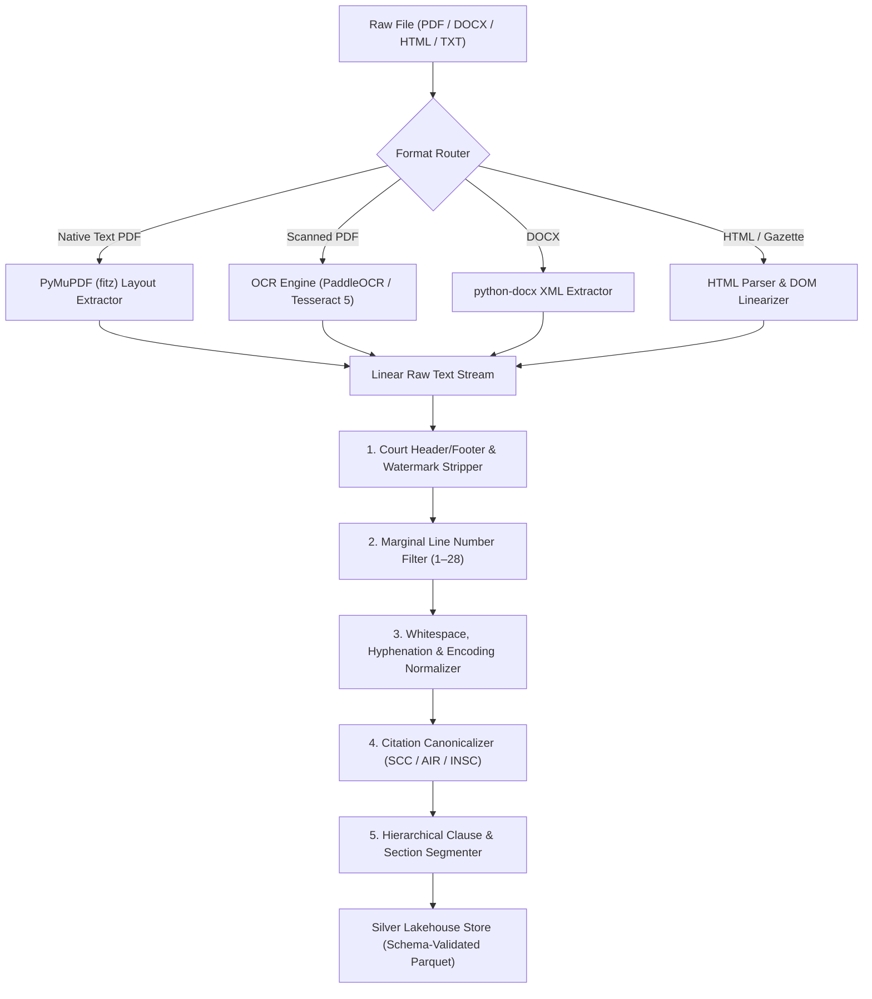
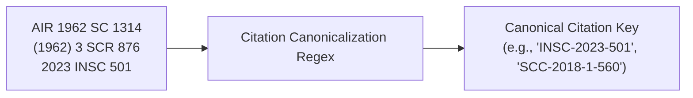

# 09. Data Preprocessing Pipeline

**Document ID:** `LEGALAI-DOC-DE-09`  
**Version:** `1.0.0`  
**Status:** Canonical Pipeline Specification  
**Dependencies:** `INDEX.md`, `01_DATASET_ARCHITECTURE.md`, `backend/app/services/parser.py`, `backend/app/services/segmenter.py`

---

## 1. Executive Summary

Legal text documents obtained from courts, official gazettes, and corporate contract repositories represent some of the most irregularly structured, noisy, and idiosyncratic documents in data engineering. Scanned court orders feature variable-resolution scans, skew, non-standard fonts, watermarks, stamps, and page line numbers (1–28).

This document details the end-to-end transformation pipeline that ingests raw Bronze artifacts, cleans noise, extracts structured layout flows, normalizes Indian citations, segments clauses, and produces validated Silver-tier Parquet datasets.

---

## 2. Ingestion & Transformation Topology



---

## 3. Extraction Engines

The ingestion layer uses a three-tier extraction strategy optimized for throughput, layout preservation, and OCR resilience:

### 3.1 Tier 1: Native Digital PDFs (`PyMuPDF`)
- **Primary Tool:** `PyMuPDF` (`fitz`) version 1.23+.
- **Rationale:** 10x faster than traditional PDF extractors, provides precise font size, coordinates, and bounding boxes required to detect headers, titles, and section splits.
- **Header/Footer Detection:** Blocks whose vertical coordinates fall within the top 5% or bottom 5% of the page bounding box and repeat across $\ge 3$ consecutive pages are automatically flagged as running headers/footers and excised.

### 3.2 Tier 2: Tables & Complex Formatting (`pdfplumber`)
- Used selectively on financial contracts, fee schedules, and statutory schedules where table boundaries and grid alignment carry substantive legal meaning.

### 3.3 Tier 3: Scanned Judgments (`PaddleOCR` / `Tesseract 5`)
- Scanned orders (typical of Indian District Courts and historical High Court reports) undergo automated pre-processing:
  - Grayscale conversion and Otsu adaptive binarization.
  - Deskewing via Radon transform (bounding angle $\pm 15^\circ$).
  - Page margin cropping to eliminate black scanning edges.
- Text recognized with character confidence $< 75\%$ is routed to human review quarantine.

---

## 4. Cleaning & Noise Elimination Algorithms

### 4.1 Marginal Line Number Removal
Indian court judgments and formal pleadings conventionally feature line numbers (1 to 28) running down the left margin:

```python
import re

# Regex pattern for left-margin court line numbers
MARGINAL_LINE_NUM_PATTERN = re.compile(
    r"^(?:\s*\d{1,2}\s+)(?=[A-Z0-9\(\"'])", 
    re.MULTILINE
)

def strip_marginal_line_numbers(text: str) -> str:
    """Removes pleading line numbers (1-28) from judgment lines."""
    lines = text.split("\n")
    cleaned_lines = []
    for line in lines:
        cleaned = MARGINAL_LINE_NUM_PATTERN.sub("", line)
        cleaned_lines.append(cleaned)
    return "\n".join(cleaned_lines)
```

### 4.2 Court Boilerplate and Watermark Stripping
Strips administrative boilerplate common to Indian e-filing systems:
- `"IN THE HIGH COURT OF JUDICATURE AT BOMBAY"`
- `"TRUE COPY - AS CERTIFIED BY REGISTRY"`
- `"Digitally Signed by ... Date: ..."`
- `"Page X of Y"`, `"Downloaded on ... from Supreme Court of India"`

### 4.3 Broken Hyphenation & Encoding Sanitization
Reconstructs words split across line breaks by automated justification algorithms:
- `re.sub(r'(\w+)-\n(\w+)', r'\1\2', text)`
- Replaces non-breaking spaces (`\u00A0`), zero-width spaces (`\u200B`), and typographic quotation marks with canonical UTF-8 equivalents.

---

## 5. Indian Legal Citation Normalizer

Legal documents in India cite cases and statutes across dozens of reporter conventions. The pipeline canonicalizes citations to standard uniform keys:



### 5.1 Codified Citation Patterns

1. **Supreme Court Cases (SCC):**
   - Pattern: `r"\b\(?(\d{4})\)?\s*(\d+)?\s*SCC\s*(?:(?:Suppl\.?|\(Supp\))\s*)?(\d+)\b"`
   - Normalized Key: `SCC-{YEAR}-{VOL}-{PAGE}`

2. **All India Reporter (AIR):**
   - Pattern: `r"\bAIR\s*(\d{4})\s*(SC|Del|Bom|Cal|Mad|All|P&H|Kar|Ker|Guj)\s*(\d+)\b"`
   - Normalized Key: `AIR-{YEAR}-{COURT}-{PAGE}`

3. **Official Neutral Citation (Supreme Court of India, 2023 onwards):**
   - Pattern: `r"\b(\d{4})\s*INSC\s*(\d+)\b"`
   - Normalized Key: `INSC-{YEAR}-{NUMBER}`

4. **Official Neutral Citation (Delhi High Court):**
   - Pattern: `r"\b(\d{4})\s*DHC\s*(\d+)\b"`
   - Normalized Key: `DHC-{YEAR}-{NUMBER}`

---

## 6. Hierarchical Clause & Section Segmentation

The segmentation engine decomposes continuous text into atomic units, extending the regex patterns in `backend/app/services/segmenter.py`:

```python
CLAUSE_BOUNDARY_PATTERNS = [
    # Top-level numbered clauses: "1.", "14.", "Article 1."
    re.compile(r"^\s*(?:SECTION|CLAUSE|ARTICLE)?\s*(\d{1,3})\s*[\.\:\-\)]\s+(?=[A-Z])", re.MULTILINE),
    
    # Sub-clauses: "1.1", "14.2(a)"
    re.compile(r"^\s*(\d{1,3}\.\d{1,3}(?:\.\d{1,3})?)\s*[\.\:\-\)]\s+", re.MULTILINE),
    
    # Alphabetical lists: "(a)", "(b)", "(iv)"
    re.compile(r"^\s*(\([a-z0-9]+\))\s+", re.MULTILINE),
]
```

### 6.1 Segmentation Validation Rule
- Every extracted clause must satisfy:
  - Minimum length: $\ge 20$ characters (prevents fragment artifacts).
  - Maximum length: $\le 8,000$ characters (clauses exceeding this are split at paragraph boundaries to fit transformer embedding windows).
  - Boundary integrity: Must preserve character offset pointers (`char_start`, `char_end`) referencing the unsegmented parent text.

