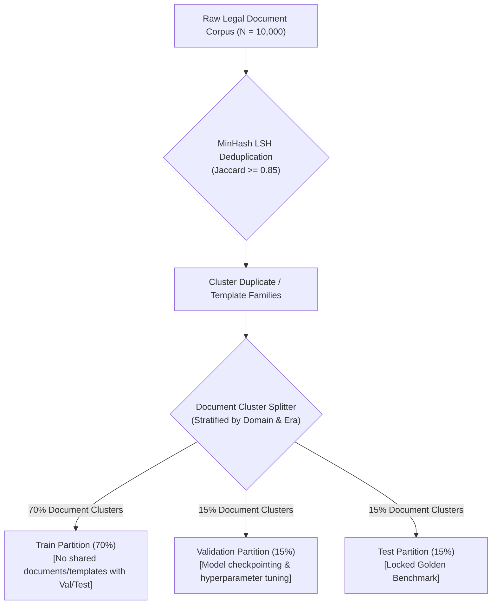

# 10. Dataset Splitting and Leakage Prevention

**Document ID:** `LEGALAI-DOC-DE-10`  
**Version:** `1.0.0`  
**Status:** Canonical Data Splitting & Integrity Standard  
**Dependencies:** `INDEX.md`, `01_DATASET_ARCHITECTURE.md`, `04_CANONICAL_DATA_SCHEMAS.md`

---

## 1. Executive Summary

Data leakage is the most pervasive failure mode in legal machine learning. Because commercial agreements and court judgments are heavily boilerplate-driven, naive random splitting at the paragraph or clause level guarantees that nearly identical clauses from the same contract appear in both training and test partitions. This yields artificially inflated test scores ($F_1 > 0.95$) that collapse catastrophic in production.

This document specifies the mandatory **Document-Level Group Partitioning**, **MinHash LSH Near-Duplicate Deduplication**, **Bilingual Translation Contamination Safeguards**, and **Benchmark Isolation Protocols** for LegalAI.

---

## 2. Document-Level Group Splitting

Under no circumstances may individual clauses, sentences, or FIRAC segments from a single parent legal document be distributed across different data partitions.



### 2.1 Splitting Rules
1. **Document ID as Group Key:** The `document_id` serves as the inviolable grouping key. All records sharing a `document_id` are co-located in the same partition.
2. **Stratification Variables:** Splits must be stratified across:
   - **Legal Domain:** (e.g., Commercial, IP, Employment, Constitutional, Arbitration).
   - **Jurisdiction:** (e.g., Supreme Court of India, Bombay High Court, Delhi High Court).
   - **Temporal Eras:** (Pre-2000, 2001–2015, 2016–Present) to prevent temporal lookahead bias.
3. **Partition Ratios:** Standard allocation is strictly **70% Train / 15% Validation / 15% Test**.

---

## 3. MinHash LSH Near-Duplicate Detection

Commercial agreements frequently originate from identical standard form templates (e.g., standard NDAs, ISDA master agreements, FIDIC construction forms) where only party names and dates differ. 

To prevent cross-partition template leakage, all documents are clustered using **MinHash Local Sensitivity Hashing (LSH)** prior to split assignment.

### 3.1 Algorithm Specification
1. **Shingling:** Convert each document into a set of character 5-grams and word 3-grams after lowercasing and punctuation stripping.
2. **MinHash Signatures:** Generate $k = 128$ minhash permutations using MurmurHash3.
3. **LSH Indexing:** Bucket documents with bands $b = 32$ and rows $r = 4$, yielding an approximate threshold:
   $$t \approx \left(\frac{1}{b}\right)^{\frac{1}{r}} = \left(\frac{1}{32}\right)^{\frac{1}{4}} \approx 0.42$$
4. **Jaccard Threshold:**
   $$J(D_1, D_2) = \frac{|D_1 \cap D_2|}{|D_1 \cup D_2|} \ge 0.85$$
   - If two documents have Jaccard similarity $J \ge 0.85$, they are assigned to the **same cluster identifier** (`template_cluster_id`).
   - The cluster splitter operates on `template_cluster_id` rather than individual `document_id`.

---

## 4. Bilingual Translation Leakage Prevention

In cross-lingual and machine translation datasets (e.g., English-Hindi statutory alignments), a subtle form of data leakage occurs when an English source text appears in the training partition while its Hindi translation appears in the test partition. This allows the model to memorize semantic representations across languages.

### 4.1 Cross-Lingual Invariance Rules
1. **Pairwise Co-Location:** An English text chunk and its corresponding Hindi parallel chunk **must always share the same split assignment**.
2. **Cross-Lingual Cluster Key:** The primary `document_id` of the original English enactment binds both English and Hindi versions:
   $$\text{Split}(\text{Section}_{10}^{\text{EN}}) \equiv \text{Split}(\text{Section}_{10}^{\text{HI}})$$
3. **Bilingual Evaluation Quarantine:** All evaluation queries in `BhashaBench-Legal` and synthetic test questions in Hindi are checked against the English training corpus using 8-gram containment:
   $$\text{Containment}(Q_{\text{eval}}, D_{\text{train}}) = \frac{|Q_{\text{eval}} \cap D_{\text{train}}|}{|Q_{\text{eval}}|}$$
   If containment $> 0.50$, the evaluation item is discarded.

---

## 5. Benchmark Contamination Auditing

To maintain uncompromised evaluation integrity, LegalAI implements an automated contamination scanner:

```python
import hashlib
from typing import Set, List

def compute_ngrams(tokens: List[str], n: int = 13) -> Set[str]:
    """Generates 13-gram token hashes for contamination scanning."""
    ngrams = set()
    for i in range(len(tokens) - n + 1):
        gram = " ".join(tokens[i:i+n])
        gram_hash = hashlib.sha256(gram.encode('utf-8')).hexdigest()
        ngrams.add(gram_hash)
    return ngrams

def scan_for_contamination(train_doc_tokens: List[str], test_hashes: Set[str]) -> bool:
    """Returns True if any 13-gram in train overlaps with the test set."""
    train_hashes = compute_ngrams(train_doc_tokens, n=13)
    overlap = train_hashes.intersection(test_hashes)
    return len(overlap) > 0
```

- Any candidate training document exhibiting an identical 13-token sequence with any gold test set item is flagged and excised from the training pool.

