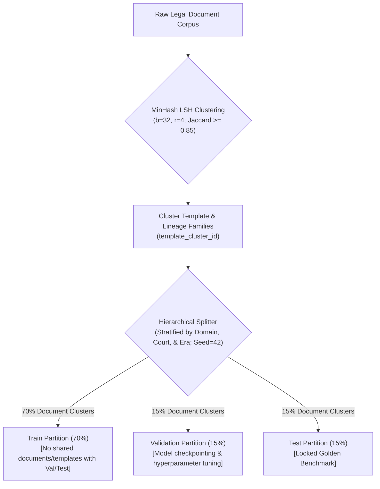

# 10. Dataset Splitting and Leakage Prevention

**Document ID:** `LEGALAI-DOC-DE-10`  
**Version:** `1.2.0`  
**Status:** Draft v1.0 — Pending Technical and Legal Review  
**Audited Date:** 2026-11-13  
**Dependencies:** `INDEX.md`, `01_DATASET_ARCHITECTURE.md`, `04_CANONICAL_DATA_SCHEMAS.md`, `PHASE_1_2_EVIDENCE_REGISTER.md`

---

## 1. Executive Summary

Data leakage is the most pervasive failure mode in legal machine learning. Because commercial agreements and court judgments are heavily boilerplate-driven, naive random splitting at the paragraph or clause level guarantees that nearly identical clauses from the same contract appear in both training and test partitions. This yields artificially inflated test scores ($F_1 > 0.95$) that collapse catastrophic in production.

This document specifies the mandatory **Hierarchical Group Partitioning**, **MinHash LSH Near-Duplicate Deduplication**, **Cross-Lingual Translation Leakage Safeguards**, and **Reproducible Benchmark Protocols** for LegalAI.

---

## 2. Hierarchical Group Splitting Architecture

Under no circumstances may individual clauses, sentences, or FIRAC segments from a single parent legal document or template family be distributed across different data partitions.



### 2.1 The 5-Tier Splitting Hierarchy
To eliminate data contamination, split assignments operate strictly on the following precedence hierarchy:
1. **Tier 1 — Template Family Cluster (`template_cluster_id`):** Contracts sharing $\ge 85\%$ near-identical boilerplate clauses must reside wholly in Train, Val, or Test.
2. **Tier 2 — Document Entity (`document_id`):** All clauses, summaries, and annotations from an individual contract or judicial opinion share an identical split.
3. **Tier 3 — Appellate Litigation Lineage:** Appellate opinions arising from the same litigation controversy (Trial Court decree $\rightarrow$ High Court appeal $\rightarrow$ Supreme Court ruling) are co-located in the same partition.
4. **Tier 4 — Bilingual Translation Pairs:** An English statutory section and its authoritative Hindi gazette counterpart share an identical split assignment (`bilingual_cluster_id`).
5. **Tier 5 — Stratification Variables:** Allocation (70% Train / 15% Val / 15% Test) is stratified by:
   - **Legal Domain:** Commercial Contracts, Corporate Law, Arbitration, Constitutional Law, Intellectual Property.
   - **Jurisdiction:** Supreme Court of India, Delhi High Court, Bombay High Court, Other High Courts.
   - **Temporal Eras:** Pre-2000, 2001–2015, 2016–Present.

---

## 3. MinHash LSH Near-Duplicate Detection & Quality Protocols

Commercial agreements frequently originate from identical standard form templates (e.g., standard NDAs, master services agreements, construction forms) where only party names and dates differ. 

### 3.1 Algorithm Specification & Candidate Bucketing
1. **Shingling:** Convert each document into a set of character 5-grams and word 3-grams after lowercasing and punctuation stripping.
2. **MinHash Signatures:** Generate $k = 128$ minhash permutations using MurmurHash3.
3. **LSH Indexing:** Bucket documents with bands $b = 32$ and rows $r = 4$, yielding an approximate candidate threshold:
   $$t \approx \left(\frac{1}{b}\right)^{\frac{1}{r}} = \left(\frac{1}{32}\right)^{\frac{1}{4}} \approx 0.42$$
4. **Exact Jaccard Verification:** For all candidate pairs returned by LSH, compute the exact Jaccard similarity:
   $$J(D_1, D_2) = \frac{|D_1 \cap D_2|}{|D_1 \cup D_2|}$$
   - **Threshold:** If $J(D_1, D_2) \ge 0.85$, the documents are assigned to the **same cluster identifier** (`template_cluster_id`).

### 3.2 Evaluation Protocol for Detection Quality (Sprint 2.3)
> [!NOTE]
> **Execution Status:** **NOT RUN** (Scheduled for Sprint 2.3 pilot dataset execution). Previous claims of 0% false positive merges were theoretical assumptions and are hereby superseded by this empirical protocol.

1. **Definition of False-Positive Cluster Merge:** Erroneous grouping of two commercially distinct contracts or independent disputes into the same cluster ($J < 0.85$), unnecessarily restricting split diversity.
2. **Definition of False-Negative Leakage:** Failure to group two contracts originating from the same boilerplate template ($J \ge 0.85$), permitting template leakage across train and test partitions.
3. **Ground-Truth Evaluation Protocol:**
   - Sample $N = 1,000$ randomly selected document pairs from the Silver corpus.
   - Independent dual legal review to annotate whether pairs represent identical template families.
   - Compute Precision, Recall, and F1 score:
     $$\text{Precision} = \frac{\text{TP}}{\text{TP} + \text{FP}}, \quad \text{Recall} = \frac{\text{TP}}{\text{TP} + \text{FN}}, \quad F_1 = \frac{2 \cdot \text{Precision} \cdot \text{Recall}}{\text{Precision} + \text{Recall}}$$
   - Target acceptance criteria: $\text{Precision} \ge 98.0\%$, $\text{Recall} \ge 95.0\%$.

---

## 4. Cross-Lingual Translation Leakage Prevention

In bilingual corpora (e.g., English Central Acts aligned with official Hindi Gazette translations), data leakage occurs if an English statutory section appears in Train while its corresponding Hindi translation appears in Test.

> [!CRITICAL]
> **Script Incompatibility Warning:**
> English text is written in the Latin alphabet (`[a-zA-Z]`), while Hindi is written in the Devanagari script (`[\u0900-\u097F]`). Because their character sets share zero overlap, naive character n-gram containment algorithms between English and Hindi will **always evaluate to 0%**, completely failing to detect translation leakage.

### 4.1 Cross-Lingual Invariance Protocols
LegalAI enforces translation leakage prevention through three deterministic mechanisms:

1. **Structural Section ID Binding:**
   - Every bilingual pair is linked by an immutable canonical statutory section key (e.g., `ICA-1872-SEC-027`).
   - The splitting algorithm assigns the statutory key as an atomic unit:
     $$\text{Split}(\text{Section}_{27}^{\text{EN}}) \equiv \text{Split}(\text{Section}_{27}^{\text{HI}})$$
2. **Cross-Lingual Semantic Cosine Audit Protocol:**
   - For conversational QA pairs, candidate test queries in Hindi are embedded using a shared multilingual model (`BAAI/bge-m3`) and compared against all English training records:
     $$\text{CosineSim}(v_{\text{test\_hi}}, v_{\text{train\_en}}) = \frac{v_{\text{test\_hi}} \cdot v_{\text{train\_en}}}{\|v_{\text{test\_hi}}\| \|v_{\text{train\_en}}\|}$$
   - Any evaluation item with $\text{CosineSim} \ge \tau$ to a training record is flagged for human review.
3. **Bilingual Terminology Projection:**
   - Evaluation queries in Hindi are projected into English statutory terminology using the canonical lexicon (`07_BILINGUAL_DATA_STRATEGY.md`) before running lexical overlap checks.

### 4.2 Threshold Calibration Protocol (Sprint 2.3)
> [!NOTE]
> **Threshold Status:** **PROVISIONAL HYPOTHESIS (NOT RUN)**. The threshold $\tau = 0.88$ represents an uncalibrated hypothesis pending Phase 2 empirical validation.

- **Empirical Calibration Procedure:**
  - Create a benchmark of $500$ verified parallel English-Hindi sentence pairs and $500$ non-parallel pairs sharing general legal vocabulary.
  - Sweep candidate cosine similarity thresholds $\tau \in \{0.80, 0.84, 0.88, 0.92\}$.
  - Select the threshold that maximizes separation between parallel translations and non-identical related documents, minimizing false negative leakage while avoiding false-positive quarantine of legitimate test queries.

---

## 5. Monolingual English Benchmark Contamination Auditing

To maintain uncompromised evaluation integrity, LegalAI implements an automated contamination scanner for monolingual English splits:

```python
import hashlib
from typing import Set, List

def compute_ngrams(tokens: List[str], n: int = 13) -> Set[str]:
    """Generates 13-gram token hashes for contamination scanning."""
    ngrams = set()
    for i in range(len(tokens) - n + 1):
        gram = " ".join(tokens[i:i+n])
        gram_hash = hashlib.sha256(gram.encode('utf-8')).hexdigest()
        ngrams.add(gram_hash)
    return ngrams

def scan_for_contamination(train_doc_tokens: List[str], test_hashes: Set[str]) -> bool:
    """Returns True if any 13-gram in train overlaps with the test set."""
    train_hashes = compute_ngrams(train_doc_tokens, n=13)
    overlap = train_hashes.intersection(test_hashes)
    return len(overlap) > 0
```

---

## 6. Pipeline Reproducibility Specifications

To ensure exact reproducibility across all engineering environments, splitting runs must declare:
- **Random Seed:** Fixed at `seed=42`.
- **Dataset Release Version:** Formally stamped as `v1.2.0`.
- **Deterministic Manifest:** Partition manifests (`data/manifests/split_manifest.jsonl`) recording `document_id`, `template_cluster_id`, assigned split (`train`, `val`, `test`), and partition SHA-256 checksums.
- **Git Commit Reference:** Transformation scripts must be tagged with exact Git commit hashes in metadata sidecars.
