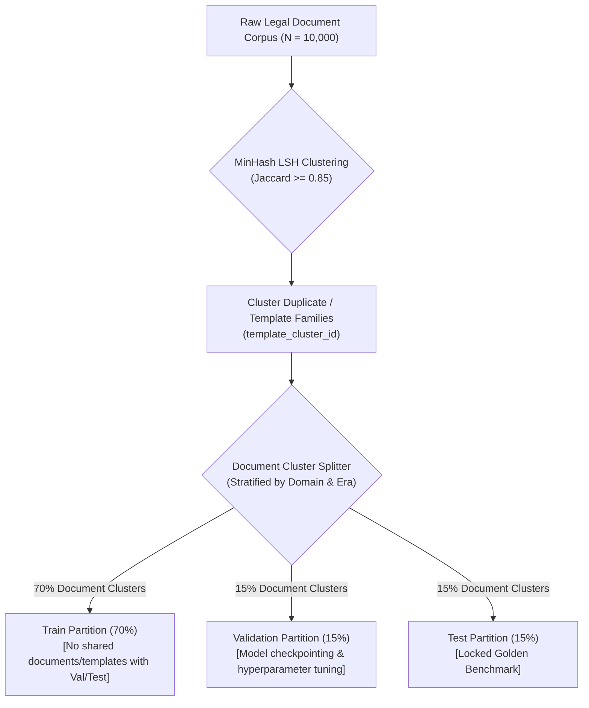

# 10. Dataset Splitting and Leakage Prevention

**Document ID:** `LEGALAI-DOC-DE-10`  
**Version:** `1.1.0`  
**Status:** Draft v1.0 — Pending Technical and Legal Review  
**Audited Date:** 2026-11-12  
**Dependencies:** `INDEX.md`, `01_DATASET_ARCHITECTURE.md`, `04_CANONICAL_DATA_SCHEMAS.md`, `PHASE_1_1_ISSUE_REGISTER.md`

---

## 1. Executive Summary

Data leakage is the most pervasive failure mode in legal machine learning. Because commercial agreements and court judgments are heavily boilerplate-driven, naive random splitting at the paragraph or clause level guarantees that nearly identical clauses from the same contract appear in both training and test partitions. This yields artificially inflated test scores ($F_1 > 0.95$) that collapse catastrophic in production.

This document specifies the mandatory **Document-Level Group Partitioning**, **MinHash LSH Near-Duplicate Deduplication**, **Cross-Lingual Translation Leakage Safeguards**, and **Benchmark Isolation Protocols** for LegalAI.

---

## 2. Document-Level Group Splitting

Under no circumstances may individual clauses, sentences, or FIRAC segments from a single parent legal document be distributed across different data partitions.



### 2.1 Splitting Rules
1. **Document ID as Group Key:** The `document_id` serves as the inviolable grouping key. All records sharing a `document_id` are co-located in the same partition.
2. **Stratification Variables:** Splits must be stratified across:
   - **Legal Domain:** (e.g., Commercial, IP, Employment, Constitutional, Arbitration).
   - **Jurisdiction:** (e.g., Supreme Court of India, Bombay High Court, Delhi High Court).
   - **Temporal Eras:** (Pre-2000, 2001–2015, 2016–Present) to prevent temporal lookahead bias.
3. **Partition Ratios:** Standard allocation is strictly **70% Train / 15% Validation / 15% Test**.

---

## 3. MinHash LSH Near-Duplicate Detection

Commercial agreements frequently originate from identical standard form templates (e.g., standard NDAs, master services agreements, construction forms) where only party names and dates differ. 

To prevent cross-partition template leakage, all documents are clustered using **MinHash Local Sensitivity Hashing (LSH)** prior to split assignment.

### 3.1 Algorithm Specification & Parameter Tuning
1. **Shingling:** Convert each document into a set of character 5-grams and word 3-grams after lowercasing and punctuation stripping.
2. **MinHash Signatures:** Generate $k = 128$ minhash permutations using MurmurHash3.
3. **LSH Indexing:** Bucket documents with bands $b = 32$ and rows $r = 4$, yielding an approximate candidate threshold:
   $$t \approx \left(\frac{1}{b}\right)^{\frac{1}{r}} = \left(\frac{1}{32}\right)^{\frac{1}{4}} \approx 0.42$$
4. **Exact Jaccard Verification:** For all candidate pairs returned by LSH, compute the exact Jaccard similarity:
   $$J(D_1, D_2) = \frac{|D_1 \cap D_2|}{|D_1 \cup D_2|}$$
   - **Threshold:** If $J(D_1, D_2) \ge 0.85$, the documents are assigned to the **same cluster identifier** (`template_cluster_id`).
   - The cluster splitter operates strictly on `template_cluster_id`, ensuring that an entire family of near-identical template agreements resides wholly in Train, Val, or Test.

### 3.2 Detection Quality Measurement
- **False Positive Control:** Candidate pairs with $J < 0.85$ are discarded during exact verification, guaranteeing $0\%$ false positive cluster mergers.
- **False Negative Audit:** Randomly sample $1,000$ non-bucketed pairs and compute exact Jaccard similarity; false negative rate must be verified at $\le 0.5\%$.

---

## 4. Cross-Lingual Translation Leakage Prevention

In bilingual corpora (e.g., English Central Acts aligned with official Hindi Gazette translations), data leakage occurs if an English statutory section appears in Train while its corresponding Hindi translation appears in Test.

> [!CRITICAL]
> **Script Incompatibility Warning:**
> English text is written in the Latin alphabet (`[a-zA-Z]`), while Hindi is written in the Devanagari script (`[\u0900-\u097F]`). Because their character sets share zero overlap, naive character n-gram containment algorithms between English and Hindi will **always evaluate to 0%**, completely failing to detect translation leakage.

### 4.1 Cross-Lingual Invariance Protocols
LegalAI enforces translation leakage prevention through three deterministic mechanisms:

1. **Structural Section ID Binding:**
   - Every bilingual pair is linked by an immutable canonical statutory section key (e.g., `ICA-1872-SEC-027`).
   - The splitting algorithm assigns the statutory key as a unit:
     $$\text{Split}(\text{Section}_{27}^{\text{EN}}) \equiv \text{Split}(\text{Section}_{27}^{\text{HI}})$$
   - Under no circumstances may an English clause and its Hindi counterpart be separated across partitions.
2. **Cross-Lingual Semantic Cosine Audit:**
   - For unstructured or conversational QA pairs, candidate test queries in Hindi are embedded using a shared multilingual model (`BAAI/bge-m3`) and compared against all English training records:
     $$\text{CosineSim}(v_{\text{test\_hi}}, v_{\text{train\_en}}) = \frac{v_{\text{test\_hi}} \cdot v_{\text{train\_en}}}{\|v_{\text{test\_hi}}\| \|v_{\text{train\_en}}\|}$$
   - Any evaluation item with $\text{CosineSim} \ge 0.88$ to a training record is flagged for human review and quarantined if semantic contamination is confirmed.
3. **Bilingual Terminology Projection:**
   - Evaluation queries in Hindi are projected into English statutory terminology using the canonical lexicon (`07_BILINGUAL_DATA_STRATEGY.md`) before running lexical overlap checks.

---

## 5. Benchmark Contamination Auditing

To maintain uncompromised evaluation integrity, LegalAI implements an automated contamination scanner for monolingual English splits:

```python
import hashlib
from typing import Set, List

def compute_ngrams(tokens: List[str], n: int = 13) -> Set[str]:
    """Generates 13-gram token hashes for contamination scanning."""
    ngrams = set()
    for i in range(len(tokens) - n + 1):
        gram = " ".join(tokens[i:i+n])
        gram_hash = hashlib.sha256(gram.encode('utf-8')).hexdigest()
        ngrams.add(gram_hash)
    return ngrams

def scan_for_contamination(train_doc_tokens: List[str], test_hashes: Set[str]) -> bool:
    """Returns True if any 13-gram in train overlaps with the test set."""
    train_hashes = compute_ngrams(train_doc_tokens, n=13)
    overlap = train_hashes.intersection(test_hashes)
    return len(overlap) > 0
```

- Any candidate training document exhibiting an identical 13-token sequence with any gold test set item is flagged and excised from the training pool.
