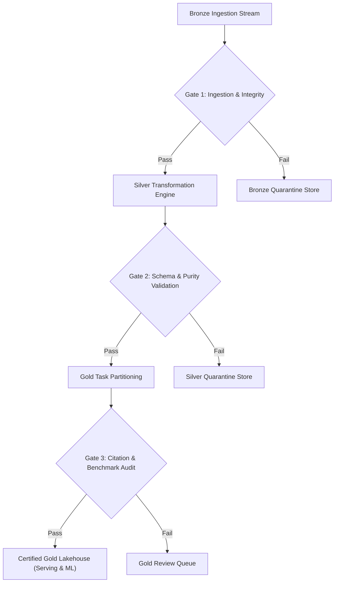

# 12. Data Quality and Validation

**Document ID:** `LEGALAI-DOC-DE-12`  
**Version:** `1.2.0`  
**Status:** Draft v1.0 — Pending Technical and Legal Review  
**Audited Date:** 2026-11-13  
**Framework:** Great Expectations / Pydantic v2 / Automated CI Checks  
**Dependencies:** `INDEX.md`, `04_CANONICAL_DATA_SCHEMAS.md`, `05_LABEL_TAXONOMY.md`, `PHASE_1_2_ISSUE_REGISTER.md`, `PHASE_1_2_EVIDENCE_REGISTER.md`

---

## 1. Executive Summary

Legal applications tolerate near-zero error margins. A single malformed statutory section, misattributed citation, or unparsed clause boundary can produce flawed legal advice or corrupted compliance audits.

This document establishes the automated data quality checks, statistical validation suites, legal citation integrity algorithms, and linguistic error thresholds enforced across the LegalAI lakehouse tiers.

All validation suites enforce dataset-specific completeness constraints, distinguish statutory facts from heuristic checks, and mandate quarantine routing for non-conforming records.

---

## 2. Multi-Tier Quality Gate Topology



---

## 3. Automated Validation Suites (Great Expectations / Pydantic v2)

The validation harness executes a battery of assertions on all Silver Parquet partitions prior to Gold promotion:

### 3.1 Structural & Schema Assertions

#### Mandatory Universal Fields ($100\%$ Non-Null Across All Records):
- `example_id` / `case_id` / `section_id` (UUID or unique canonical slug)
- `document_id` (Parent document hash or source ID)
- `dataset_version` (Semantic version string, e.g., `"1.2.0"`)
- `language` (ISO 639-1 code: `"en"` or `"hi"`)
- `jurisdiction` (`"IN"` or specific state code)
- `annotation_status` (Must match canonical enum values)
- `provenance` (Struct containing non-null `source_name`, `source_license`, `sha256_hash`, `ingested_at`, `is_synthetic`)

#### Dataset-Specific Completeness & Nullability Rules:
1. **`ContractClauseRecord`:**
   - **Strict Non-Null ($100\%$):** `clause_text`, `clause_category`, `char_start`, `char_end`, `is_boilerplate`, `perspective`.
   - **Permissible Nulls:** `clause_title` (for unnumbered running clauses), `embedding` (pre-vectorization), `secondary_categories` (defaults to empty list `[]`).
2. **`ContractRiskRecord`:**
   - **Strict Non-Null ($100\%$):** `clause_id`, `risk_title`, `risk_severity`, `risk_score`, `perspective`, `affected_party`.
   - **Permissible Nulls:** `suggested_revision_text` (acceptable where the recommendation is total clause deletion or waiver).
3. **`RealJudgmentCaseStudyRecord` / `FIRACCaseStudyRecord`:**
   - **Strict Non-Null ($100\%$):** `case_id`, `case_name`, `court`, `decision_date`, `firac_analysis` (`facts`, `issues`, `court_reasoning`, `ratio_decidendi`, `holding`).
   - **Permissible Nulls:** `neutral_citation` (for pre-2023 judgments without neutral indexing), `summary_hi` (prior to dual-language generation), `obiter_dicta` (empty sequence if none identified), `embedding`.
4. **`BilingualStatuteRecord`:**
   - **Strict Non-Null ($100\%$):** `section_id`, `act_title_en`, `section_number`, `section_text_en`, `section_text_hi`, `alignment_confidence`.
   - **Permissible Nulls:** `gazette_notification_ref` (where Gazette S.O./G.S.R. number is unrecorded in source), `chapter`, `section_title_hi`.

### 3.2 Categorical Conformance
- Values in `clause_category` must belong strictly to the 21 classes of `ClauseType` defined in `05_LABEL_TAXONOMY.md`.
- Values in `risk_severity` must strictly belong to `['low', 'medium', 'high', 'critical']`.
- Values in `perspective` must strictly belong to `['neutral', 'first_party', 'second_party', 'vendor', 'client', 'employer', 'employee', 'landlord', 'tenant']`.

### 3.3 Length Distribution Bounds
- `clause_text` length: minimum $20$ characters, maximum $8,000$ characters.
- Any clause $< 20$ characters is quarantined as an extraction fragment; any clause $> 8,000$ characters is flagged for sub-segmentation.

### 3.4 Encoding & Code Point Integrity
- Text must be valid UTF-8.
- Text must contain **zero occurrences** of the Unicode replacement character `\uFFFD` (indicative of binary decode corruption).
- Character offsets (`char_start`, `char_end`) must strictly evaluate to valid slice bounds within the document code point array: $0 \le \text{char\_start} < \text{char\_end} \le \text{len}(\text{raw\_text})$.

---

## 4. Legal Citation Integrity Algorithm

> [!WARNING]
> **Heuristic Range Caution:**
> Hardcoded section ranges are screening heuristics and triage filters, **not conclusive proof of statutory validity**. Statutes are routinely amended by inserting alphanumeric provisions (e.g., Section 20A in the *Specific Relief Act, 1963*, or Sections 43A, 66A–66F, and 72A in the *Information Technology Act, 2000*), while other sections may be repealed or omitted. Definitive validation requires cross-referencing against the full codified section graph in the official legislative repository.

```python
import re
from typing import Dict, Any

# Heuristic screening upper bounds for central enactments
OFFICIAL_CENTRAL_ACTS_HEURISTIC = {
    "Indian Contract Act, 1872": {"year": 1872, "sections_max": 266},
    "Companies Act, 2013": {"year": 2013, "sections_max": 470},
    "Arbitration and Conciliation Act, 1996": {"year": 1996, "sections_max": 87},
    "Information Technology Act, 2000": {"year": 2000, "sections_max": 90},
    "Specific Relief Act, 1963": {"year": 1963, "sections_max": 44},
    "Digital Personal Data Protection Act, 2023": {"year": 2023, "sections_max": 44},
    "Bharatiya Nyaya Sanhita, 2023": {"year": 2023, "sections_max": 358},
}

def validate_statutory_citation_heuristic(statute_name: str, section_str: str) -> Dict[str, Any]:
    """Provides a heuristic validity screening on statutory citations.
    
    NOTE: Flags anomalies for human or legislative graph audit; does not make conclusive statutory determinations.
    """
    if statute_name not in OFFICIAL_CENTRAL_ACTS_HEURISTIC:
        return {"valid": False, "status": "UNKNOWN_STATUTE", "reason": f"Unindexed statute: {statute_name}"}
    
    match = re.search(r"\b(\d+)([A-Z])?\b", section_str)
    if not match:
        return {"valid": False, "status": "MALFORMED_SECTION", "reason": "No numerical section identified"}
    
    sec_num = int(match.group(1))
    max_sec = OFFICIAL_CENTRAL_ACTS_HEURISTIC[statute_name]["sections_max"]
    
    # Flag numbers exceeding historical bounds for manual confirmation
    if sec_num > max_sec:
        return {
            "valid": False,
            "status": "SECTION_OUT_OF_BOUNDS_HEURISTIC",
            "reason": f"Section {sec_num} exceeds recorded statutory upper bound ({max_sec}) for {statute_name}"
        }
    
    return {
        "valid": True,
        "status": "HEURISTIC_PASS",
        "statute": statute_name,
        "section": match.group(0),
        "note": "Screening heuristic passed; definitive validation requires legislative graph verification."
    }
```

---

## 5. Linguistic & OCR Quality Standards

### 5.1 Optical Character Recognition (CER & WER)
- Scanned judgments must satisfy calibrated acceptance thresholds:
  - **Character Error Rate (CER):** $\le 3.5\%$
  - **Word Error Rate (WER):** $\le 6.0\%$
- Computed against human double-keyed reference pages. Documents failing this threshold are flagged and routed to the manual transcription queue.

### 5.2 Devanagari Script Purity Index (Hindi Corpora)
For records designated with `language: "hi"`, the pipeline computes the Script Purity Index:
$$\text{SPI} = \frac{\text{Count}(\text{Devanagari Unicode Characters } [\text{U}+0900\text{ to }\text{U}+097\text{F}])}{\text{Total Alphabetic Characters}} \times 100$$
- **Threshold:** $\text{SPI} \ge 85.0\%$ (allowing $15\%$ for Latin citations, section numbers, and case names like *AIR 1954 SC 44*). Records with $\text{SPI} < 85.0\%$ are routed to `quarantine/`.

---

## 6. Continuous Integration & Pipeline Automation

All dataset transformation commits trigger an automated validation workflow:
1. Executes schema checks across sample fixtures.
2. Runs Pydantic v2 validation on random batches ($n = 1,000$ per partition).
3. Verifies that no evaluation sample from `data/gold/benchmarks/` has been modified or leaked into training partitions.
4. Generates an automated Data Quality Report (`quality_manifest.json`) logging mean clause lengths, class distributions, null counts, and error frequencies.
