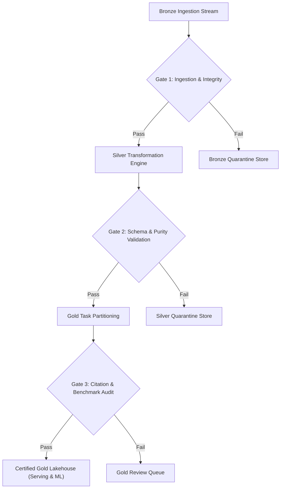

# 12. Data Quality and Validation

**Document ID:** `LEGALAI-DOC-DE-12`  
**Version:** `1.1.0`  
**Status:** Draft v1.0 — Pending Technical and Legal Review  
**Audited Date:** 2026-11-12  
**Framework:** Great Expectations / Pydantic v2 / Automated CI Checks  
**Dependencies:** `INDEX.md`, `04_CANONICAL_DATA_SCHEMAS.md`, `05_LABEL_TAXONOMY.md`, `PHASE_1_1_ISSUE_REGISTER.md`

---

## 1. Executive Summary

Legal applications tolerate near-zero error margins. A single malformed statutory section, misattributed citation, or unparsed clause boundary can produce flawed legal advice or corrupted compliance audits.

This document establishes the automated data quality checks, statistical validation suites, legal citation integrity algorithms, and linguistic error thresholds enforced across the LegalAI lakehouse tiers.

---

## 2. Multi-Tier Quality Gate Topology



---

## 3. Automated Validation Suites (Great Expectations / Pydantic)

The validation harness executes a battery of assertions on all Silver Parquet partitions prior to Gold promotion:

### 3.1 Structural & Schema Assertions
1. **Dataset-Specific Completeness (Zero Nulls on Mandatory Fields):**
   - Mandatory non-null across all records: `example_id`, `document_id`, `dataset_version`, `language`, `jurisdiction`, `annotation_status`, `provenance`.
   - `ContractClauseRecord`: `clause_text`, `clause_category`, `char_start`, `char_end` ($100\%$ non-null). Permissible nulls: `clause_title` (for unnumbered clauses), `embedding`.
   - `ContractRiskRecord`: `clause_id`, `risk_title`, `risk_severity`, `risk_score`, `perspective`, `affected_party` ($100\%$ non-null). Permissible nulls: `suggested_revision_text`.
2. **Categorical Conformance:**
   - Values in `clause_category` must belong strictly to the 21 classes of `ClauseType` defined in `05_LABEL_TAXONOMY.md`.
   - Values in `risk_severity` must strictly belong to `['low', 'medium', 'high', 'critical']`.
3. **Length Distribution Bounds:**
   - `clause_text` length: minimum $20$ characters, maximum $8,000$ characters.
   - Any clause $< 20$ characters is quarantined as an extraction fragment; any clause $> 8,000$ characters is flagged for sub-segmentation.
4. **Encoding Integrity:**
   - Text must be valid UTF-8.
   - Text must contain **zero occurrences** of the Unicode replacement character `\uFFFD` (indicative of binary decode corruption).

---

## 4. Legal Citation Integrity Algorithm

> [!WARNING]
> **Heuristic Range Caution:**
> Hardcoded section ranges are screening aids, not conclusive proof of validity. Statutes are routinely amended by inserting alphanumeric provisions (e.g., Section 20A in the *Specific Relief Act, 1963*, or Sections 43A and 72A in the *Information Technology Act, 2000*), while other sections may be repealed. Definitive validation requires cross-referencing against the full codified section roster in the official statutory graph.

```python
import re
from typing import Dict, Any

OFFICIAL_CENTRAL_ACTS = {
    "Indian Contract Act, 1872": {"year": 1872, "sections_max": 266},
    "Companies Act, 2013": {"year": 2013, "sections_max": 470},
    "Arbitration and Conciliation Act, 1996": {"year": 1996, "sections_max": 87},
    "Information Technology Act, 2000": {"year": 2000, "sections_max": 90},
    "Specific Relief Act, 1963": {"year": 1963, "sections_max": 44},
    "Digital Personal Data Protection Act, 2023": {"year": 2023, "sections_max": 44},
}

def validate_statutory_citation_heuristic(statute_name: str, section_str: str) -> Dict[str, Any]:
    """Provides a heuristic validity check on statutory citations; flags anomalies for expert audit."""
    if statute_name not in OFFICIAL_CENTRAL_ACTS:
        return {"valid": False, "status": "UNKNOWN_STATUTE", "reason": f"Unindexed statute: {statute_name}"}
    
    match = re.search(r"\b(\d+)([A-Z])?\b", section_str)
    if not match:
        return {"valid": False, "status": "MALFORMED_SECTION", "reason": "No numerical section identified"}
    
    sec_num = int(match.group(1))
    max_sec = OFFICIAL_CENTRAL_ACTS[statute_name]["sections_max"]
    
    # Flag numbers exceeding historical bounds for manual confirmation
    if sec_num > max_sec:
        return {
            "valid": False,
            "status": "SECTION_OUT_OF_BOUNDS",
            "reason": f"Section {sec_num} exceeds recorded statutory upper bound ({max_sec}) for {statute_name}"
        }
    
    return {"valid": True, "status": "HEURISTIC_PASS", "statute": statute_name, "section": match.group(0)}
```

---

## 5. Linguistic & OCR Quality Standards

### 5.1 Optical Character Recognition (CER & WER)
- Scanned judgments must satisfy calibrated acceptance thresholds:
  - **Character Error Rate (CER):** $\le 3.5\%$
  - **Word Error Rate (WER):** $\le 6.0\%$
- Computed against human double-keyed reference pages. Documents failing this threshold are flagged for manual transcription.

### 5.2 Devanagari Script Purity Index (Hindi Corpora)
For records designated with `language: "hi"`, the pipeline computes the Script Purity Index:
$$\text{SPI} = \frac{\text{Count}(\text{Devanagari Unicode Characters } [\text{U}+0900\text{ to }\text{U}+097\text{F}])}{\text{Total Alphabetic Characters}} \times 100$$
- **Threshold:** $\text{SPI} \ge 85.0\%$ (allowing $15\%$ for Latin citations, section numbers, and case names like *AIR 1954 SC 44*). Records with $\text{SPI} < 85.0\%$ are routed to `quarantine/`.

---

## 6. Continuous Integration & Pipeline Automation

All dataset transformation commits trigger an automated validation workflow:
1. Executes schema checks across sample fixtures.
2. Runs Pydantic v2 validation on random batches ($n = 1,000$ per partition).
3. Verifies that no evaluation sample from `data/gold/benchmarks/` has been modified.
4. Generates an automated Data Quality Report (`quality_manifest.json`) logging mean clause lengths, class distributions, and error frequencies.
