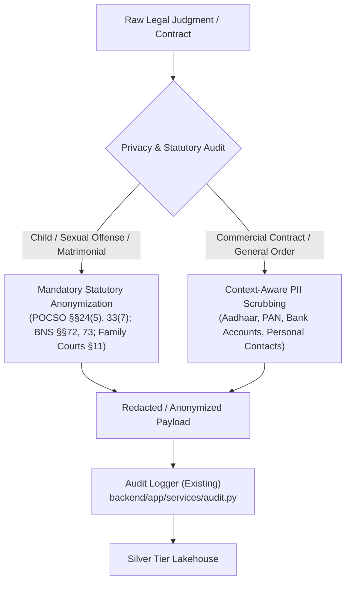

# 13. Data Privacy and Governance

**Document ID:** `LEGALAI-DOC-DE-13`  
**Version:** `1.1.0`  
**Status:** Draft v1.0 — Pending Technical and Legal Review  
**Audited Date:** 2026-11-12  
**Statutory Framework:** DPDP Act 2023 (Phased Commencement) / POCSO Act 2012 / BNS 2023 (§§ 72 & 73) / Family Courts Act 1984 (§ 11)  
**Dependencies:** `INDEX.md`, `03_LICENSE_AND_PROVENANCE_POLICY.md`, `backend/app/services/audit.py`, `backend/app/models/db_models.py`, `PHASE_1_1_ISSUE_REGISTER.md`

---

## 1. Executive Summary

Legal datasets intrinsically encompass sensitive personal data, corporate trade secrets, proprietary intellectual property, and confidential judicial filings. The deployment of AI models trained on unredacted legal corpora introduces severe legal liabilities under India's emerging data protection architecture.

This document formalizes the privacy engineering standards, context-aware Personally Identifiable Information (PII) scrubbing protocols, statutory anonymization rules, and data sovereignty safeguards governing the **LegalAI Data Platform**.

---

## 2. Statutory Privacy & Anonymization Mandates



### 2.1 Statutory Non-Disclosure Enactments
1. **POCSO Act, 2012 (Sections 24(5), 33(7), 23, 37):**
   - Section 24(5) bars police and medical practitioners from disclosing the child's identity.
   - Section 33(7) places an affirmative statutory duty on the Special Court to ensure the child's identity is not disclosed during trial.
   - Section 23 imposes penalties on media or individuals who publish identifying particulars.
   - Enforcement: Automated regex and NER filters redact child victim identities to `[REDACTED_CHILD_VICTIM]` or `Child_X`.
2. **Bharatiya Nyaya Sanhita, 2023: Sections 72 and 73 (formerly IPC Section 228A):**
   - **Section 72, BNS 2023:** Prohibits printing or publishing the name or any matter disclosing the identity of a victim of sexual offenses (Sections 64 to 71).
   - **Section 73, BNS 2023:** Prohibits printing or publishing any matter relating to court proceedings conducted *in camera* without prior written court permission.
   - Enforcement: Mandatory masking of victim and complainant identities (`Victim X`, `Prosecutrix`) and exclusion of *in-camera* transcripts.
3. **Juvenile Justice (Care and Protection of Children) Act, 2015 (Section 74):**
   - Absolute bar on disclosing the name, address, or school of any child in conflict with law or child in need of care.
4. **Family Courts Act, 1984 (Section 11):**
   - In-camera matrimonial proceedings require masking of personal allegations, child custody details, and individual spousal identifiers.

---

## 3. Context-Aware PII Scrubbing & Pattern Registry

Naive regular expressions match arbitrary numbers (e.g., treating phone numbers or timestamps as bank accounts) and suffer from syntax flaws. LegalAI enforces context-aware patterns:

### 3.1 Validated Indian Identifier Regex Specifications

```python
import re

INDIAN_PII_PATTERNS = {
    # Indian Aadhaar Card (12 digits with optional spaces or dashes, starting 2-9)
    "AADHAAR": re.compile(r"\b[2-9]\d{3}[\s\-]?\d{4}[\s\-]?\d{4}\b"),
    
    # Permanent Account Number (PAN) (5 letters, 4 digits, 1 letter)
    "PAN": re.compile(r"\b[A-Z]{5}[0-9]{4}[A-Z]\b"),
    
    # Indian Passport Number (1 letter followed by 7 digits)
    "PASSPORT": re.compile(r"\b[A-Z][1-9]\d{6}\b"),
    
    # Indian Mobile Numbers (+91 or leading 0 optional, starting with 6-9)
    "PHONE": re.compile(r"(?:\+91[\-\s]?|0)?[6-9]\d{9}\b"),
    
    # Personal Email Addresses (Syntactically correct without character-class pipe error)
    "EMAIL": re.compile(r"\b[A-Za-z0-9._%+-]+@[A-Za-z0-9.-]+\.[A-Za-z]{2,}\b"),
    
    # Context-Aware Bank Account Numbers (requires banking keyword trigger within 30 characters)
    "BANK_ACCOUNT_CONTEXT": re.compile(
        r"(?i)(?:a/c|account\s*(?:no\.?|number)|iban|ifsc|bank)\s*[:\-]?\s*(\d{9,18})\b"
    ),
}
```

### 3.2 Controlled Entity Preservation (Corporate vs. Individual)
- **Public Listed Corporations:** Corporate names in published commercial judgments (e.g., *Tata Motors Ltd.*, *State Bank of India*) are preserved, as they are essential for commercial legal precedent authority.
- **Sole Proprietorships & Partnerships:** Entities that incorporate personal names (e.g., *M/s. Ramesh Sharma & Sons*) are screened contextually. If the dispute involves personal debt, family settlement, or individual consumer claims, the personal name element is pseudonymized.
- **Natural Persons:** In individual litigation, names are pseudonymized:
  $$\text{Pseudonym} = \text{"Party\_"} + \text{SHA256}(\text{Name} + \text{Salt})[:8]$$

> [!WARNING]
> **Pseudonymization vs. Anonymization:**
> Salted hashing is **pseudonymization**, NOT irreversible anonymization. The mapping can be reverse-engineered using dictionary attacks on predictable names. The salt must be treated as a sensitive cryptographic key and stored in a secure key vault.

---

## 4. Digital Personal Data Protection Act, 2023 (DPDP) Alignment

The DPDP Act was enacted on August 11, 2023, with implementation phased under Section 1(2). LegalAI adopts its core principles as product architecture:

1. **Processing Boundaries:** Contract data uploaded to `/api/upload` is processed solely for clause analysis and risk evaluation. It is never automatically diverted into general model training sets without explicit opt-in consent.
2. **Right to Erasure:** In compliance with data minimization principles, when a user deletes a contract in the frontend (`/api/contracts/{id}`), the backend executes a cascading purge:
   - Removes raw text from the `contracts` relational table.
   - Deletes all associated records in the `analyses` table.
   - Purges all embedded vectors from Qdrant (`points.delete(collection_name="clauses", filter=...)`).
   - Retains only an anonymized cryptographic entry in `audit_logs`.
3. **Data Sovereignty:** All database volumes (Qdrant vector collections, PostgreSQL instances, and Parquet data lakes) must reside within data centers physically situated inside the territory of the Republic of India.

---

## 5. Audit Logging & Compliance Ledger

All data access, modifications, risk audits, and redaction actions are registered in the existing audit framework matching the actual database model:

- **Backend Service:** `backend/app/services/audit.py` (`log_audit`)
- **Database Model:** `AuditLog` in `backend/app/models/db_models.py`
- **Actual Database Schema Fields:**
  ```python
  class AuditLog(Base):
      __tablename__ = "audit_logs"
      id = Column(Integer, primary_key=True, index=True)
      user_id = Column(Integer, ForeignKey("users.id"), nullable=True)
      action = Column(String, index=True)       # e.g., 'CONTRACT_UPLOAD', 'PII_REDACTION', 'PURGE'
      details = Column(Text, default="")        # JSON-serialized audit payload including resource IDs and checksums
      ip_address = Column(String, default="")
      created_at = Column(DateTime, default=lambda: datetime.now(timezone.utc))
  ```
- **Audit Details Structure:** The `details` text column stores a structured JSON payload:
  ```json
  {
    "resource_type": "contract",
    "resource_id": "c9a8f21e-...",
    "action_detail": "Automated PII scrubbing completed; 3 Aadhaar spans redacted.",
    "input_sha256": "e3b0c442...",
    "output_sha256": "7a35e89b..."
  }
  ```
