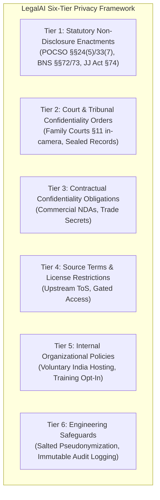
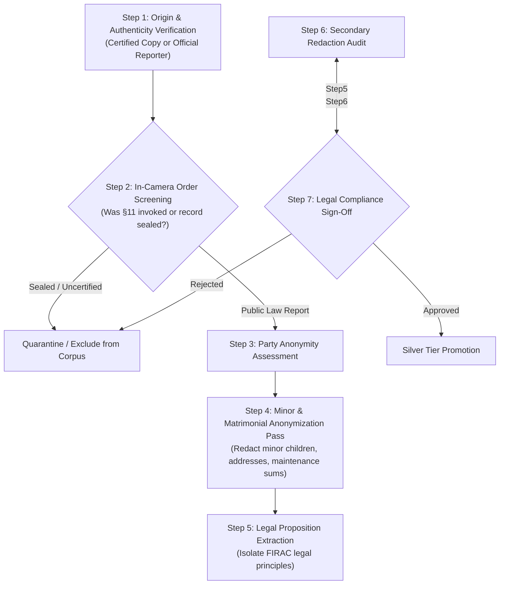

# 13. Data Privacy and Governance

**Document ID:** `LEGALAI-DOC-DE-13`  
**Version:** `1.2.1`  
**Status:** Draft v1.0 — Pending Technical and Legal Review  
**Audited Date:** 2026-11-13  
**Statutory Framework:** DPDP Act 2023 (Phased Commencement) / POCSO Act 2012 (§§ 24(5), 27, 33(7)) / BNS 2023 (§§ 72 & 73) / Family Courts Act 1984 (§ 11)  
**Dependencies:** `INDEX.md`, `03_LICENSE_AND_PROVENANCE_POLICY.md`, `backend/app/services/audit.py`, `backend/app/models/db_models.py`, `PHASE_1_2_1_EVIDENCE_REGISTER.md`

---

## 1. Executive Summary

Legal datasets intrinsically encompass sensitive personal data, corporate trade secrets, proprietary intellectual property, and confidential judicial filings. The deployment of AI models trained on unredacted legal corpora introduces severe legal liabilities under India's emerging data protection architecture.

This document formalizes the privacy engineering standards, context-aware Personally Identifiable Information (PII) scrubbing protocols, statutory anonymization rules, 12-stage data lifecycle governance, and data sovereignty safeguards governing the **LegalAI Data Platform**.

---

## 2. Six-Tier Privacy Governance Framework

To eliminate legal ambiguity and prevent conflation of statutory commands with internal preferences, LegalAI categorizes all privacy requirements into six distinct tiers:



| Governance Tier | Source / Authority | Nature | Scope & Enforcement in LegalAI |
| :--- | :--- | :--- | :--- |
| **Tier 1: Statutory Non-Disclosure** | Parliament Enactments (POCSO, BNS, JJ Act) | Strict Statutory Duty (Criminal Penalties) | Absolute bar on disclosing identities of child victims, sexual offense victims, and juveniles. Automated masking to `[REDACTED_CHILD_VICTIM]` or `Victim_X`. |
| **Tier 2: Court Confidentiality Orders** | Judicial Orders & Family Courts Act § 11 | Judicial Discretion / Procedural Mandate | Proceedings ordered *in camera* or sealed by judicial order cannot be published without court leave. Ingested only under 7-Step Protocol. |
| **Tier 3: Contractual Confidentiality** | Private Agreements / NDAs | Civil Liability / Breach of Contract | Commercial contracts ingested must have non-public party particulars, commercial rates, and trade secrets scrubbed or synthesized. |
| **Tier 4: Source Terms & Licensing** | Platform Terms of Service | Contractual / Operational Policy | Upstream platform ToS (e.g., KanoonGPT terms) must be audited; prohibited scraping flows are quarantined. |
| **Tier 5: Internal Policies** | LegalAI Corporate Governance | Internal Risk-Management Policy | Voluntary India-only data hosting; mandatory user opt-in for model training; cascading deletion workflows. |
| **Tier 6: Engineering Safeguards** | Security Architecture | Technical Implementation | Context-aware regex scrubbing; KMS-vaulted salt keys for pseudonymization; append-only audit logging. |

---

## 3. Statutory Non-Disclosure Enactments (Tier 1 & Tier 2)

### 3.1 POCSO Act, 2012 (Sections 24(5), 27, 33(7), 23)
- **Section 24(5) (Police Officer's Responsibility):**  
  > *"The police officer shall also ensure that the identity of the child is protected from the public media, unless for reasons to be recorded in writing, the Special Court has permitted such disclosure in the interest of the child."*  
  This statutory duty is specifically imposed upon the **police officer** during the investigation and statement recording phase.
- **Section 27 (Medical Examination):** Medical examination of the child is conducted independently pursuant to Section 27 and Section 164A CrPC / Section 184 BNSS, ensuring the child's dignity and presence of parents/custodians.
- **Section 33(7) (Special Court's Responsibility):** Mandates that the Special Court shall ensure that the identity of the child is not disclosed at any time during the course of trial.
- **Section 23:** Prescribes criminal penalties for media organizations or individuals publishing identifying particulars.
- **Enforcement in LegalAI:** Automated regex and entity filters tag any document referencing POCSO for complete redaction of minor party names and family descriptors to `[REDACTED_CHILD_VICTIM]` or `Child_X`.

### 3.2 Bharatiya Nyaya Sanhita, 2023: Sections 72 and 73
- **Section 72, BNS 2023 (formerly IPC Section 228A):**  
  Prohibits printing or publishing the name or any matter disclosing the identity of any victim of sexual offenses (Sections 64 to 71).
- **Section 73, BNS 2023 (Printing / Publishing Court Proceedings Without Permission):**  
  > *"Whoever prints or publishes any matter in respect for any proceeding before a court with respect to an offence referred to in section 72 without previous permission of such court, shall be punished with imprisonment of either description for a term which may extend to two years and shall also be liable to fine.*  
  > *Explanation.—The printing or publishing of the judgment of any High Court or the Supreme Court does not amount to an offence within the meaning of this section."*
- **Specific Statutory Scope:** Section 73 applies **strictly to proceedings relating to offences referred to in Section 72 BNS**. It does **not** create a blanket penal bar on every in-camera proceeding under every Indian enactment (such as matrimonial suits or commercial arbitrations).
- **Enforcement in LegalAI:** Mandatory masking of victim names (`Victim X`, `Prosecutrix`) and total exclusion of trial proceedings relating to Section 72 offences. Published appellate judgments of High Courts and the Supreme Court deciding questions of law are permitted under the statutory Explanation, subject to strict victim pseudonymization.

### 3.3 Juvenile Justice (Care and Protection of Children) Act, 2015 (Section 74)
- Absolute bar on disclosing the name, address, school, or any information leading to identification of a child in conflict with law or child in need of care.

### 3.4 Family Courts Act, 1984 (Section 11) — In-Camera Scope & 7-Step Screening Protocol
- **Statutory Standard:** Section 11 provides that proceedings *may* be held in camera if the Family Court so desires, and *shall* be so held if either party requests.
- **Statutory Distinction:** Section 11 primarily governs the procedural conduct of the proceedings (excluding the general public from the courtroom). It does **not** itself establish an automatic penal ban on publishing reported appellate High Court or Supreme Court judgments on questions of Hindu or Special Marriage law, unless an express court non-publication/sealing order exists or child identity is involved.
- **LegalAI Internal Screening Protocol (Tier 5 Policy):** To avoid exposing sensitive personal matrimonial strife, LegalAI enforces a 7-step review protocol:



1. **Step 1 (Origin Verification):** Confirm source is an authorized official law report or certified copy, not an unauthorized leak.
2. **Step 2 (In-Camera & Sealing Screening):** Inspect trial docket and judgment text for express invocations of Section 11 or sealed-record directives. If sealed, exclude entirely.
3. **Step 3 (Party Anonymity Assessment):** Identify if High Court or Supreme Court directed party initials (e.g., *X v. Y*).
4. **Step 4 (Minor & Matrimonial Anonymization Pass):** Apply automated and human redaction to names of minor children, school details, private residential addresses, personal phone numbers, and specific bank maintenance figures.
5. **Step 5 (Legal Proposition Extraction):** Isolate pure legal principles (e.g., statutory interpretation of Section 13B Hindu Marriage Act, jurisdiction under Family Courts Act Section 7).
6. **Step 6 (Secondary Redaction Audit):** Independent dual-annotator verification of scrubbed text.
7. **Step 7 (Legal Compliance Sign-Off):** Tier 2 Legal Adjudicator signs compliance certificate before Gold partition promotion.

---

## 4. Context-Aware PII Scrubbing Specifications

```python
import re

INDIAN_PII_PATTERNS = {
    # Indian Aadhaar Card (12 digits with optional spaces or dashes, starting 2-9)
    "AADHAAR": re.compile(r"\b[2-9]\d{3}[\s\-]?\d{4}[\s\-]?\d{4}\b"),
    
    # Permanent Account Number (PAN) (5 uppercase letters, 4 digits, 1 uppercase letter)
    "PAN": re.compile(r"\b[A-Z]{5}[0-9]{4}[A-Z]\b"),
    
    # Indian Passport Number (1 letter followed by 7 digits)
    "PASSPORT": re.compile(r"\b[A-Z][1-9]\d{6}\b"),
    
    # Indian Mobile Numbers (+91 or leading 0 optional, starting with 6-9)
    "PHONE": re.compile(r"(?:\+91[\-\s]?|0)?[6-9]\d{9}\b"),
    
    # Personal Email Addresses
    "EMAIL": re.compile(r"\b[A-Za-z0-9._%+-]+@[A-Za-z0-9.-]+\.[A-Za-z]{2,}\b"),
    
    # Context-Aware Bank Account Numbers (requires banking keyword trigger within 30 characters)
    "BANK_ACCOUNT_CONTEXT": re.compile(
        r"(?i)(?:a/c|account\s*(?:no\.?|number)|iban|ifsc|bank)\s*[:\-]?\s*(\d{9,18})\b"
    ),
}
```

### 4.1 Pseudonymization vs. Anonymization
- Salted hashing constitutes **pseudonymization**, NOT irreversible anonymization:
  $$\text{Pseudonym} = \text{"Party\_"} + \text{SHA256}(\text{Raw\_Name} + \text{KMS\_Salt})[:8]$$
- Salt values are managed as cryptographic credentials in AWS KMS and never written to raw logs or documentation.

---

## 5. Digital Personal Data Protection Act, 2023 (DPDP) Clarifications

### 5.1 Section 16 Clarification (Negative List vs. Data Localization)
> [!IMPORTANT]
> **Statutory Truth regarding DPDP Section 16:**
> - Section 16(1) of the DPDP Act empowers the Central Government to restrict the transfer of personal data by a data fiduciary to countries or territories outside India as notified (a "negative list" / blacklist approach).
> - Section 16 **does not** impose a universal requirement that all data fiduciaries host all databases in India.
> - Section 16(2) preserves higher localization standards in existing sectoral laws (e.g., RBI guidelines for payment system data).

### 5.2 LegalAI Voluntary India-Only Hosting Policy
The decision to host all LegalAI databases (PostgreSQL, Qdrant vector store, Parquet data lakes) within AWS `ap-south-1` (Mumbai) is an **internal corporate security and risk-management policy (Tier 5)**, designed to maintain data sovereignty, reduce compliance overhead, and minimize cross-border legal exposure.

### 5.3 Phased Commencement Notice
The DPDP Act was published in the Gazette of India on August 11, 2023. Under Section 1(2), different provisions come into force on dates appointed by Central Government notification. Substantive operational chapters remain subject to phased transition rules. LegalAI implements core principles (data minimization, purpose limitation, right to erasure) as foundational architecture in advance of formal deadlines.

---

## 6. End-to-End 12-Stage Data Lifecycle & Lineage

```mermaid
flowchart LR
    S1["1. Sourcing"] --> S2["2. Ingest (Bronze)"]
    S2 --> S3["3. Privacy Screening"]
    S3 --> S4["4. OCR & Clean"]
    S4 --> S5["5. Metadata Schema"]
    S5 --> S6["6. Chunk Lineage"]
    S6 --> S7["7. PII Scrub"]
    S7 --> S8["8. Leakage Filter"]
    S8 --> S9["9. Silver Lake"]
    S9 --> S10["10. Split Binding"]
    S10 --> S11["11. Gold Parquet"]
    S11 --> S12["12. Audit & Purge"]
```



1. **Stage 1 (Sourcing & Harvest):** Authorized capture from public domain gazettes, open data portals, or licensed partners.
2. **Stage 2 (Ingestion & Hashing):** Bronze lake ingestion; immediate SHA-256 calculation and immutable raw archiving.
3. **Stage 3 (Statutory & Privacy Screening):** Automated regex and classifier pass detecting POCSO, sexual offense, and matrimonial content.
4. **Stage 4 (OCR & Text Normalization):** PDF/image extraction, line-number stripping, and hyphenation repair.
5. **Stage 5 (Metadata Extraction & Schema Validation):** Canonical Pydantic validation of parent document records.
6. **Stage 6 (Chunking & Lineage Preservation):** Segmentation into clauses or paragraphs while retaining:
   - `parent_document_id`, `chunk_index`, `char_start`, `char_end`, and `section_id`.
7. **Stage 7 (Entity Recognition & PII Scrubbing):** Indian identifier redactor and salted pseudonymization.
8. **Stage 8 (Deduplication & Leakage Filtering):** MinHash LSH and section ID cross-lingual binding.
9. **Stage 9 (Silver Lake Promotion):** Staging in validated Silver Parquet partitions for annotation or downstream ETL.
10. **Stage 10 (Split Binding & Benchmark Isolation):** Group-level train/validation/test assignment with frozen gold benchmarks.
11. **Stage 11 (Gold Parquet Packaging):** Serialization into Snappy-compressed columnar Parquet and Hugging Face loaders.
12. **Stage 12 (Retention, Audit Logging & Cascading Purge):** User deletion requests trigger cascading removal across relational DB, Qdrant vectors, and ephemeral caches, retaining only cryptographic audit entries in `audit_logs`.

---

## 7. Audit Logging & Database Model Alignment

All administrative actions, risk audits, redactions, and cascading purges are recorded using the existing backend audit service:

- **Backend Service:** `backend/app/services/audit.py` (`log_audit`)
- **Database Model:** `AuditLog` in `backend/app/models/db_models.py`
- **Schema Alignment:**
  ```python
  class AuditLog(Base):
      __tablename__ = "audit_logs"
      id = Column(Integer, primary_key=True, index=True)
      user_id = Column(Integer, ForeignKey("users.id"), nullable=True)
      action = Column(String, index=True)       # e.g., 'CONTRACT_UPLOAD', 'PII_REDACTION', 'CASCADING_PURGE'
      details = Column(Text, default="")        # JSON payload capturing resource IDs, SHA-256 hashes, redaction counts
      ip_address = Column(String, default="")
      created_at = Column(DateTime, default=lambda: datetime.now(timezone.utc))
  ```
