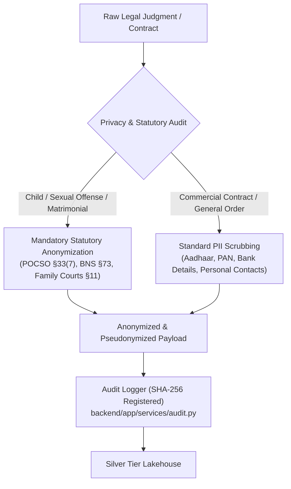

# 13. Data Privacy and Governance

**Document ID:** `LEGALAI-DOC-DE-13`  
**Version:** `1.0.0`  
**Status:** Canonical Privacy & Governance Policy  
**Statutory Framework:** DPDP Act 2023 / POCSO Act 2012 / BNS 2023 / Family Courts Act 1984  
**Dependencies:** `INDEX.md`, `03_LICENSE_AND_PROVENANCE_POLICY.md`, `backend/app/services/audit.py`

---

## 1. Executive Summary

Legal datasets intrinsically encompass sensitive personal data, corporate trade secrets, proprietary intellectual property, and confidential judicial filings. The deployment of AI models trained on unredacted legal corpora introduces severe legal liabilities under India's new data protection architecture.

This document formalizes the privacy engineering standards, automated Personally Identifiable Information (PII) scrubbing protocols, statutory anonymization rules, and data sovereignty safeguards governing the **LegalAI Data Platform**.

---

## 2. Statutory Privacy & Anonymization Mandates



### 2.1 Statutory Non-Disclosure Enactments
1. **POCSO Act, 2012 (Sections 33(7) & 24(5)):**
   - Absolute statutory bar against disclosing the identity, address, educational institution, or family of a child victim.
   - Any document mentioning POCSO triggers an immediate automated pass replacing all minor references with `[REDACTED_CHILD_VICTIM]` or `Child_X`.
2. **Bharatiya Nyaya Sanhita, 2023 (Section 73) / IPC Section 228A:**
   - Prohibition on printing or publishing the name or particulars disclosing the identity of any victim of sexual assault.
   - Court opinions referring to offenses under Sections 63 to 71 of BNS are scrubbed of victim and complainant personal identifiers.
3. **Juvenile Justice Act, 2015 (Section 74):**
   - Strict bar on disclosing the name, address, or school of any child in conflict with law.
4. **Family Courts Act, 1984 (Section 11):**
   - In-camera matrimonial proceedings require masking of personal allegations, child custody details, and individual spousal identifiers.

---

## 3. Automated PII Scrubbing & Pattern Registry

All unstructured text entering the Silver lakehouse tier passes through the deterministic PII scrubber:

### 3.1 Indian Identifier Regex Specifications

```python
import re

INDIAN_PII_PATTERNS = {
    # Indian Aadhaar Card (12 digits with optional spaces or dashes)
    "AADHAAR": re.compile(r"\b[2-9]\d{3}[\s\-]?\d{4}[\s\-]?\d{4}\b"),
    
    # Permanent Account Number (PAN) (e.g., ABCDE1234F)
    "PAN": re.compile(r"\b[A-Z]{5}[0-9]{4}[A-Z]\b"),
    
    # Indian Passport Number (1 letter followed by 7 digits)
    "PASSPORT": re.compile(r"\b[A-Z][1-9]\d{6}\b"),
    
    # Indian Mobile Numbers (+91 or leading 0 optional, starting 6-9)
    "PHONE": re.compile(r"(?:\+91[\-\s]?)?[6-9]\d{9}\b"),
    
    # Personal Email Addresses
    "EMAIL": re.compile(r"\b[A-Za-z0-9._%+-]+@[A-Za-z0-9.-]+\.[A-Z|a-z]{2,7}\b"),
    
    # Bank Account Numbers (9 to 18 digits)
    "BANK_ACCOUNT": re.compile(r"\b\d{9,18}\b"),
}
```

### 3.2 Selective Entity Preservation (Corporate vs. Individual)
- **Corporate Entities:** Corporate entity names in published judgments (e.g., *Tata Consultancy Services Ltd.*, *Union of India*, *State Bank of India*) are **not redacted**, as they are indispensable for legal citation indexing and commercial precedent authority.
- **Natural Persons:** In sensitive individual disputes, individual party names are transformed into consistent deterministic pseudonyms:
  $$\text{Pseudonym} = \text{"Party\_"} + \text{SHA256}(\text{Name} + \text{Salt})[:8]$$

---

## 4. Digital Personal Data Protection Act, 2023 (DPDP) Compliance

LegalAI operates as a **Data Processor** on behalf of enterprise clients (who act as **Data Fiduciaries**) when processing proprietary contracts:

1. **Processing Boundaries:** Contract data uploaded to `/api/upload` is processed solely for clause analysis and risk evaluation. It is never automatically diverted into general model training sets without explicit opt-in consent.
2. **Right to Erasure:** In compliance with Section 12 of the DPDP Act, when a user deletes a contract in the frontend (`/api/contracts/{id}`), the backend executes a cascading purge:
   - Removes raw text from the `contracts` relational table.
   - Deletes all associated records in the `analyses` table.
   - Purges all embedded vectors from Qdrant (`points.delete(collection_name="clauses", filter=...)`).
   - Retains only an anonymized cryptographic entry in `audit_logs`.
3. **Data Sovereignty:** All database volumes (Qdrant vector collections, PostgreSQL instances, and Parquet data lakes) must reside within data centers physically situated inside the territory of the Republic of India.

---

## 5. Audit Logging & Compliance Ledger

All data access, modifications, risk audits, and redaction actions are registered in the existing audit framework:
- **Backend Service:** `backend/app/services/audit.py`
- **Database Model:** `AuditLog` in `backend/app/models/db_models.py`
- **Recorded Fields:**
  - `user_id`: Operator executing the request.
  - `action`: e.g., `CONTRACT_UPLOAD`, `PII_REDACTION`, `FIRAC_EXPORT`, `PURGE_REQUEST`.
  - `resource_type`: `contract`, `analysis`, or `lakehouse_partition`.
  - `resource_id`: Target UUID.
  - `details`: JSON payload recording execution metadata and checksums.
  - `created_at`: UTC timestamp.

