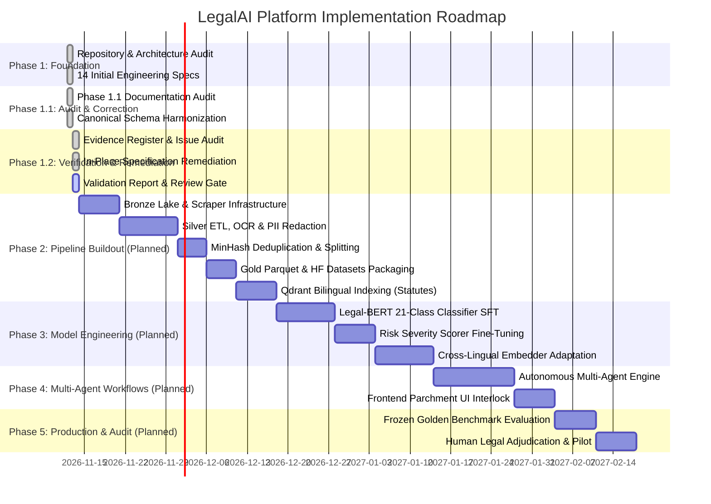

# 14. Dataset Implementation Roadmap

**Document ID:** `LEGALAI-DOC-DE-14`  
**Version:** `1.2.0`  
**Status:** Draft v1.0 — Pending Technical and Legal Review  
**Audited Date:** 2026-11-13  
**Dependencies:** `INDEX.md`, All specifications `01` through `13`, `PHASE_1_2_ISSUE_REGISTER.md`, `PHASE_1_2_EVIDENCE_REGISTER.md`

---

## 1. Executive Summary

This roadmap defines the chronological milestones, engineering sprints, resource requirements, and risk mitigation checkpoints required to transition from the **Phase 1, 1.1, and 1.2: Project Foundation, Evidence Verification, and Dataset Governance** specifications into **Phase 2: Data Engineering & Pipeline Buildout**.

Execution follows strict gated governance: no subsequent phase initiates without formal review and sign-off on predecessor milestones.

The current determination under Phase 1.2 is **`CONDITIONALLY READY FOR INDEPENDENT REVIEW`**.

---

## 2. Multi-Phase Master Architecture Roadmap

---

## 3. Phase 2 Detailed Sprint Breakdown (Data Engineering)

### Sprint 2.1: Ingestion Infrastructure & Bronze Lake Setup
- **Objectives:**
  1. Configure local directory topology under `data/bronze/` and cloud storage mirror (AWS S3 Indian Region `ap-south-1`).
  2. Implement deterministic crawler for **India Code** central enactments and authorized Hindi gazettes.
  3. Establish AWS Registry of Open Data synchronization for Supreme Court judgments (1950–2023).
  4. Write SHA-256 integrity hasher and metadata sidecar generators.
- **Deliverables:**
  - `scripts/ingestion/crawl_india_code.py`
  - `scripts/ingestion/sync_aws_judgments.py`
  - Automated bronze ingestion manifest (`data/bronze/manifest.jsonl`).

### Sprint 2.2: Silver ETL, Layout Parsing & PII Redaction
- **Objectives:**
  1. Build `PyMuPDF` layout extraction engine with court header/footer stripping and safe marginal line number filter (1–28).
  2. Integrate `PaddleOCR` / `Tesseract 5` pipeline for historical scanned judgments with CER validation ($\le 3.5\%$).
  3. Deploy context-aware Indian PII cleaner and statutory anonymizer (POCSO, BNS Section 72, Family Courts).
  4. Implement canonical citation normalizer (SCC, AIR, INSC).
- **Deliverables:**
  - `scripts/pipeline/extract_layout.py`
  - `scripts/pipeline/scrub_pii.py`
  - `scripts/pipeline/normalize_citations.py`
  - Validated Silver Parquet partitions in `data/silver/validated/`.

### Sprint 2.3: Deduplication, Cluster Splitting & Gold Packaging
- **Objectives:**
  1. Implement MinHash LSH near-duplicate detector ($J \ge 0.85$) to cluster standard template agreements.
  2. Execute baseline duplicate benchmark on sample corpus to measure real precision, recall, and false-positive rates (replacing ungrounded 0% claim).
  3. Enforce strict document-level 70/15/15 train/val/test group splitting with bilingual section binding.
  4. Package task-ready Parquet partitions: `contract_clauses`, `risk_intelligence`, `firac_case_studies`, `bilingual_statutes`.
  5. Deploy Hugging Face `GeneratorBasedBuilder` script with per-config licensing.
- **Deliverables:**
  - `scripts/pipeline/minhash_dedup.py`
  - `scripts/pipeline/group_split.py`
  - Certified Gold Parquet partitions in `data/gold/`.

### Sprint 2.4: Vector Store Seeding & Application Integration
- **Objectives:**
  1. Update `backend/app/services/vector_db.py` to index the cleaned, chunked Indian statutory corpus in Qdrant.
  2. Create bilingual dense collections (`statutes_en`, `statutes_hi`) with hybrid sparse BM25 payload vectors.
  3. Seed demonstration contracts and landmark Supreme Court FIRAC cases into the local SQLite/PostgreSQL development database.
- **Deliverables:**
  - Seeded Qdrant collections under `backend/qdrant_data/`.
  - Database migration script for sample contracts and FIRAC analyses.

---

## 4. Dependencies, Resource Allocation & Risk Matrix

| Risk / Dependency | Probability | Impact | Phase 1.2 Verification Status & Mitigation Strategy |
| :--- | :--- | :--- | :--- |
| **High OCR Error Rate in Pre-1975 Judgments** | High | High | Restrict initial Gold RAG index to post-1975 digital reports; route legacy scans through PaddleOCR deskew and manual transcription queue. |
| **ACORD Commercial Standards Exposure** | High | Resolved | **EXCLUDED / QUARANTINED.** Commercial ACORD forms are strictly excluded from all training and serving pipelines. Public-domain Indian insurance templates used exclusively. |
| **Atticus A-CoRD Release Verification** | Medium | Medium | **NOT VERIFIED (`EVID-SRC-01`).** Standalone Hugging Face parquet release unverified; quarantined until upstream source repo and license are authenticated. |
| **LegalTransEn Release Verification** | Medium | Medium | **NOT VERIFIED (`EVID-SRC-03`).** Quarantined pending confirmation of upstream huggingface dataset card and license terms. |
| **KanoonGPT Terms of Service Boundaries** | Medium | Medium | **CONDITIONAL (`EVID-SRC-04`).** Quarantined from automated crawling pending legal review of IndianKanoon Terms of Service. AWS Open Data used for judgments. |
| **Cross-Lingual Cosine Threshold Validation** | Medium | Medium | **PROVISIONAL HYPOTHESIS (`EVID-ML-02`).** Empirical validation of 0.88 cosine similarity threshold marked `NOT RUN`; validation experiment scheduled in Sprint 2.3. |
| **Hindi Legal Terminology Ambiguity** | Medium | Medium | Strict enforcement of canonical glossary in `07_BILINGUAL_DATA_STRATEGY.md` with Tier 2 Hindi legal expert review. |
| **Computational Constraints (Vectorization)** | Low | Medium | Use quantized embeddings (`fastembed`, `bge-small-en-v1.5` / `bge-m3`) with batched GPU acceleration. |

---

## 5. Phase 1.2 Sign-Off & Governance Gate

> [!IMPORTANT]
> **Human Review Gate:**  
> All 15 core technical specifications under `docs/dataset-engineering/` have been remediated in-place to Version 1.2.0, resolving statutory inaccuracies, dataset licensing boundaries, canonical schema discrepancies, and machine-learning leakage assumptions.
> 
> As mandated by Phase 1.2 governance:  
> **CURRENT PLATFORM DETERMINATION: `CONDITIONALLY READY FOR INDEPENDENT REVIEW`.**  
> 
> **DO NOT DECLARE "READY FOR PHASE 2" OR COMMENCE PIPELINE IMPLEMENTATION WITHOUT FORMAL WRITTEN SIGN-OFF FROM INDEPENDENT LEGAL COUNSEL AND LEAD DATA ARCHITECT.**
